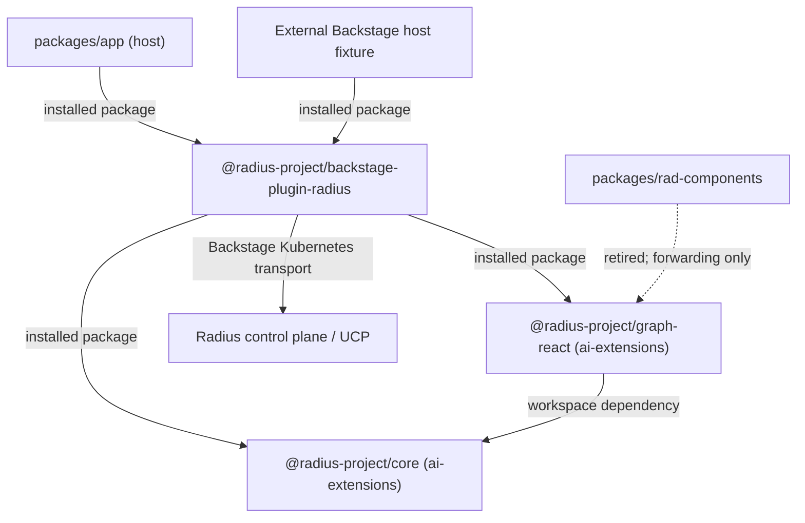

# Radius Dashboard test plan

- **Author**: Nicole James (@nicolejms)
- **Date**: 2026-09
- **Revised**: 2026-10-27
- **Status**: Draft
- **Companion design**: [Radius Dashboard as a distributable Backstage plugin](./2026-09-radius-backstage-plugin.md)
- **Decision record**: [Keep the Radius Backstage plugin in dashboard and use shared graph libraries](./2026-10-radius-backstage-plugin-adr.md)

## Purpose

`radius-project/ai-extensions` owns and publishes shared domain logic and graph rendering as
`@radius-project/core` and `@radius-project/graph-react`. This repository develops and publishes the
Backstage plugin, proposed as `@radius-project/backstage-plugin-radius`. The
[companion design](./2026-09-radius-backstage-plugin.md) sets that ownership. Extraction changes
two things the tests must protect:

1. The dashboard must use the shared graph implementation. Move reusable rendering and layout from
   `packages/rad-components` into `graph-react`, then switch the dashboard to that package.
   Delete the old implementation. Tests compare the rendered result
   with a frozen baseline, not with a second dashboard copy of the model.
2. The plugin becomes a published contract. `packages/app` must use the same package entry points
   as an external Backstage host fixture, without privileged access to workspace source.

Both changes affect code that lacked meaningful regression tests when this work began. Record
passing tests before extraction, review and freeze the baseline, then extend coverage to plugin
contracts, installed packages, and host integration.

The dashboard backend already uses Backstage's new system; the Radius frontend and standalone app
still use the legacy frontend. Test native Radius extensions first, move the app through hybrid
mode, then remove required compatibility helpers. We own Radius and must implement native support,
not leave it wrapped in `convertLegacyPlugin`.

The phases assign dashboard work and required checks. The appendices specify exports, routes,
requests, pages, fixtures, and host cases. The companion design sets the required suites across
both repositories. If the documents disagree, follow the design and correct this plan.

## Revised migration scope

The companion design's
[Backstage delivery decision](./2026-09-radius-backstage-plugin.md#backstage-changes-and-delivery-decision)
uses dashboard commit
[`9d295b5`](https://github.com/radius-project/dashboard/commit/9d295b5097c62d9c3fa9dab136172f34c1b912bf).
The review inspected source; it did not run a migration. Coverage figures and completed phases
below describe the earlier legacy frontend. They do not establish new-system support.

| Surface                      | What is already present                                                                                    | New evidence required                                                                                                              |
| ---------------------------- | ---------------------------------------------------------------------------------------------------------- | ---------------------------------------------------------------------------------------------------------------------------------- |
| Backend host                 | `createBackend` with app, proxy, auth, guest provider, catalog, and Kubernetes registrations.              | Real native startup, service failure handling, and authorized Kubernetes GET/graph POST checks; no new Radius backend requirement. |
| Radius backend scaffold      | Native `createBackendPlugin` and `coreServices`, with a health-only router that the host does not install. | Keep BE-01-BE-05 maintenance coverage. Do not require `/api/radius/health` from the production host.                               |
| Radius frontend              | Legacy plugin, API factory, eight routable extensions, route refs, feature flag, and optional home cards.  | Native page/API extensions and optional card integration using the same product code, plus packed native subpath qualification.    |
| Standalone app               | Legacy `createApp`, root element tree, routes, APIs, themes, guest sign-in, and sidebar.                   | Hybrid cutover and then native modules/extensions, with URL, auth, theme, and navigation regression checks.                        |
| Third-party frontend plugins | Catalog, catalog graph, home, user settings, and Kubernetes API integration.                               | Exact-version native-entry inventory, temporary adapters only where needed, and a removal condition for every adapter.             |

Before the first stable release, test native Radius support and the fully migrated standalone app.
Keep testing the legacy public entry for its agreed support window. Retire hybrid mode after the
app migration. Test frontend systems separately from React 18/19 graph-library support.

`convertLegacyPlugin` and `convertLegacyPageExtension` from `@backstage/core-compat-api` apply to
third-party frontend plugins, not backend plugins. List and test every converted page. Use the
relevant plugin's supported converter or a native blueprint for cards. Temporary app helpers
(`convertLegacyAppOptions`, `convertLegacyAppRoot`) preserve app composition while the app moves
to `@backstage/frontend-defaults`. They do not replace native Radius support.

Run required installs and CI on open-source Backstage. Test the Radius proxy access policy for
resource reads and graph queries.

## Current state

`yarn test:all --coverageReporters=json-summary` measured the original tree. The case counts below
precede Phase 0 (31 suites, 127 cases); the coverage percentages record its baseline.

| Workspace                       | Source files | With a colocated test | Test cases |
| ------------------------------- | -----------: | --------------------: | ---------: |
| `plugins/plugin-radius`         |           50 |                    26 |        122 |
| `plugins/plugin-radius-backend` |            2 |                     1 |          1 |
| `packages/rad-components`       |            9 |                     2 |          2 |
| `packages/app`                  |            9 |                     1 |          1 |
| `packages/backend`              |            1 |                     1 |          1 |
| **Total**                       |       **71** |                **31** |    **127** |

Phase 0 set its coverage floors from these measurements:

| Workspace                       | Statements | Branches | Functions |  Lines |
| ------------------------------- | ---------: | -------: | --------: | -----: |
| `plugins/plugin-radius`         |     54.77% |   31.09% |    40.80% | 55.16% |
| `plugins/plugin-radius-backend` |     62.50% |      n/a |    50.00% | 71.43% |
| `packages/rad-components`       |     80.00% |   59.09% |    73.33% | 77.27% |
| `packages/app`                  |     75.00% |    0.00% |     0.00% | 78.79% |
| `packages/backend`              |      0.00% |      n/a |       n/a |  0.00% |
| **Total**                       | **56.95%** |**31.82%**|**42.03%** |**57.35%**|

`packages/app` reported 75% of statements but 0% of branches and functions. Imports ran top-level
code without calling the functions inside, so the statement figure did not prove tested behavior.
Phase 1 raised coverage to 93.51/100.00/83.33/92.86. Backend coverage rose from 0% to 100%.

Measurements after each phase increment:

| Workspace                       | Baseline | After 0 and 3 | After Tier A | After first Phase 1 pages | After Phase 1 components | After Phase 1 complete | After Phase 2 | After Phase 3 | After review |
| ------------------------------- | -------: | ------------: | -----------: | ------------------------: | -----------------------: | ---------------------: | ------------: | ------------: | --------------: |
| `plugins/plugin-radius`         |   54.77% |        58.42% |       58.42% |                    61.22% |                   69.19% |                 72.70% |        73.79% |        73.89% |     **73.89%** |
| `plugins/plugin-radius-backend` |   62.50% |        62.50% |       62.50% |                    62.50% |                   62.50% |                 93.75% |        93.75% |        93.75% |          93.75% |
| `packages/rad-components`       |   80.00% |        81.33% |       86.52% |                    86.52% |                   86.52% |                 86.52% |        95.08% |        95.08% |      **95.89%** |
| `packages/app`                  |   75.00% |        75.00% |       75.00% |                    75.00% |                   75.00% |                 93.51% |        93.51% |        93.51% |          93.51% |
| `packages/backend`              |    0.00% |         0.00% |        0.00% |                     0.00% |                    0.00% |                100.00% |       100.00% |       100.00% |         100.00% |
| Suites / cases                  |   31/127 |        33/159 |       34/260 |                    36/272 |                   43/331 |                 53/427 |        54/460 |        56/477 |     **56/476** |

Statement coverage only; the enforced floors in Appendix G carry all four metrics.

Two Playwright specs add fourteen cases: one home-page smoke test, eight direct real-renderer
cases, and five dashboard-host journeys with fixed Kubernetes/UCP interceptions.

The original counts hid these gaps:

- **Coverage is concentrated.** 45 of 127 unit cases live in `plugin-radius/src/api/api.test.ts`.
  Fifteen unit test files contain exactly one case, and most of those assert once or twice.
- **The graph had little coverage.** `AppGraph.test.tsx` rendered the sample application and checked
  the React Flow attribution link, not nodes, edges, direction, ordering, or Dagre layout.
  Neither the gateway direction-correction branch nor the precedence-sensitive `order`
  computation in `initialNodes` had tests.
- **The plugin contract had no tests.** `plugin.test.ts` checked only that `radiusPlugin` existed.
  Tests did not pin public exports, route refs, extension mount points, the `radiusApiRef` id,
  or the feature-flag name that external consumers depend on.
- **Forty source files had no colocated test,** including every `packages/app` component,
  `ResourceListPage`, `ResourceLayout`, `OverviewTab`, `DetailsTab`, `RecipeListPage`,
  `RecipeTable`, and the `resources/resource.ts` domain model. Phase 1 has now closed every one of
  them that ships behavior; only `packages/app/src/index.tsx`, the barrels, and `setupTests.ts`
  remain deliberately without direct tests. See Appendix F.

CI ran `yarn test:all` with `--coverage` but no threshold, so zero coverage could pass. Phase 0
added floors in the root configuration. Per-workspace floors do not work in the repository run;
see "Where coverage floors must live."

## Current status

| Phase | Name                                     | Repository                                | Status      | Outcome                                                                                                                                                                                                                                                                                                                           |
| ----- | ---------------------------------------- | ----------------------------------------- | ----------- | --------------------------------------------------------------------------------------------------------------------------------------------------------------------------------------------------------------------------------------------------------------------------------------------------------------------------------- |
| 0     | Record the behavior                      | dashboard                                 | Done        | Public exports, route table, request table, page inventory, and a coverage floor are written down                                                                                                                                                                                                                                 |
| 1     | Harden existing behavior                 | dashboard                                 | Done        | Every shipped page, table, tab, card, host component, backend-plugin lifecycle, and domain rule has a real test before it is rearchitected. All thirteen `plugin-radius` components, both host workspaces, the backend plugin, and the declaration modules are covered; `packages/backend` no longer carries a coverage exemption |
| 2     | Freeze the pre-extraction baseline       | dashboard                                 | Done        | Real-renderer graph journeys, deterministic host journeys, connection/error characterization, and all fourteen graph records are frozen                                                                                                                                                                                           |
| 3     | Plugin contract and packaging            | dashboard                                 | Done        | The current internal package's API factory, exports, lazy host routes, local tarball shape/resolution, declarations, and import boundaries are verified without making release decisions                                                                                                                                          |
| 3A    | Native Radius frontend and backend audit | dashboard                                 | Not started | Native extensions reuse product code; packed legacy/native entries and the existing native backend are qualified                                                                                                                                                                                                                  |
| 3B    | Hybrid standalone frontend               | dashboard                                 | Not started | App uses the new frontend root with native Radius and temporary, tracked app/third-party compatibility code                                                                                                                                                                                                                       |
| 3C    | Native standalone frontend               | dashboard                                 | Not started | Required legacy app helpers and third-party converters are removed; supported legacy public exports remain tested                                                                                                                                                                                                                 |
| 4     | Consume shared packages                  | dashboard, needs `ai-extensions` releases | Not started | The plugin uses `core` and `graph-react`; no parallel implementation remains                                                                                                                                                                                                                                                      |
| 5     | Host integration and installed artifact  | dashboard                                 | Not started | Both hosts mount the plugin from packed tarballs with no source aliases                                                                                                                                                                                                                                                           |
| 6     | Permanent CI gates                       | both                                      | Not started | Coverage floors, contract, packaging, and the consumer pin are required for merge and publish                                                                                                                                                                                                                                     |
| 7     | Accessibility, visual, reliability       | dashboard                                 | Not started | Keyboard and axe coverage, reviewed screenshots, and scheduled failure-mode checks                                                                                                                                                                                                                                                |
| 8     | Release qualification                    | both                                      | Not started | The published plugin loads in the control-plane image and in an external Backstage host                                                                                                                                                                                                                                           |
| 9     | Migrate the test corpus to `Radius.*`    | dashboard, tracks `radius` releases       | Not started | Tests and fixtures describe the resource-type model the product is moving to, not the legacy one                                                                                                                                                                                                                                  |

All phase work runs in `radius-project/dashboard`. The repository column identifies dependencies,
not the location of the work.

Phases 3A-3C do not wait for `ai-extensions` releases. Phase 4 is the direct shared-release dependency,
because that is where dashboard replaces its own implementations with the published `core` and
`graph-react` packages. Phases 6 and 8 span both
repositories because the consumer-pin gate is defined in `ai-extensions` CI while the pin, the
journey implementation it invokes, and the release checks live here.

Dashboard owns Phase 3 and the Backstage plugin. Ai-extensions owns and publishes
`@radius-project/core` and `@radius-project/graph-react`. Phase 3 tests the current
`@internal/plugin-radius` package locally without changing its private status or selecting its
public name, license/notices, or publication settings. It changes no shared code and needs no
upstream release. Publication still requires those release decisions.

Complete Phases 0–2 before extraction. Review and freeze the real-renderer baseline first. Phase 3
may run alongside Phase 2 and, like the frontend work, needs no upstream graph release. Phase 4
extracts the code after Phase 2's records pass review. Phases 5–8 follow it.

Run frontend Phases 3A, 3B, and 3C in that order. They correspond to P8a, P8b, and P8c and add new
tests without reopening completed Phase 3. They may run alongside Phase 4 in separate changes.
Record a passing host baseline at each cutover and rerun Phase 2 graph checks. Change frontend
registration separately from graph/domain extraction. Phase 5 needs Phase 4 and 3A; stable
standalone acceptance and Phase 8 also need 3C. Apply Phase 6 gates as each surface appears,
including native entries before extraction finishes.

Phase 9's timing remains a maintainer decision rather than a fixed dependency. See open decision 8.

## Rules for every change

- Add focused tests with the production change. Manual checks do not replace automated tests.
- Use the simplest test that can reproduce the failure, then add a wider test only when the failure
  crosses a real boundary.
- Record behavior **before** changing it. A refactor pull request that also changes assertions is
  not a refactor; split it.
- Keep tests local and repeatable. No live clusters, no personal kubeconfig, no real Radius control
  plane, no network fetches, no public CDN assets.
- Test the plugin through its **package entry point** (currently `@internal/plugin-radius`, with the
  final public name deferred), including an approved native subpath when added, not through deep relative paths, wherever the test is
  asserting consumer-visible behavior. Deep imports are allowed only for genuinely internal helpers.
- Assert on accessible roles and names, not on CSS classes, Material-UI internals, or React Flow
  internals. The graph rework replaces all of those internals; it must not change what a user can
  perceive. Classify every graph test by tier and say so in the file.
- Never assert graph behavior against a test double for the renderer. A graph suite that passes
  with the renderer removed is not a graph suite.
- Unexpected Kubernetes proxy calls fail the test. A mocked API never returns a default success for
  a request the test did not declare.
- Show external failures as failures. If the cluster, proxy, or resource provider cannot be
  reached, the UI must surface an error state and a test must assert it.
- Close servers, timers, browser contexts, and Storybook processes after success or failure.
- Preserve the public export list, route refs, extension mount points, `radiusApiRef` id, feature
  flag name, and request table in Appendix A unless a separate approved change says otherwise.
- Keep legacy-root assertions scoped to the legacy entry. Add a separate reviewed native extension
  inventory; do not change the old baseline to make an untested native entry appear qualified.
- Install exactly one active Radius entry and one `radius-api` factory in each host. Native and
  converted copies must not register the same page, API, navigation item, or feature twice.

## Required checks

| Check                      | Required when                                                                           | What it protects                                                                                   |
| -------------------------- | --------------------------------------------------------------------------------------- | -------------------------------------------------------------------------------------------------- |
| Focused unit tests         | Every behavior change                                                                   | Rules, parsing, aggregation, error handling, and state transitions                                 |
| Component render tests     | Any page, tab, table, card, or icon changes                                             | Loading, empty, populated, and error states, and accessible names                                  |
| Plugin contract tests      | Exports, routes, extensions, apiRefs, feature flags, or package metadata change         | Silent breakage for anyone consuming the published plugin                                          |
| Graph invariant tests      | Any graph normalization, node, edge, layout, or rendering change                        | Structural truths that must hold regardless of implementation                                      |
| Graph semantic tests       | Any graph rendering, labelling, or interaction change                                   | What a user can see, name, and operate in the graph                                                |
| Graph record diff          | The graph implementation is replaced, extracted, or consolidated                        | Unintended behavior change hidden inside an intended one                                           |
| API request tests          | A request path, API version, resource type, merge, or fallback rule changes             | Wrong path, wrong version, dropped duplicates, and swallowed failures                              |
| Backend plugin tests       | The backend plugin, its routes, or its registration changes                             | Broken registration, missing route, and unhandled errors                                           |
| Packaging tests            | Build config, entry points, `files`, dependencies, or peer dependencies change          | Missing code, bundled peer deps, and a package that cannot be installed                            |
| Host integration tests     | `packages/app` wiring, route bindings, or plugin consumption changes                    | A host that compiles but cannot mount or navigate the plugin                                       |
| Frontend-system tests      | Native entries, blueprints, discovery, app composition, or compatibility helpers change | Missing extensions/APIs, duplicate registration, lost cards/themes/auth, and adapters with no exit |
| Native backend regression  | Backend dependencies, service wiring, authentication, or proxy policy change            | Startup errors and unauthenticated or forbidden GET/graph POST handling                            |
| Chromium behavior tests    | Any graph, page, or navigation behavior changes from Phase 2 onward                     | Real navigation, focus, graph interaction, and rendering                                           |
| Accessibility and keyboard | An interactive page or graph state changes after Phase 2 begins                         | Unusable controls, poor focus order, missing names, and WCAG                                       |
| Installed artifact check   | Package contents, dependencies, styles, or build inputs change                          | A package that builds here but cannot be installed anywhere else                                   |
| Screenshot review          | A selected stable visual state changes after Phase 7 begins                             | Layout, clipping, theme, graph, and status presentation                                            |
| Release qualification      | Before release after Phase 8                                                            | Installation, discovery, connection setup, reachability, and page load                             |

Tests that do not open a browser do not retry. Browser checks may retry once to collect useful
failure information, but the original failure stays visible and a retry-only pass is recorded as
flaky. Setting a check aside requires a linked issue, an owner, a narrow scope, and a clear end
condition.

## Standard local check

Run the affected focused tests while working. Before completing a source change, run:

```console
yarn install --immutable
yarn tsc
yarn lint:all
yarn format:check
yarn test:all
yarn build:all
yarn test:e2e
```

CI is authoritative for packaging, container, and control-plane checks.

### Known flakiness in the existing suite

On a loaded machine, five `plugin-radius` page suites exceed Jest's default 5000 ms per-test
timeout during parallel repository runs: `EnvironmentListPage`, `ApplicationListPage`,
`ResourceTypesListPage`, `ResourceTypeDetailPage`, and `ResourcePage`. Each passes reliably alone.
The failures come from test-runner contention, not the product.

A timed-out suite runs less code and can fail a coverage threshold, hiding the timeout behind a
misleading report. During Phase 0, seven timed-out suites lowered branch coverage to 30.72% against
a 31% floor.

The baseline work recorded the timeout without raising `testTimeout`, which would change the
runner being used as evidence. After the Phase 1 page rewrites, CI's `yarn test:all` command passed
all 53 suites / 427 cases with default workers in 38.257 seconds. Open decision 7 is therefore an
environment-specific guardrail rather than an active blocker. Keep #360 open: one clean run does
not rule out the loaded-machine failure.

The diagnostic remains `yarn test:all --maxWorkers=2`. If a future default-worker run fails while
the reduced-parallelism run passes, the difference identifies contention rather than a product or
coverage regression. The repository's standard local coverage command keeps `--maxWorkers=2` for
reproducibility, while CI continues to exercise its configured default.

## Test architecture

### Tooling

No new test framework is introduced. The existing runners are:

| Concern                      | Tool                                                             |
| ---------------------------- | ---------------------------------------------------------------- |
| Unit and component           | Jest 30 with the jsdom environment                               |
| Rendering and queries        | React Testing Library, `@testing-library/jest-dom`, `user-event` |
| Backstage harnesses          | `@backstage/test-utils`                                          |
| HTTP boundary                | `msw`                                                            |
| HTML canvas APIs under jsdom | `jest-canvas-mock`                                               |
| Browser                      | Playwright 1.62, Chromium                                        |
| Visual                       | Storybook, screenshotted through Playwright                      |

The Backstage CLI supplies Jest configuration, transforms, and environment. The original tree had
no `jest.config.js` or workspace `jest` key. Add floors through a `jest` key that the CLI merges,
not a separate handwritten configuration.

#### Where coverage floors must live

Per-workspace coverage floors do not protect CI.

CI runs `yarn test:all`, which is `backstage-cli repo test --coverage`. That command runs each
workspace as a Jest **project**, and Jest rejects `coverageThreshold` inside a project config:

```
Option "coverageThreshold" is not supported in an individual project configuration.
```

Jest prints the warning and continues. The same floor works when a workspace runs alone, so a
local check can pass while repository CI silently ignores the threshold.

Floors therefore live in the **root** `package.json`, as `coverageThreshold` path groups:

```jsonc
"jest": {
  "coverageThreshold": {
    "./plugins/plugin-radius/src/": { "statements": 58, "branches": 31, "functions": 41, "lines": 57 },
    "./packages/rad-components/src/": { "statements": 81, "branches": 63, "functions": 73, "lines": 78 }
    // ...
  }
}
```

Jest handles these groups as follows:

- A file matched by a path group is **removed** from the `global` group. Once every source
  directory has a group, `global` measures nothing, reports 0%, and fails the build for a reason
  unrelated to coverage. There is deliberately no `global` entry.
- Because `global` is gone, a newly added workspace would be unguarded by default. `PU-23` closes
  that hole by requiring an exact `./<workspace>/src/` group or a recorded exemption. A threshold
  on one component subdirectory does not protect the rest of the workspace.

At the baseline, `packages/backend` had 0% coverage. A zero floor would enforce nothing, so the
policy recorded a justified exemption. Phase 1 removed it after adding the first real test.

Test enforcement by raising one group's floor to 99: the run must fail and name that group.
`PU-20`–`PU-25` protect the configuration. PU-32–PU-34 reject partial-directory groups, zero,
negative, non-finite, out-of-range, and missing required percentages. Optional branch/function
floors must also be positive when present.

These tests check configuration shape, not historical values. They allow a positive threshold to
fall to another positive value. Reviewers must reject unjustified decreases until Phase 6 adds
automatic comparison with the base revision.

Keep Jest during extraction. Backstage has no supported Vitest path at this baseline, so switching
would require separate workspace configurations and maintenance after CLI upgrades. A runner
change during Phases 0–2 would also obscure whether failures came from extraction or the runner.
The graph tests use Playwright and gain nothing from that switch. Reconsider Vitest in a separate
change after Phase 4, or sooner if the CLI adds supported integration. The requirement is a stable
runner during extraction, not permanent use of Jest.

React Flow calls HTML canvas APIs missing from jsdom, so tests use `jest-canvas-mock`. A stubbed canvas
can pass a render assertion without laying out a graph. Run Tier B and C tests in real Chromium.
Keep jsdom for request handling and states without a graph.

Ai-extensions tests graph-react with Vitest; dashboard consumes it under Jest. The published
artifact crosses runner, module-format, and transform boundaries. IA-01–IA-08 and CP-01–CP-05 test
that crossing; upstream tests cannot prove that the package works here. Repository ownership
creates the boundary regardless of runner choice. Using the author's runner can hide packaging
and interop faults rather than expose them.

### Layers

| Layer | Name              | Runner                      | Scope                                                                     |
| ----- | ----------------- | --------------------------- | ------------------------------------------------------------------------- |
| L1    | Pure logic        | Jest (node)                 | Resource IDs, type equivalence, recipe aggregation, domain use cases       |
| L2    | Component render  | Jest + RTL + `@backstage/test-utils` | Pages, tabs, tables, cards, icons, error and empty states        |
| L3    | Plugin contract   | Jest (node)                 | Exports, route refs, extensions, apiRef, feature flags, package metadata   |
| L4    | Host integration  | Jest + RTL, plus a packed-install fixture | Both hosts mounting the plugin from tarballs               |
| L5    | Browser           | Playwright (Chromium)       | Real-renderer journeys, graph interaction, keyboard, accessibility          |
| L6    | Record diff       | Playwright + a normalizer   | The graph record for each fixture, diffed against the frozen baseline      |
| L7    | Visual            | Storybook + Playwright      | Reviewed screenshots of stable states                                      |

Test the dashboard graph at L5 and L6. Graph-react owns pure-model behavior after extraction;
dashboard must prove that the installed package still renders correctly in its host.

### Boundaries the rearchitecture creates

Extraction separates host, plugin, shared-package, and graph responsibilities. Two move across
repositories. Test each boundary separately so a failure identifies the smallest affected scope.



- **Host boundary.** Neither host may reach inside the plugin. PB-04 enforces it for
  `packages/app`; the external fixture proves it for everyone else.
- **Plugin boundary.** The plugin's public surface is a contract. Appendix A is the source of truth
  and PU-01 compares the real exports against it.
- **Shared-package boundary.** `core` and `graph-react` are consumed as published artifacts, not
  workspace source. IA-03 proves the resolved tree actually uses them.
- **Graph boundary.** The graph implementation leaves this repository. What stays here is the
  evidence that the dashboard still renders correctly: the frozen journeys and the record diff.

### What the graph rework breaks, and why it matters

The reviewed `AppGraph.tsx` mixed normalization, layout, and rendering. Every
`getLayoutedElements` call reused a module-level `Dagre.graphlib.Graph`, accumulating nodes and edges
across renders and preventing isolated tests. The later #355 fix removed that state. Extraction
will replace the remaining internals, so tests must protect rendered behavior rather than pin the
code being deleted.

### Graph test taxonomy

Consolidation replaces node and edge objects, layout inputs, and markup. Tests of those internal
shapes will break even when the graph remains correct. Mark each test with a tier that states
whether extraction may change its assertion.

| Tier | Kind                  | Asserts                                                                | Allowed to change?                            |
| ---- | --------------------- | ---------------------------------------------------------------------- | --------------------------------------------- |
| A    | Invariant             | Structural truths independent of representation                        | **No.** A break is a regression.              |
| B    | Semantic / observable | What a user perceives: accessible names, relationships, operability    | **No**, except by approved product change.    |
| C    | Record diff           | A normalized projection of the whole rendered graph                    | **Yes**, but only via a declared manifest.    |
| D    | Visual baseline       | Reviewed screenshots of selected stable states                         | **Yes**, with a stated product reason.        |
| E    | Implementation unit   | Internals of the current model and layout                              | **Deleted** with the code it describes.       |

#### Tier A: invariants

State properties every correct graph must satisfy without naming internal fields. Write these
tests once and keep them unchanged through extraction.

Examples: every resource yields exactly one node; every retained connection yields exactly one
edge; every edge endpoint resolves to a node that exists; node ids are unique; the same input
produces the same output twice in a row; rendering graph A then graph B equals rendering graph B
alone; every node receives a finite position; no two node bounding boxes overlap.

#### Tier B: semantic and observable

Test what users can see and operate through accessible roles, names, and rendered output. A user
can find a resource by name, see connections between named resources, and operate zoom and fit.
Empty graphs report that they are empty; failed graphs report the failure. Do not inspect React
Flow or Dagre internals.

Run these tests in a real browser with the real renderer before extraction.
`ApplicationTab.test.tsx` replaces `AppGraph` with a double and cannot provide that coverage.

#### Tier C: record diff, and how we verify we changed what we expected

Render each fixture and use one normalizer to produce a sorted, stable graph record. A snapshot
of React Flow's node objects would bury meaningful changes in internal object churn.

A record stores each node's resource id, displayed label and type, icon identity, and status badge
with its accessible name. For each edge, it stores resolved source and target ids and direction.
It omits coordinates, colours, class names, nesting, transform matrices, and other presentation
details.

Dagre produces coordinates. Recording them would make each layout-algorithm upgrade churn the
baseline without explaining whether users lost anything. Tier A instead checks the required
properties: finite positions, no overlapping node boxes, and independence from render order.
GU-08 and GU-09 name the violated property when they fail.

Use `not-yet-populated` when the renderer has never supplied a field. A legitimate renderer could
return `null` to clear an icon, so `null` cannot distinguish that choice from the missing features
in #35 and #89. The sentinel lets GU-23 test the actual missing-field condition.

Generate and commit records from the current implementation in Phase 2, before extraction.
Regenerate them in the extraction PR and compare old and new in CI:

- **A difference that is not listed in the expected-change manifest fails the check.**
- The manifest is a committed file. Each entry names the fixture, the record field, the old value,
  the new value, and the reason. A reviewer approves the manifest, not a wall of snapshot churn.
- Entries that explain a deliberate shared-renderer behavior change are legitimate. Entries that
  cannot be explained are the bugs this whole exercise exists to catch.
- The manifest is emptied at the end of each extraction phase, so it never becomes a permanent
  allowlist.

Equivalent layout changes produce no record diff. Tier A checks required layout properties
instead of comparing node coordinates.

#### Tier D: visual baselines

Capture colour, spacing, clipping, and themes in screenshots. A reviewer must approve each new
baseline for a stated product reason. See Appendix D.

#### Tier E: implementation units

Tier E tests describe `initialNodes`, `getLayoutedElements`, and `ResourceNode` internals. Delete
them when those implementations move to graph-react. Relevant shared-code tests move with the
extracted code; do not copy dashboard test implementations into ai-extensions. Before deleting a
Tier E test, identify the Tier A, B, or C test that continues to protect its dashboard behavior.

#### Not blessing existing defects

Records capture existing behavior, including defects. Tag each defect `KNOWN-DEFECT`, link its
issue, and mark its fields as expected to change. Two cases remain here: `initialNodes` corrects
gateway direction to compensate for an upstream bug, and resource reads choose the first cluster
while graph requests choose the last. Review fixed a third case, shared Dagre state (#355), after
recording it. Report unchanged `KNOWN-DEFECT` fields too, so extraction cannot carry them forward
silently.

`KNOWN-DEFECT` assertions record current behavior, not correctness, even beside Tier A tests.
Replace the assertion with a desired-behavior regression test in the same reviewed fix. For #355,
GU-08 originally recorded unequal layouts caused by accumulated nodes and edges. Moving graph
creation inside `getLayoutedElements` made sequential and standalone layouts equal in both
orderings. GU-08 now asserts that equality, and the `jest.isolateModules` leak-detection code is
gone. When records exist, list the issue, old/new behavior, and affected fields in the
expected-change manifest. Never weaken unrelated topology, rendering, or interaction assertions.

## Phases

### Phase 0: record the behavior (done)

Record shipped behavior and add checks that enforce it. Change no production behavior in this phase.

Deliverables:

- Appendix A filled in from the real tree: public exports, route refs and paths, extension mount
  points, `radiusApiRef` id, feature flag names, the Kubernetes proxy request table, and the page
  inventory.
- A committed coverage baseline and a `coverageThreshold` set **at the measured baseline**, so
  coverage can only go up. These live in the **root** `package.json` as path groups; per-workspace
  floors are silently ignored by the repo-wide run CI executes. No standalone Jest config is
  introduced. See "Where coverage floors must live".
- Graph fixtures extracted from `sampledata.ts` into named JSON fixtures (Appendix E) covering the
  shapes the graph must handle. **Deferred to Phase 2**, where the records that consume them are
  built; extracting fixtures with no consumer would freeze a shape nothing reads.

Phase 0 also changed the following:

- The plugin's unused `resourceId.ts` copy was deleted. Its test moved to the package it actually
  imported.
- Threshold enforcement was verified with a negative test rather than assumed, which is what
  exposed the project-config trap.

Completion evidence: `yarn test:all` fails if coverage drops, demonstrated by raising one group's
floor and observing the named failure; Appendix A matches the tree; PU-20–PU-25 and PU-31–PU-35
keep the configuration enforceable.

### Phase 1: harden existing behavior (done)

Close the twenty-four substantive gaps in Appendix F and deepen the fifteen one-case smoke tests.
Cover the domain logic and every shipped page in loading, empty, populated, and error states.

Priority order, highest regression risk first:

1. `resources/resource.ts`, `resourceId.ts`, `resourceTypes.ts`: the domain model every page reads.
   `resourceId.ts` is **done**: the existing suite is now tagged RU-01 (well-formed ids) and RU-02
   (rejected ids) against the live `rad-components` implementation, including two `KNOWN-DEFECT`
   cases recording inputs it wrongly rejects (names containing `.` or `_`, and resource types
   containing a digit). Both are legal Radius names. `resource.ts` (RS-01–RS-14) and
   `resourceTypes.ts` are also covered.
2. `ResourceListPage`, `ResourceLayout`, `OverviewTab`, `DetailsTab`, `ApplicationResourcesTab`,
   `EnvironmentResourcesTab`: untested resource navigation.
3. `RecipeListPage`, `RecipeTable`: untested rendering over already-tested aggregation.
4. `ApplicationListInfoCard`, `EnvironmentListInfoCard`: the two exported cards a consumer can
   embed without a route.
5. `packages/app` `Root`, `HomePage`, `LearnCard`, `CommunityCard`, `SupportCard`.
6. `plugin-radius-backend/src/service/router.ts` registration and router behavior. Its `index.ts`
   is a barrel, not the registration itself.

Every page test must check the error path. Before Phase 1, no page test checked what users saw
after a non-OK Kubernetes proxy response, although `makeRequest` throws on each one.

The following pages and components now have suites with error-path assertions:

- `RecipeListPage` (RE-01–RE-08). The aggregation already had unit tests, but nothing exercised the
  asynchronous half of the feature: the pack ids live on the environment and each pack is fetched
  separately, so the fan-out, the `Promise.allSettled` tolerance of an unreachable pack, the
  de-duplication of a pack referenced by two environments, and the environment selector were all
  uncovered.
- `ResourceListPage` (RL-01–RL-04). The page is a thin shell, but it is the only place
  `ResourceTable` renders **without** a resource type, which selects the
  Type/Application/Environment/Status column set rather than the environment one. That column set
  had no test.
- `ResourceTypeDetailPage` (RT-01–RT-30). This was the single largest gap in the repository: 2,693
  lines at roughly 20% statements. The existing three tests never left the Overview tab, so the
  entire schema interpretation was unexercised. The new cases walk the Properties and Output
  Properties tabs and pin the type formatting (`$ref` to last segment, `items.type` to `T[]`,
  `items.$ref` to `Ref[]`, bare `array`, `additionalProperties` to `map`, untyped to `object`),
  requiredness, read-only filtering in both directions, the upper/lower-case `Schema` fallbacks, the
  recursive `definitions` discovery, and the descending version ordering. RT-28–RT-29 use real
  route parameters and request-sensitive stubs to cover different namespaces/types and refetching
  after navigation. RT-30 preserves repeated property names by API version and parent path rather
  than overwriting them in a name-keyed map.
- `ApplicationListInfoCard` (AC-01–AC-08) and `EnvironmentListInfoCard` (EC-01–EC-08). Priority 4
  above: the two components a host can embed **without** a route, so they are published surface
  rather than internal detail, and neither had any test.
- The resource-navigation spine from priority 2: `OverviewTab` (OT-01–OT-07), `DetailsTab`
  (DT-01–DT-03), `ApplicationResourcesTab` (AR-01–AR-03), `EnvironmentResourcesTab` (EV-01–EV-03),
  and `ResourceLayout` (LY-01–LY-04).

Those tests exposed #361, #362, #363, and further effects of #352. Each has a filed issue and a
characterization assertion. See "Tracked defects."

Three query choices can make assertions pass or fail for the wrong reason.

`ResponseErrorPanel` renders its message twice, in the summary heading and again in the expanded
detail list, so `getByText` fails there with "found multiple elements". Assert on all matches.

`LinkButton` renders an anchor with `role="button"`, not `role="link"`, so a `getByRole('link')`
query for an action button finds nothing while the correct href is sitting in the DOM.

A name on the page does not prove that it appears as a list item. An application's name appears
in breadcrumbs and its resources' Application column; an environment's name appears in its
resources' Environment column. Query the Name column in AR-03 and EV-03 to distinguish a parent
listed as its own child from a correct parent label. Both tests originally passed on the wrong
text. Give parent fixtures matching membership properties too. Empty properties exclude the
parent before the self-ID filter runs and hide a missing filter.

These tests raised `plugins/plugin-radius` statement coverage from 61.22% to 69.19%, function
coverage from 46.23% to 58.79%, and branch coverage from 33% to 46.74%. The floors rose with them.

The closing Phase 1 increment covered the remaining Appendix F files. In `plugin-radius`:
`RecipeTable` (RK-01–RK-10, including the empty, populated, and per-resource-type-row cases and the
recipe-name-to-source mapping), `routes.ts` (RO-01–RO-07), `features.ts` (FF-01–FF-05), and
`resources/resource.ts` (RS-01–RS-14). In the hosts: `packages/app`'s `Root`, `HomePage`, the three
home cards, and `apis.ts` (RR, HP, LC, CC, SC, AP), and `packages/backend`'s entry point
(BK-01–BK-06). Together with the lower layer's RT-28–RT-30 and stricter page assertions, that took
`plugin-radius` to **72.70%** statements, `packages/app` from
75.00/0.00/0.00/78.79 to **93.51/100.00/83.33/92.86**, and `packages/backend` from 0% to **100%**,
which let its coverage exemption be deleted and replaced by a measured floor (PU-31).
The backend plugin registration and lifecycle are now pinned by BE-01–BE-05, taking
`plugin-radius-backend` from 62.50/n/a/50.00/71.43 to **93.75/n/a/100/100**.

The tests also account for three test-environment constraints. `resources/resource.ts` emits no
JavaScript, so RS uses compile-time exact-type and optional-key assertions. An unrelated TypeScript
error cannot satisfy them. Fixing #365 must replace RS-14 with corrected-model assertions, not
preserve the defect. The backend entry uses `backend.add(import(…))`; default SWC output leaves
native dynamic imports that Jest's CJS runtime rejects. The workspace therefore documents a
`jest.transform` override. Backstage also appends a hidden `", Opens in a new window"` to external
link names, so home-card href queries match a prefix.

**Outstanding:** the cluster-selection divergence (#356), which Phase 2 covers with the connection
regression cases rather than a colocated unit test.

Completion evidence: RU-01–RU-14, every component prefix listed in Appendix B, and BE-01–BE-05
pass; every substantive file in Appendix F has a direct test or is a barrel/infrastructure file
covered indirectly; coverage floors are raised to the new measured values.

### Phase 2: freeze the pre-extraction baseline (done)

Freeze real-renderer journeys before moving graph or domain code. They let reviewers compare
extraction against known behavior. Phase 4 cannot start before this baseline is frozen.

- Add dashboard-owned browser journeys that drive the **real** renderer and the real stylesheet
  against deterministic fake Kubernetes and UCP responses. No `AppGraph` test double.
- Cover list-to-application navigation for both `Applications.Core` and `Radius.Core`, visible
  named nodes and edges, non-overlapping layout, zoom and fit, selection and detail behavior,
  theme and CSS loading, direct-link refresh, and the existing graph error and timeout states.
- Generate and commit the graph records for every Appendix E fixture.
- Add the connection regression cases now, while the old behavior is still observable: two
  clusters whose first and last ordering disagree, a connection change during in-flight work, and
  partial failure.
- Triage the baseline. Tag each `KNOWN-DEFECT` with a linked issue rather than blessing it.
- Prove the suite is real: GU-20 requires that removing the renderer or the stylesheet makes the
  journeys fail.

The Appendix E fixtures live at `packages/rad-components/src/__fixtures__/graph/`. The model-level
portions of GU-01–GU-10 run against them through `buildGraphModel`; the browser-level portions run
the real `AppGraph` and React Flow stylesheet from Storybook, and the host journeys mount that same
renderer through the real application list, resource detail route, and App Graph tab. No graph test
replaces `AppGraph` with a test double.

GU-02 compares exact source/target multisets against fixture-owned expectations, not a count
derived from the builder or its parser. GU-02a demonstrates that redirected, reversed, missing,
and extra edges fail those assertions, including count-preserving duplicates in the multi-tier
graph. This is model-level assertion sensitivity, not the pending GU-20 real-renderer/CSS check.

Tier A tests call `buildGraphModel` in `packages/rad-components/src/graphModel.ts` rather than
`initialNodes`. Phase 4 can point that adapter at the shared package while keeping the assertions
unchanged, except for reviewed linked-defect replacements.

The semantic normalizer is `packages/rad-components/src/graphRecord.ts`. It emits only sorted node
and edge meaning: ids, labels, types, the currently unpopulated icon/status semantics recorded as
the explicit `not-yet-populated` sentinel, resolved endpoints, and direction. It records no layout
coordinates. All fourteen records are committed under
`src/__fixtures__/graph-records/`; `graph-expected-changes.md` is empty. GU-22 rejects undeclared
record changes, GU-23 reports known defects whose own invariant is still violated as carried
forward, and GU-24 keeps the manifest empty between extraction phases.

GU-22 compares generated and committed records. Editing both the renderer and record could pass it
without declaring the change. GU-25 also compares committed records with the base branch and
requires a manifest entry for changed baselines. It resolves `GRAPH_RECORD_BASE_REF`, then
`origin/main`, and fails if neither is reachable. The build workflow checks out full history.
A record absent at the base belongs to a new fixture and needs no baseline-change entry.

The corpus uses `Applications.Core/*` and `Applications.Datastores/*`, although `main` defaults
to `Radius.*` (#327), to reach the legacy branches under review.
`AppGraph.tsx` compares against the literal strings `Applications.Core/containers` (line 93, layout
order) and `Applications.Core/gateways` (line 122, the inbound-to-outbound edge workaround). A
`Radius.*` corpus would skip both branches, including the gateway workaround the records must
characterize. The hard-coded namespace checks are defect #373. Once those checks accept both
namespaces, one declared corpus migration can add useful assertions instead of two rename rounds.

Each `knownGraphDefects` entry has an `isPresent` predicate for its violated invariant: dangling
endpoints, self-edges, duplicate ids, missing icons, or missing badges. Tracking changed fields
instead would let a populated `nodes.0.icon` clear an unrelated duplicate-id defect. GU-23b tests
each predicate against healthy and violating records so a constant predicate cannot pass.

The direct renderer spec at `packages/rad-components/e2e-tests/appGraph.test.ts` covers true
component unmount/remount determinism and scheduled-work cleanup, the renderer's existing
accessible node text and endpoint-derived edge names, non-overlap, mouse and keyboard controls,
both application namespaces, light and dark hosts, the current blank empty state, the current
missing details interaction, and GU-20 sensitivity against both a stub and removed stylesheet.
`packages/app/e2e-tests/radiusGraph.test.ts` drives list-to-detail navigation for
`Applications.Core` and `Radius.Core`, direct-link refresh, unavailable upstream, and timeout
through deterministic intercepted Kubernetes proxy responses. GU-17 injects a Dagre failure at
the real component boundary under Jest; using a browser-only product hook solely to force an
otherwise unreachable layout exception would change the product being characterized.

CN-01–CN-08 and ER-01–ER-10 now pin the current connection and failure behavior. In particular,
CN-03/CN-04 preserve #356's first-cluster/last-cluster disagreement, CN-05 pins the absence of any
selected-connection input through which cancellation could occur, CN-06 records the global filter
key, and ER-08 records the silent partial-inventory result. A separate application-navigation case
proves late results are ignored but the superseded network request is not cancelled. Each incorrect
behavior is linked below rather than being normalized into the baseline.

The invariants found four defects before extraction that the existing tests could not detect:

- `initialNodes` **mutates its input**, rewriting `connection.direction` in place. A caller that
  renders the same graph object twice gets different input the second time (GU-05b).
- An **unparseable connection id is not skipped**. The parse result only gates the direction
  rewrite; the edge-building loop that follows runs over every connection regardless, so the
  connection becomes an edge to a node that does not exist and the dependency vanishes from the
  diagram silently (GU-05a).
- A **connection to a resource absent from the graph** produces the same dangling edge (GU-04).
- A **self-referential connection** produces a self-loop (GU-06a), and **duplicate resource ids**
  produce duplicate node ids, one of which React Flow silently discards.

GU-08 first recorded the Dagre state leak with `jest.isolateModules`. Without module isolation, the
first layout polluted later measurements and could let the defective code pass. During review,
the maintainer requested a fix. `getLayoutedElements` now creates a graph per call, and GU-08
compares sequential and standalone layouts for equality in both orderings. The isolation code is
gone, and that fix closed #355.

Completion evidence: GU-01–GU-25, CN-01–CN-08, and ER-01–ER-10 pass; all records are
committed; GU-20 demonstrates the suite cannot pass against a stub or without the stylesheet.
The repository run is 54 suites / 460 cases, and the Playwright run is 2 specs / 13 cases.

### Phase 3: plugin contract and packaging (done)

Test the current package before selecting release settings or adopting shared packages.
Dashboard owns this phase; it needs no ai-extensions release.

The current source entry now exposes the intended consumer contract:

- The workspace and host retain `@internal/plugin-radius` and the package remains private while
  final naming and publishability stay deferred. It declares the Backstage plugin metadata needed
  to build and locally pack the current artifact, and exports both `radiusApiRef` and the
  `RadiusApi` type from its package entry point.
- PU-07a invokes the registered API factory with a mock `kubernetesApiRef`, calls the resulting
  `RadiusApi`, and asserts the Kubernetes proxy request contract rather than merely inspecting
  registration metadata.
- PU-28 navigates every one of the eight real lazy extensions through its dashboard host route.
  The test uses the production plugin and route table with deterministic Kubernetes/UCP responses,
  so a wrong import, missing component export, or unresolved route fails in the browser.

`packagingArtifact.test.ts` runs a real `yarn build` and `yarn pack`. Backstage's `prepack` rewrites
workspace manifests, so run this suite alone through `yarn test:package` in its own CI step, outside
repository Jest. This avoids racing with `packaging.test.ts`, which reads manifests without a
spin-lock. A killed pack run can no longer leave rewritten manifests hidden behind passing
concurrent tests. PP-01 requires the script and CI step. Store tarballs and the consumer fixture
in a private `os.tmpdir()` directory so recursive cleanup cannot affect repository files.

- PU-26 builds the plugin and compares the named runtime exports in `dist/index.esm.js` with the
  source entry point.
- PU-27 packs both the plugin and its current graph dependency, extracts them into an isolated
  `node_modules` tree, and compiles a consumer against the emitted `dist/index.d.ts`. PU-27a proves
  package resolution points at those extracted candidate tarballs rather than workspace source,
  and PU-27b proves build/pack restores both candidate source manifests byte-for-byte and that the
  source development contract still resolves to TypeScript source, with failure-path cleanup
  guarding the working tree.
- PU-27c inspects the packed manifest and archive: package identity,
  Backstage metadata, built entry points, `files`, `sideEffects`, peer React placement, rewritten
  workspace ranges, and absence of shipped `src` content are enforced. It does not assert the
  `private` flag or the license, which are release checklist items.

PB-04 must find real host imports and require every one to use the plugin entry point. PB-01a and
PB-02a apply the same check to rad-components and reject private source imports. An empty scan
cannot pass as evidence.

Phase 3 proves the current local tarball, not final shared-package or installed-host support.
PB-01–PB-03 and PB-05 apply when Phase 4 adds core and graph-react; PU-29 checks forwarding/deletion
there too. Phase 5 covers clean package-manager installs, transitive resolution, CSS/build output,
React peers, nested/base-path mounting, and IA-01–IA-08. Final package names, publication settings,
and license/notices remain release decisions.

### Phase 3A: native Radius frontend and backend audit

Add native Radius support before switching the standalone app. This maps to design unit P8a and
can start without published `core` or `graph-react` packages.

- Pin the external native Backstage host, compiler, lockfile, and supported frontend API versions.
  Record the supported legacy host and its retirement milestone separately.
- Inventory all eight page extensions, route refs/parameters, the API factory and Kubernetes API
  dependency, `radius-catalog`, and optional home cards. Approve native extension IDs and default
  paths. Legacy display names are not unique enough to serve as native extension IDs.
- Add `createFrontendPlugin`, `PageBlueprint`, and `ApiBlueprint` registration through a documented
  default-export subpath, initially proposed as `/alpha`. Reuse page components and API logic.
  Use supported route-ref conversion where needed, not copied routing or domain implementations.
- Extend the isolated build/pack check to both entry points and declarations. Check source-to-dist
  export rewriting, native discovery metadata, peer dependencies, and public import boundaries.
  A packed legacy-root success alone is insufficient.
- Run the existing dashboard journeys through the packed native plugin in the external fixture.
  Use supported frontend test utilities for extension/API wiring tests, not legacy plugin mocks
  that bypass extension installation.
- Audit the existing native backend and its service dependencies. Add controlled startup and
  auth/proxy checks. Keep the unused health-only scaffold outside initial distribution.

Completion evidence: FS-01-FS-08 and BS-01-BS-04 pass. Removing a required native page or API
extension makes its test fail. The legacy contract stays green. No Radius implementation is
wrapped with `convertLegacyPlugin`.

### Phase 3B: hybrid standalone frontend

Switch `packages/app` only after 3A passes. This maps to design unit P8b.

- Move `createApp` to `@backstage/frontend-defaults`. Use temporary app-options/root helpers only
  where needed. Update `src/index.tsx` and app render tests for the new `app.createRoot()` element
  contract.
- Install Radius natively exactly once. Remove its old route/feature registration only after the
  corresponding native page works. Do not let root conversion install a second Radius copy.
- Keep an adapter register for catalog, catalog graph, home, user settings, and Kubernetes API
  integration. For each, record exact version, native entry and evidence, missing surface, temporary
  adapter if needed, owner, upstream reference, and removal condition. Mark unverified entries as
  unverified, not supported.
- Prefer native third-party entries. If a converter is needed, list every converted page, assign
  explicit names/paths where inference is wrong, and use the relevant card/entity converter.
- Run home, settings, catalog, sidebar, themes, API overrides, and sign-in checks as well as Radius
  journeys. Keep existing standalone URLs; verify nested external mounting separately. No external
  install may inherit the dashboard's automatic guest sign-in.

Completion evidence: FS-09-FS-12 pass with the real native backend. Store the qualified pre-cutover
revision/lockfile/image for rollback. Every remaining compatibility use has a named removal owner.
Hybrid success does not complete 3C or permit a stable release.

### Phase 3C: native standalone frontend

Replace temporary app composition and required third-party adapters with native extensions/modules.
This maps to design unit P8c and depends on 3B plus native support for every required surface.

- Move API registration, themes, sign-in, navigation, home composition, and route bindings into
  supported native extensions/modules. Preserve behavior, not the old element-tree structure.
- Remove obsolete routes, imports, app helpers, and third-party converters after replacement tests
  pass. A required third-party feature with no native replacement blocks completion; do not
  remove the feature, invent an upstream deadline, or declare indefinite hybrid mode complete.
- Repeat all host and real-renderer journeys without required legacy app compatibility code.
  Keep legacy public Radius exports tested until their approved retirement milestone.
- Advance the supported-consumer pin through review and qualify the native host against candidate
  shared packages when Phase 4 provides them. Preserve the coherent rollback tuple.

Completion evidence: FS-13-FS-16 pass. All required surfaces run natively without required app
helpers or third-party converters. Run the same journeys in the built host; documentation and
source scans alone cannot prove completion.

### Phase 4: consume shared packages and remove duplicates

Switch the plugin to `@radius-project/core` and `@radius-project/graph-react`, then delete the
replaced dashboard implementations.

- Regenerate the graph records and diff them against the Phase 2 baseline. Every difference must
  map to an entry in `graph-expected-changes.md`; an unexplained difference fails the check.
- Tier A and Tier B correctness requirements must pass **unchanged** unless a separately approved
  behavior change explicitly revises the requirement. `KNOWN-DEFECT` characterization pins are
  the narrow exception described above: replace a pin with a desired-behavior test when fixing
  its linked issue, with reviewed expected-change evidence. Never preserve a defect to keep a pin green.
- Delete, do not migrate, the Tier E implementation unit tests for code that moved. Each deletion
  cites the Tier A, B, or C requirement that now covers the behavior.
- Assert zero remaining parallel implementations of the resource-ID parser, the graph request
  policy, the layout, and the renderer. Phase 0 already removed the plugin's dead copy of
  `resourceId.ts`, so one implementation remains in `rad-components`; Phase 4 collapses that to an
  import of `core`.
- If `rad-components` keeps its exports for compatibility, assert it is a pure forwarding wrapper:
  no layout, no renderer, no domain logic, and no independent React Flow or Dagre dependency.
- Report any `KNOWN-DEFECT` field that did not change, so a defect is not carried forward silently.

Completion evidence: GU-22–GU-25 pass; the manifest is emptied and reviewed; no duplicate parser,
layout, or renderer remains; `AppGraph.tsx` either forwards or is gone.

### Phase 5: host integration and the installed artifact

Prove both hosts consume the same packed artifact, with no workspace resolution anywhere.

- A host test mounts `packages/app` with the plugin bound through route bindings and navigates to
  each page. This catches a mount point that compiles but does not resolve.
- An import-boundary test asserts no file under `packages/app/src` imports a path inside the plugin
  other than its package entry point.
- Build and pack the plugin and its common dependencies, install the tarballs into a clean external
  Backstage fixture with no source aliases, then compile declarations, build, load CSS, register
  the plugin, and exercise real host routes against fake upstream data.
- Prove resolution, not just success: both direct and transitive imports resolve to the candidate
  tarballs, no `rad-components` implementation satisfies an import, peer React is not duplicated,
  and the candidate CSS is present in the build output and loaded in the browser.
- Cover nested mounting and a non-root app base path, and both the legacy and the approved new
  frontend entry points.
- Include the frontend matrix below. Use the hybrid standalone row during 3B, then replace it with
  the fully native standalone row after 3C. Keep the legacy external row for its support window.
  Tests must exercise actual features/discovery and not a hand-mounted component that bypasses
  plugin registration.
- Run the same journey implementation in both hosts through host-specific setup. No copied pages,
  graph, or test implementations.

Completion evidence: HU-01–HU-12, IA-01–IA-08, and RX-01–RX-03 pass; removing a file from
`files` or substituting a toy graph fails the gate. Stable acceptance also requires
FS-01-FS-16 and BS-01-BS-04, with 3C complete.

#### Frontend-system host matrix

Pin each host's Backstage version, lockfile, compiler, React version, auth configuration, and plugin
entry. All Backstage rows stay on qualified React 18; isolated React 19 library tests are separate.

| Host                                      | Radius entry                                             | Backend                           | Required outcome                                                                                                                               |
| ----------------------------------------- | -------------------------------------------------------- | --------------------------------- | ---------------------------------------------------------------------------------------------------------------------------------------------- |
| Supported legacy external fixture         | Legacy package root                                      | Qualified new backend system      | Existing public contract and shared journeys pass until the legacy retirement milestone.                                                       |
| Native external fixture                   | Packed native subpath                                    | Qualified new backend system      | Native features/discovery, nested mount, non-root base path, API override, cards, themes, and host-owned auth pass without a Radius converter. |
| Temporary hybrid standalone app           | Native Radius plus tracked app/third-party compatibility | Existing native dashboard backend | All existing product and host journeys pass; no duplicate registration. Required during 3B, not a stable support promise.                      |
| Native standalone app and built container | Native Radius and native host composition                | Existing native dashboard backend | All required journeys pass without required legacy app helpers/converters. Required for 3C and stable release.                                 |

A legacy backend host is not an initial support promise. If later approved, qualify its backend
adapter separately; frontend `core-compat-api` results cannot qualify it.

### Phase 6: permanent CI gates

Combine the checks the earlier phases introduced into required gates.

- Coverage thresholds per workspace, ratcheted to the Phase 1 and Phase 4 values, plus the
  design's rule that changed code is meaningfully covered and no baseline is lowered.
- Contract, packaging, installed-artifact, and record-diff checks required for pull requests and
  for publishing.
- Maintain the **supported consumer pin**: a reviewed immutable dashboard commit plus lockfile,
  toolchain, and host configuration that `ai-extensions`'s mandatory common-code consumer CI checks
  out. Dashboard owns keeping that pin current and keeping the shared journey implementation
  runnable from outside this repository.
- The publish workflow runs the installed-artifact check against the exact artifact it will publish,
  and publishes in dependency order after the cross-consumer gates pass.
- CI uploads coverage and bounded failure traces; logs contain no kubeconfig or token values.
- Make native extension contracts, packed subpath resolution, native backend regression, and the
  active frontend host matrix required checks. Reject duplicate installs, a missing native entry,
  expired adapter milestones, and success reports from a legacy-only run.

Completion evidence: CP-01–CP-05 pass; all suites run without a live cluster or registry
credentials; each gate is required on the default branch.

### Phase 7: accessibility, visual baselines, and reliability

- Keyboard-only traversal of the sidebar, one list page, and the graph controls and details, with
  focus restoration and loading and error announcements.
- Axe scan with no serious or critical violations on every page, in light and dark themes.
- Accessible presentation of resource information that does not depend on reading the graph.
- The reviewed screenshots in Appendix D.
- Scheduled checks for empty data, partial data, slow responses, connection switching under load,
  repeated navigation, and simultaneous graphs.

Completion evidence: E2E-01–E2E-20 and the Appendix D baselines pass; baselines are stable
across three consecutive scheduled runs; retry-only passes are recorded as flaky.

### Phase 8: release qualification

Run HOST-01–HOST-08 against the built container image with the published plugin installed, and
against the external Backstage host fixture, in a disposable cluster with a disposable Radius
install. Confirm plugin discovery, connection configuration, proxy reachability, page load, and
clean, actionable failure when the control plane is absent or access is forbidden. The harness must
distinguish a test-system failure from a product failure and must prove cleanup.

Complete when every host case passes before release. Skipped or simulated runs do not count.
Also require the native standalone and external-host matrix, no required temporary compatibility
code, and installation on open-source Backstage. Record both
frontend entry and backend package set in the release/rollback tuple.

### Phase 9: migrate the test corpus from `Applications.Core` to `Radius.*`

Most test fixtures use legacy `Applications.Core` types. Add current `Radius.*` coverage without
losing tests for legacy types that remain supported.

At the plan's measurement, `git grep -c` found `Applications.` in 40 files across
`plugins/plugin-radius` and `packages/rad-components`, including every graph fixture added in
Phase 2, `sampledata.ts`, and 57 occurrences in `api.test.ts` alone. `Radius.` appears in 15. The
dashboard's UI already hides those types: `ResourceTypesTable.tsx` sets
`EXCLUDED_NAMESPACES = ['Applications.', 'Microsoft.']`, so the resource types page deliberately
hides the namespace nearly all of our tests are written in.

The plan's research found no formal deprecation of `Applications.Core`: no
announcement, issue, or release note declaring it deprecated and no stated removal release; the
`Applications.*` providers are still registered out of the box in
`deploy/manifest/built-in-providers/self-hosted/`; the Dapr integration documentation states the
legacy types "remain supported" for that integration and there is no `Radius.Dapr` namespace at all;
and the `Radius.*` types are still preview-gated behind `--preview` / `RADIUS_PREVIEW=true`. The
v0.59 release notes say only that `Radius.Core` "will eventually replace the existing
`Applications.Core` types". The docs contain no migration guide.

No announced deadline drives this work. A baseline limited to legacy types would preserve legacy
assumptions in the tests meant to detect migration regressions.

This requires model changes, not a namespace rename. `Radius.Core` contains five first-class types:
`applications`, `environments`, `recipePacks`, `terraformSettings`, and `bicepSettings`.
Other types became user-defined resource types registered from YAML
manifest, spread across `Radius.Compute`, `Radius.Data`, `Radius.Security`, `Radius.Messaging`,
`Radius.Storage`, and `Radius.AI`. Some legacy types have no successor at all.

| Legacy type                                | New type                        | Notes                                                          |
| ------------------------------------------ | ------------------------------- | -------------------------------------------------------------- |
| `Applications.Core/applications`           | `Radius.Core/applications`      | Clean rename; `properties.extensions` removed                    |
| `Applications.Core/environments`           | `Radius.Core/environments`      | Properties differ substantially, see below                       |
| `Applications.Core/containers`             | `Radius.Compute/containers`     | `properties.container` (single) becomes `properties.containers` (map) |
| `Applications.Core/gateways`               | `Radius.Compute/routes`         | Renamed **and** re-modeled                                       |
| `Applications.Core/httpRoutes`             | **removed, no successor**       | Removed in v0.28; services are part of container rendering       |
| `Applications.Core/secretStores`           | `Radius.Security/secrets`       | Name-level match only; different shape                           |
| `Applications.Core/volumes`                | `Radius.Compute/persistentVolumes` | Name-level match only; legacy was Azure-KeyVault-oriented     |
| `Applications.Core/extenders`              | **no successor identified**     | Superseded by user-defined types; unverified                     |
| `Applications.Datastores/redisCaches`      | `Radius.Data/redisCaches`       | Clean rename                                                     |
| `Applications.Datastores/mongoDatabases`   | `Radius.Data/mongoDatabases`    | Clean rename                                                     |
| `Applications.Datastores/sqlDatabases`     | `Radius.Data/sqlServerDatabases` | Inferred, and contradicted by a stale in-repo example           |
| `Applications.Messaging/rabbitMQQueues`    | `Radius.Messaging/rabbitMQ`     | Note the dropped `Queues` suffix                                 |
| `Applications.Dapr/*`                      | **no successor**                | Dapr still requires the legacy types; keep this fixture coverage  |

Keep Dapr fixtures on legacy types. The corpus must cover both namespaces, and each test must
state which namespace it exercises and why.

Update fixtures for these differences:

- **Resource ids.** The overall shape is unchanged, but three real forms break the current parser.
  Type names may contain **digits** (`Radius.Data/neo4jDatabases`); the normative rule is
  `^[a-z][A-Za-z0-9]+$`, against our `[a-zA-Z]+`. Namespaces may contain digits too, normatively
  `^[A-Z][A-Za-z0-9]+\.[A-Z][A-Za-z0-9]+$`. And globally-scoped recipe packs produce ids with **no
  `resourceGroups` segment at all**, as in
  `/planes/radius/local/providers/Radius.Core/recipePacks/kubernetes-pack`.
  Our regex requires that segment. Fix this alongside its existing rejection of `.` and `_`.
  Take the character classes from `pkg/cli/manifest/validation.go`.
- **API versions are per-type, not per-namespace.** `Applications.*` is uniformly
  `2023-10-01-preview`; most `Radius.*` types are `2025-08-01-preview`, but
  `Radius.Data/neo4jDatabases` is `2025-09-11-preview`, and a user-defined type may carry any
  `^\d{4}-\d{2}-\d{2}(-preview)?$` value. No fixture or test may hardcode a single global
  api-version, and `ApplicationTab`'s `2023-10-01-preview` fallback needs a test for what happens
  when the dynamic lookup fails against a `Radius.*` type.
- **Environments.** `properties.compute` is gone; the Kubernetes namespace moved to
  `properties.providers.kubernetes.namespace`. `properties.recipes` is gone, replaced by
  `properties.recipePacks`. `properties.providers` changed structure: legacy
  `azure: { scope }` became `azure: { subscriptionId, resourceGroupName?, identity? }`, and
  `kubernetes` is a new key. `recipeConfig` split into separate `terraformSettings` and
  `bicepSettings` resources referenced by id, and `extensions` is gone. Our
  `EnvironmentProperties` interface models the union of both and should be split.
- **Connections.** The legacy `iam` field is gone. Every `Radius.*` type inherits a frozen base
  schema carrying `application`, `environment`, `connections`, and `codeReference`.
- **The graph response gained a required field.** `Radius.Core/applications/getGraph` returns
  `connections[].kind`, a required enum of `Connection` or `Dependency`, plus optional `icons` and
  `resources[].iconHash`. The request body accepts `includeIcons` and
  `dependsOnEdges`. The upstream wire-change note calls out consumers keying off the enum shape and
  names the dashboard. The graph model lacks edge kinds, so this requires product support.

Work items:

- **NS-01** Every fixture and test declares the namespace it exercises. No test silently assumes one.
- **NS-02** The Appendix E graph fixtures gain `Radius.*` counterparts. `both-namespaces.json`
  already covers the mixed case and stays.
- **NS-03** Correct and re-namespace `sampledata.ts`. Its type is singular,
  `type: 'Applications.Core/container'`, while its id says `containers`.
  The sample therefore never exercises `initialNodes`' plural container comparison.
- **NS-04** The two hardcoded namespace couplings in `AppGraph.tsx` are made namespace-aware: the
  layout `order` check against `Applications.Core/containers`, and the gateway direction correction
  against `Applications.Core/gateways`. Under the new model these are `Radius.Compute/containers`
  and `Radius.Compute/routes`. The old checks treat a new container as a leaf and skip the gateway
  direction workaround. Check whether the new graph API still needs that workaround.
- **NS-05** `getEquivalentTypes` covers only applications and environments. Extend it, or replace it,
  using the mapping above. Record types that deliberately have no equivalent.
- **NS-06** `parseResourceId` accepts digits in type and namespace segments and ids with no
  resource group. Shares a fix with the existing parser defect.
- **NS-07** The graph model carries `connections[].kind`, and a fixture covers a `Dependency` edge.
- **NS-08** `EnvironmentProperties` is split into legacy and current shapes rather than a union, so
  a test cannot accidentally assert against a field combination that no real payload produces.
- **NS-09** At least one fixture uses a **user-defined** resource type in a non-`Radius.` namespace,
  since that is the central case of the new model and nothing in our corpus exercises it.
- **NS-10** Dapr fixtures stay on `Applications.*` with a comment explaining why.

Run this separately from Phases 1, 2, and 4. Changing namespaces, fixtures, records, and
implementation together would hide which change caused a difference.

Run it after Phase 4's record diff passes, with its own Tier C entry in
`graph-expected-changes.md`. The original alternative was to migrate before Phase 1 instead of
freezing a legacy baseline. That choice needed an early decision: each new legacy fixture adds
migration work.

**Prerequisite:** confirm with maintainers whether the dashboard is expected to support the
`Radius.*` types before they leave preview. If yes, this moves ahead of Phase 7. See open decision 8.

Completion evidence: NS-01–NS-10 pass; the record diff for the re-namespaced corpus is reviewed and
its expected-change manifest is emptied afterwards; no test outside the Dapr fixtures asserts
against an `Applications.*` type without a stated reason.

## Tracked defects

Each `KNOWN-DEFECT` assertion has an issue here. It records existing behavior rather than desired
behavior and should fail when the fix lands. Replace that assertion with a regression test for
the fix; do not preserve the defect to keep the baseline green.

| Issue | Defect                                                                                                                                                                                | Pinned by                                                 |
| ----- | ------------------------------------------------------------------------------------------------------------------------------------------------------------------------------------- | --------------------------------------------------------- |
| #35   | Graph nodes do not expose resource-type icon identity                                                                                                                                 | GU-21, GU-23                                              |
| #41   | Selecting a graph node does not reveal dismissible resource details                                                                                                                   | GU-18                                                     |
| #89   | Graph nodes do not expose deployment status                                                                                                                                           | GU-21, GU-23                                              |
| #352  | `parseResourceId` rejects legal names and types; `ResourceLink` then throws                                                                                                           | RU-02, AC-08, EC-08                                       |
| #353  | Graph silently drops connections whose target cannot be resolved                                                                                                                      | GU-04, GU-05a                                             |
| #354  | `initialNodes` mutates the graph payload it is given                                                                                                                                  | GU-05b                                                    |
| #355  | Graph layout state leaked between applications through a module-level Dagre graph; fixed during baseline review at maintainer request. GU-08 now asserts the correct invariant        | GU-08 (regression)                                        |
| #356  | Cluster selection disagrees between `RadiusApi` and the graph request                                                                                                                 | CN-03, CN-04                                              |
| #357  | Graph builder does not validate resources: self-loops and duplicate node ids                                                                                                          | GU-06a                                                    |
| #358  | Publication/consumer blockers: final package name and publishability remain deferred; the API contract is exported and source `workspace:^` is proven to rewrite during local packing | PU-10, PU-17, PU-19, PU-26–PU-28; release checklist below |
| #359  | `rad-components` declares ISC while the repository is Apache-2.0                                                                                                                      | Release checklist below                                   |
| #360  | Five page suites can time out under loaded parallel execution and misreport as coverage failures                                                                                      | Phase 1 default-worker recheck; open guardrail            |
| #361  | A resource type with no description shows placeholder container documentation                                                                                                         | RT-07                                                     |
| #362  | `ResourceLayout` renders literal `undefined/undefined: undefined` off-route                                                                                                           | LY-04                                                     |
| #363  | The output-properties tab hides read-only nested properties and shows writable ones                                                                                                   | RT-27                                                     |
| #364  | "Join us on Discord" navigates to the dashboard home page instead of Discord                                                                                                          | CC-05, CC-06                                              |
| #365  | `Resource.systemData` is required and typed `Record<string, never>`, so every fixture must be cast                                                                                    | RS-14                                                     |
| #366  | The Sucrase Jest transform's cache key ignores `instrument`, so an override that selects it reports 0% while its tests pass                                                           | PU-35 guardrail; fix is upstream                          |
| #367  | Connection context is implicit, unscoped, and not consistently cancellable                                                                                                            | CN-02, CN-05–CN-08, ER-01, ER-02                          |
| #368  | The graph has no explicit empty state or degraded layout-failure state                                                                                                                | GU-15, GU-17                                              |
| #369  | Partial namespace failures are silently presented as complete inventory                                                                                                               | ER-08                                                     |
| #370  | The graph request error state has no retry action                                                                                                                                     | GU-16                                                     |
| #373  | `AppGraph` hard-codes `Applications.Core/*` type literals, so `Radius.Core` resources take different layout and edge-direction paths                                                  | Tier C corpus namespace choice; no assertion yet          |

The following notes distinguish release decisions, product defects, and test-harness defects.

### Release checklist, not tests

Removed assertions PU-16, PU-18, and FF-02 pinned `private === true`, conflicting licenses, and the
exact `features.ts` export list. They tested whether decisions remained open rather than whether
behavior remained correct. Resolving a decision should not fail CI. Keep behavioral assertions
such as GU-15 and GU-18, whose failure identifies a product change.

The decisions themselves still have to be made before anything is published:

- [ ] **Final package name.** The plugin is `@internal/plugin-radius`. The published scope is not
      decided. `PU-19` records today's name as a fact about the source, not as approval of it.
- [ ] **Publishability.** The package is `private: true`. Whether it is published, and by which
      release process, is deferred.
- [ ] **License reconciliation.** The repository root declares no license; the `LICENSE` file is
      Apache-2.0; both plugins declare Apache-2.0; `rad-components` declares ISC and is not
      private, so the only currently publishable package is the one that disagrees with the
      repository. Resolve before the graph code moves (#359).
- [ ] **Frontend support policy.** Approve the exact legacy/native Backstage versions, native
      subpath, retirement milestone for the legacy entry, and owners/exit conditions for temporary
      third-party adapters. Passing old Phase 3 tests does not close this decision.
- [ ] **Native migration completion.** Require 3C before stable standalone release. Confirm that
      required installs and builds pass on open-source Backstage.

For #356, pass the same two-cluster list to both paths before moving the graph request. The test
records that `RadiusApi` chooses the first and `ApplicationTab` the last. Extraction must then
show whether it preserves or deliberately fixes that disagreement.

For #352, RU-02 records rejected parser inputs; AC-08 and EC-08 record the visible symptom: a blank
card reporting `Cannot read properties of null (reading 'scrollWidth')`. Parser-only coverage
would miss that symptom because the parse error itself never reaches the user.

Both #361 and #363 come from `ResourceTypeDetailPage`: 2,693 lines with two near-duplicate
eleven-hundred-line tab bodies intended to differ by one boolean. Test each defect, but retain
the duplication as its shared cause.

Track #360 as an open test-harness decision, not a `KNOWN-DEFECT` product assertion. It can report
an unrelated path group's coverage threshold as the cause of a timeout.

Phase 1's closing increment found #364 and #365. In #364, `to=""` gives an enabled `LinkButton`
the wrong `/` destination without an obvious visual fault. CC-05 records its href; CC-06 records
the missing new-window hint present on the two working cards. In #365, the required `systemData`
field has type `Record<string, never>`, permitting no properties, so fixtures cast around the
intended model. RS-14 checks exact type and requiredness rather than accepting an unrelated
TypeScript error. Fixing #365 must replace it with coverage for the optional, open-valued field.

Like #360, #366 is a harness defect with no product behavior to characterize. The fix belongs in
`backstage/backstage`: published `@backstage/cli-module-test-jest` owns the defective `getCacheKey`,
and `@backstage/cli/config/jestSucraseTransform.js` is a 27-line re-export shim. Current exposure
here is zero. The CLI uses `jestSwcTransform`, no workspace selects Sucrase, and the backend
override uses SWC.

A future override could select Sucrase because it lowers `import()` to `require` and makes backend
entry tests run. Its cache can then report 0% coverage while the tests pass. Under Phase 6 that
would look like a path-group threshold failure. Fix the transform; do not lower the floor.

## Test data and safety

- Test data is small, readable, fixed, and uses obvious placeholder names (`demo-app`, `demo-env`,
  `demo-group`). No customer names, cluster names, or real resource IDs.
- No kubeconfig, cluster credential, or control-plane endpoint is read by a unit, component, or
  contract test. `KubernetesApi` is always a declared mock.
- A request the test did not declare fails the test.
- Browser tests serve fixture data from a local stub on an OS-assigned port bound to `127.0.0.1`.
- Vendor assets (React Flow styles, fonts) are served locally; no CDN fetches.
- Saved traces and logs are scrubbed of environment values before upload.

## Decisions taken from the design

The companion design settled these decisions after the first draft:

1. **Ownership.** Shared domain logic and graph rendering are owned and published by
   `ai-extensions` as `@radius-project/core` and `@radius-project/graph-react`. The Backstage plugin
   will be published from this repository, but its final public name remains a release decision.
   PU-19 pins the current internal identity so a rename cannot happen accidentally.
2. **No duplicate graph model.** The design rejects duplicated implementations as a compatibility
   mechanism. This plan therefore tests a frozen baseline and a reviewed record diff instead of
   cross-repository parity fixtures.
3. **`rad-components` is retired** as an implementation owner. At most it survives as a forwarding
   wrapper with no layout, renderer, or domain logic, which PU-29 and Phase 4 assert.
4. **React.** The dashboard stays on React 18. `graph-react` is qualified independently on 18 and
   19, so this plan carries a React matrix requirement (RX-01–RX-03) but no host upgrade.
5. **Frontend system.** Both the legacy and the approved new frontend entry points are in scope,
   but Radius must implement the new entry natively. The standalone app moves through hybrid to
   native composition in 3A-3C. Retain legacy public exports for a bounded support window, not
   indefinite app compatibility helpers. This is separate from a React major upgrade.
6. **The Radius backend plugin is out of the initial distribution.** It is a health-only scaffold
   and is not registered in the running backend. BE-01–BE-05 now provide maintenance coverage for
   its router and lifecycle, but remain explicitly outside the release gates.
7. **Backend system.** The host and Radius scaffold already use the new backend APIs. Audit and
   test them; do not schedule a legacy backend rewrite or install the scaffold without a need.

## Open decisions

1. **Coverage floor targets.** Raise floors from measured results. Appendix G's absolute targets
   remain proposals. Where they differ, follow the design: meaningfully cover changed code and
   never lower an existing baseline.
2. **License.** Phase 0 verified that the repository root declares
   no license, the `LICENSE` file is Apache-2.0, the two plugins declare Apache-2.0, and
   `rad-components` declares ISC and is not private. The only currently publishable package thus
   disagrees with the repository. Maintainers must confirm the moved code's license before
   publication. Track that decision in the release checklist, not a test that fails when resolved.
3. **Where the shared journey implementation lives** so that `ai-extensions`'s mandatory consumer
   CI can run it against the supported consumer pin without copying test code. CP-03 assumes it is
   invoked from the dashboard commit itself.
4. **~~Quantization bucket size for graph record positions.~~ Resolved: records carry no positions.**
   Coordinate buckets could hide layout regressions or flag harmless Dagre changes. Tier A
   instead checks layout properties (GU-08, GU-09), leaving no bucket to calibrate.
5. **Whether to move dashboard from Jest to Vitest, after Phase 4.** Deferred rather than rejected.
   Deciding it requires knowing whether the Backstage CLI has gained supported Vitest support by
   then, and the decision should be made against a frozen baseline so the migration itself can be
   verified. It must not be taken while extraction is in flight.
6. **The published package names.** `@radius-project/core`,
   `@radius-project/graph-react`, and the final Backstage plugin name remain subject to npm scope
   confirmation. Phase 3 qualifies the current internal/private plugin artifact without selecting
   or publishing a final identity.
7. **Whether to raise `testTimeout` for the five slow page suites.** They exceed Jest's 5000 ms
   default under parallel load while passing in isolation (see "Known flakiness in the existing
   suite"). Raising the timeout makes the gate trustworthy; it also hides that a single page render
   takes seconds, which is worth understanding before it is masked. The recommendation is to leave
   it until Phase 1 rewrites those suites, and to treat any CI occurrence before then as a
   fix-immediately signal.
8. **When the corpus moves to `Radius.*`, and whether the dashboard must support those types while
   they are still preview-gated.** Phase 9 argues the slot is after Phase 4's record diff is green,
   but moving before Phase 1 without freezing a legacy baseline would have cost less if maintainers
   expected `Applications.*` support to end sooner than this plan assumes.
   The research behind Phase 9 found no formal deprecation, no removal release, and no migration
   guide, so this cannot be resolved from the public record and needs a maintainer answer. Deciding
   late is the expensive option, because every fixture added in the meantime is written twice.
9. **Exact frontend support matrix and adapter exits.** P0 selects Backstage versions, native
   subpath, legacy retirement milestone, and owners/upstream references for third-party gaps.
   Native Radius support and native standalone completion are decided scope, not open choices.
   A missing required native third-party feature blocks 3C until resolved or separately approved
   scope changes; no unverified support range or upstream end date is assumed.

## Appendices

### Appendix A: compatibility inventory

Phase 0 recorded these exports. PU-01–PU-09 must preserve them unless an approved change updates
the contract.

#### Public exports of `plugins/plugin-radius`

Plugin and extensions: `radiusPlugin`, `ApplicationListPage`, `EnvironmentListPage`,
`EnvironmentPage`, `RecipeListPage`, `ResourceListPage`, `ResourcePage`, `ResourceTypesListPage`,
`ResourceTypeDetailPage`.

Route refs: `applicationListPageRouteRef`, `environmentListPageRouteRef`,
`environmentPageRouteRef`, `recipeListPageRouteRef`, `resourceListPageRouteRef`,
`resourceTypesListPageRouteRef`, `resourceTypeDetailPageRouteRef`, `resourcePageRouteRef`.

Components: `RadiusLogo`, `RadiusLogomarkReverse`, `ApplicationIcon`, `EnvironmentIcon`,
`ResourceIcon`, `RecipeIcon`, `ApplicationListInfoCard`, `EnvironmentListInfoCard`.

Other: `featureRadiusCatalog` (value `radius-catalog`).

The original inventory marked these host dependencies for export review in Phase 2:
`radiusApiRef` (id `radius-api`), `rootRouteRef`, `RadiusApi` and `RadiusApiImpl`.

#### Public exports of `packages/rad-components`

`AppGraph`, `ResourceNode`, `parseResourceId`, and the types `AppGraphData` and `ResourceId`.

This package is retired as an implementation owner in Phase 4. Inventory external consumers of the
`@radapp.io/rad-components` identity before migration; if the exports must survive, they become
forwarding wrappers over `graph-react` and PU-15 asserts they contain no logic.

#### Kubernetes proxy request table

Every request the plugin issues, asserted by RU-08–RU-14:

| Operation             | Path shape                                                                  | API version                       |
| --------------------- | --------------------------------------------------------------------------- | --------------------------------- |
| Resource by id        | `/apis/api.ucp.dev/v1alpha3{id}?api-version=…`                              | Best version for the parsed type  |
| List by type          | `/planes/radius/local[/resourceGroups/{g}]/providers/{type}?api-version=…`  | Best version for the type         |
| List applications     | As above for `Applications.Core/applications` and `Radius.Core/applications`| Best version per type             |
| List environments     | As above for `Applications.Core/environments` and `Radius.Core/environments`| Best version per type             |
| List resource groups  | `/planes/radius/local/resourceGroups`                                       | `2023-10-01-preview`              |
| List group resources  | `/planes/radius/local/resourceGroups/{g}/resources`                         | `2023-10-01-preview`              |
| List providers        | `/planes/radius/{plane}/providers`                                          | `2023-10-01-preview`              |
| Resource type detail  | `/planes/radius/{plane}/providers/{ns}/resourceTypes/{type}`                | `2023-10-01-preview`              |

Fixed behaviors the tests must pin: the `2023-10-01-preview` fallback when version discovery fails;
the `Microsoft.Resources/deployments` skip in group listing; de-duplication by `id` when merging
equivalent types; throwing the first rejection only when **every** equivalent-type request fails;
and the `fixupResource` back-fill of `environment` from the owning application.

#### Page inventory

Applications list, Environments list, Environment detail (overview, details, resources tabs),
Resources list, Resource detail (overview, details, application tabs), Resource types list,
Resource type detail, Recipes list.

### Appendix B: unit and contract requirements

#### Domain and API: RU-01–RU-14

| ID    | Requirement                                                                                 |
| ----- | ------------------------------------------------------------------------------------------- |
| RU-01 | `parseResourceId` returns plane, group, type, and name for well-formed ids; done            |
| RU-02 | `parseResourceId` returns `undefined` for malformed, empty, and partially formed ids; done  |
| RU-03 | Resource type equivalence maps `Applications.Core/*` and `Radius.Core/*` in both directions |
| RU-04 | An unknown resource type yields no equivalents and takes the single-type path               |
| RU-05 | `resource.ts` accessors handle a resource with absent, empty, and partial `properties`      |
| RU-06 | Recipe aggregation groups by type and name, and is stable for duplicate entries             |
| RU-07 | Recipe aggregation tolerates an environment with no recipes                                 |
| RU-08 | Each operation in the request table issues exactly the declared path and version            |
| RU-09 | Version discovery failure falls back to `2023-10-01-preview` and does not throw             |
| RU-10 | Equivalent-type merge de-duplicates by `id` and preserves first-seen order                  |
| RU-11 | A partial failure across equivalent types returns the successful results                    |
| RU-12 | A total failure across equivalent types throws the first rejection                          |
| RU-13 | A non-OK proxy response throws an error containing the status and body                      |
| RU-14 | No configured connection produces setup guidance, not an empty successful list              |

RU-14 replaces the current behavior deliberately. Today `selectCluster()` returns the first cluster
it finds and the graph request in `ApplicationTab` uses a different one; Phase 0 records that
divergence and Phase 2 adds CN-01–CN-08 as the regression cases that make the fix reviewable.

#### Connections: CN-01–CN-08

| ID    | Requirement                                                                                                         |
| ----- | ------------------------------------------------------------------------------------------------------------------- |
| CN-01 | A single configured connection is selected automatically; done                                                      |
| CN-02 | Multiple configured connections require an explicit selection; none is auto-picked; done, KNOWN-DEFECT              |
| CN-03 | Two clusters whose first and last ordering disagree resolve to the same connection everywhere; done, KNOWN-DEFECT   |
| CN-04 | Resource reads and the graph request use the same selected connection; done, KNOWN-DEFECT                           |
| CN-05 | Changing connection cancels in-flight work and rejects late responses from the superseded one; done, KNOWN-DEFECT   |
| CN-06 | Cache keys, filter persistence, and links are connection-scoped; same-named apps do not collide; done, KNOWN-DEFECT |
| CN-07 | Plane selection is explicit rather than assuming `radius/local`; done, KNOWN-DEFECT                                 |
| CN-08 | An invalid or removed connection selection produces an actionable error, not a blank page; done, KNOWN-DEFECT       |

#### Error states: ER-01–ER-10

Distinguish loading, empty, partial, stale, and error states. Give each failure its own requirement:
no configured connection, invalid selection, unauthenticated, forbidden, not found, unsupported
API version, malformed payload, partial inventory, timeout, and unavailable upstream.

ER-08 requires partial inventory to appear as partial, with a retry action. Failed discovery must
never appear as "no resources." Do not retry authorization failures or switch clusters automatically.

#### Package boundaries: PB-01–PB-05

| ID    | Requirement                                                                          |
| ----- | ------------------------------------------------------------------------------------ |
| PB-01 | The plugin imports only the public entry points of `core` and `graph-react`          |
| PB-02 | No plugin file imports a host adapter's private source                               |
| PB-03 | Browser code imports browser-safe subpaths, never a root barrel that reads `process` |
| PB-04 | No file under `packages/app/src` imports a path inside the plugin beyond its entry   |
| PB-05 | No dashboard package re-declares a contract that `core` owns                         |

PB-04 currently guards the internal package entry; extend its allowlist to the approved public root
and native subpath during 3A, while rejecting private source imports. PB-01a and PB-02a provide non-vacuous
predecessor checks for the current `rad-components` dependency: the scanner must find real imports,
all must use its public entry point, and none may reach into another package's `src` or `private`
paths. PB-01–PB-03 and PB-05 receive their final namesake assertions in Phase 4, when `core` and
`graph-react` exist as dependencies and duplicated dashboard contracts can actually be detected.

#### Installed artifact: IA-01–IA-08

| ID    | Requirement                                                                                      |
| ----- | ------------------------------------------------------------------------------------------------ |
| IA-01 | Packed tarballs install into a clean fixture with no workspace or source aliases                  |
| IA-02 | Declarations compile and the frontend and backend build from the installed packages               |
| IA-03 | Direct and transitive imports resolve to the candidate tarballs, not a released or local copy     |
| IA-04 | No surviving `rad-components` implementation satisfies a graph import                             |
| IA-05 | Peer React is not duplicated in the resolved tree                                                 |
| IA-06 | Candidate CSS is present in the build output and is loaded in the browser                         |
| IA-07 | The plugin registers and real host routes serve pages against fake upstream data                  |
| IA-08 | The gate exercises built output, never a dev server, and never a mocked `core` or `graph-react`   |

Apply IA-01-IA-08 to both supported frontend entries; their phase status does not change merely
because the legacy tarball imports. FS-07 covers the added native export/declaration/discovery
surface.

#### Frontend migration: FS-01-FS-16

These are new requirements, not completed Phase 3 assertions. Use the existing Jest/Playwright
runners and supported frontend test utilities. The legacy PU assertions remain scoped to the root
entry; native IDs and exports have a separate reviewed inventory.

| ID    | Requirement                                                                                                                                                                                                                                                            | Phase |
| ----- | ---------------------------------------------------------------------------------------------------------------------------------------------------------------------------------------------------------------------------------------------------------------------- | ----- |
| FS-01 | Native default export has plugin ID `radius` and a complete reviewed set of uniquely named extensions for all eight routed pages. Removing one fails its installed-host journey.                                                                                       | 3A    |
| FS-02 | Native `radius-api` lookup constructs the real API with the host Kubernetes dependency and a representative GET reaches the fake transport. Removing the API extension fails lookup. Graph POST remains covered through its current path until Phase 4 centralizes it. | 3A    |
| FS-03 | Native routes preserve parameter names, external bindings, existing standalone URLs, and nested/base-path navigation with history and direct refresh.                                                                                                                  | 3A    |
| FS-04 | The `radius-catalog` feature flag has the same ID and enabled/disabled behavior; optional home cards render when installed and their absence does not break Radius pages.                                                                                              | 3A    |
| FS-05 | Both entries use the same product pages/API logic. Native Radius contains no `convertLegacyPlugin` or copied renderer/domain implementation. Boundary checks reject private imports.                                                                                   | 3A    |
| FS-06 | A host API override is used by native pages, including connection selection and failure states; no hidden default bypasses it.                                                                                                                                         | 3A    |
| FS-07 | Packed root/native entries and declarations resolve without source aliases; source export maps are rewritten to shipped files, and explicit features or supported discovery install exactly one Radius plugin/API/page set.                                            | 3A    |
| FS-08 | The same real-renderer journeys pass in legacy and native external fixtures using the same candidate plugin tarball; neither fixture substitutes hand-mounted pages for plugin registration.                                                                           | 3A    |
| FS-09 | Hybrid app renders the new `app.createRoot()` element through its actual entry point and preserves alerts, dialogs, sign-in, and host theme behavior.                                                                                                                  | 3B    |
| FS-10 | Native Radius and converted app composition do not register duplicate Radius routes, API factories, sidebar items, or flags.                                                                                                                                           | 3B    |
| FS-11 | Home, catalog/entity page, catalog graph, settings, and Kubernetes API integration work at pinned versions. Each temporary adapter has an owner, upstream reference, explicit page/card mapping, and removal condition.                                                | 3B    |
| FS-12 | Host-owned auth is preserved; unauthenticated and forbidden responses stay distinct, both themes work, and external installation does not enable automatic guest sign-in.                                                                                              | 3B    |
| FS-13 | Built standalone app runs all required journeys without required legacy app helpers or third-party converters; a source scan is paired with actual native runtime evidence.                                                                                            | 3C    |
| FS-14 | Removing old app routes/imports does not lose home cards, links, feature flags, theme selection, API overrides, or direct-link refresh.                                                                                                                                | 3C    |
| FS-15 | Required installs/builds run on open-source Backstage. The host enforces Radius proxy authorization for resource reads and graph queries.                                                                                                                              | 3C    |
| FS-16 | Cutover records the previous qualified app revision/lockfile/image and the new frontend/backend tuple; restoring the prior tuple passes its journeys. Legacy public entry stays tested until approved retirement.                                                      | 3C    |

#### Native backend regression: BS-01-BS-04

These qualify the existing host, not a new Radius backend. They complement the scaffold's
BE-01-BE-05 maintenance tests and use controlled identities/services and no live cluster in PR CI.
Phase 8 separately checks real supported Radius/auth installations.

| ID    | Requirement                                                                                                                                                                                       |
| ----- | ------------------------------------------------------------------------------------------------------------------------------------------------------------------------------------------------- |
| BS-01 | Real `createBackend` composition initializes the declared app, proxy, auth/provider, catalog, and Kubernetes plugins with controlled configuration; import mocks alone are insufficient.          |
| BS-02 | A missing required service or failed plugin initialization produces an explicit startup failure, not a silent skip or a passing health-only assertion.                                            |
| BS-03 | Authenticated allowed requests reach the selected Kubernetes GET and graph POST paths; unauthenticated/forbidden requests are rejected according to host policy without cross-connection leakage. |
| BS-04 | Required Radius journeys work without registering the health-only Radius scaffold. Its absence does not cause API lookup or discovery failure.                                                    |

#### React matrix: RX-01–RX-03

| ID    | Requirement                                                                       |
| ----- | --------------------------------------------------------------------------------- |
| RX-01 | The dashboard resolves exactly one React 18 copy after installing the plugin       |
| RX-02 | `graph-react` journeys pass on React 18 as consumed by the dashboard               |
| RX-03 | A React 19 result for the isolated library is never reported as host qualification |

#### Consumer pin: CP-01–CP-05

| ID    | Requirement                                                                                       |
| ----- | ------------------------------------------------------------------------------------------------- |
| CP-01 | The supported consumer pin names an immutable commit, lockfile digest, toolchain, and host matrix  |
| CP-02 | The pinned commit builds and its journeys pass from a clean isolated checkout                      |
| CP-03 | The journey implementation is invokable by `ai-extensions` CI without copying dashboard test code  |
| CP-04 | Updating the pin requires the new commit to pass the same gate                                     |
| CP-05 | A stale pin older than the agreed window fails a scheduled check                                   |

#### Components: per-file prefixes

Originally scoped as a single `CU-01–CU-26` block. In implementation that proved unreadable: a flat
range gives no hint which file a failing id belongs to, and renumbering one component shifts every
later id. Component requirements therefore use a **two-letter prefix per source file**, numbered
from 01 within that file. The requirement is unchanged: one case per shipped page, tab,
table, and card, covering loading, empty, populated, and error states, plus the accessible name of
its heading and primary controls.

| Prefix | Source file under test                                  | Implemented |
| ------ | ------------------------------------------------------- | ----------- |
| RE     | `components/recipes/RecipeListPage.tsx`                  | RE-01–RE-06 |
| RK     | `components/recipes/RecipeTable.tsx`                     | RK-01–RK-10 |
| RL     | `components/resources/ResourceListPage.tsx`              | RL-01–RL-07 |
| RT     | `components/resourcetypes/ResourceTypeDetailPage.tsx`    | RT-01–RT-30 |
| AC     | `components/applications/ApplicationListInfoCard.tsx`    | AC-01–AC-08 |
| EC     | `components/environments/EnvironmentListInfoCard.tsx`    | EC-01–EC-08 |
| EV     | `components/environments/EnvironmentResourcesTab.tsx`    | EV-01–EV-03 |
| OT     | `components/resources/OverviewTab.tsx`                   | OT-01–OT-07 |
| DT     | `components/resources/DetailsTab.tsx`                    | DT-01–DT-03 |
| AR     | `components/resources/ApplicationResourcesTab.tsx`       | AR-01–AR-03 |
| LY     | `components/resources/ResourceLayout.tsx`                | LY-01–LY-04 |
| RS     | `resources/resource.ts`                                  | RS-01–RS-14 |
| RO     | `routes.ts`                                              | RO-01–RO-07 |
| FF     | `features.ts`                                            | FF-01–FF-05 |

The same scheme covers the two host workspaces, which are not part of the
plugin but ship in the same repository and are rearchitected by the same work:

| Prefix | Source file under test                                  | Implemented |
| ------ | ------------------------------------------------------- | ----------- |
| RR     | `packages/app` `components/Root/Root.tsx`                | RR-01–RR-06 |
| HP     | `packages/app` `components/home/HomePage.tsx`            | HP-01–HP-07 |
| LC     | `packages/app` `components/home/LearnCard.tsx`           | LC-01–LC-07 |
| CC     | `packages/app` `components/home/CommunityCard.tsx`       | CC-01–CC-07 |
| SC     | `packages/app` `components/home/SupportCard.tsx`         | SC-01–SC-06 |
| AP     | `packages/app` `apis.ts`                                 | AP-01–AP-04 |
| BK     | `packages/backend` `src/index.ts`                        | BK-01–BK-06 |

`EV` rather than `ER` for `EnvironmentResourcesTab`, because `ER-01–ER-10` is already reserved above
for cross-cutting error states. New component suites take the next free two-letter prefix and must
not reuse one listed in this appendix.

The scheme also covers non-rendering files: RS is types-only; RO, FF, and AP contain declarations.
Each still has one file, one suite, and named requirement ids. RS emits no JavaScript, so rendering
and coverage cannot test it. Its exact-type and optional-key assertions instead fail `yarn tsc`
when a declared contract changes.

#### Plugin contract and coverage policy

PU-01–PU-28 and PU-31–PU-35 are implemented (`plugin.test.ts`, `packaging.test.ts`,
`packagingArtifact.test.ts`, `coveragePolicy.test.ts`, and the PU-28 host journey). PU-29 remains a
Phase 4 requirement because it applies only if `rad-components` survives extraction as a
compatibility wrapper. PU-30 remains release qualification: Phase 3 preserves the existing license
metadata but does not decide the final package license/notices.

These four suites inspect the repository through `../../..`, so extraction must relocate them.
Do not put them at the root: `backstage-cli repo test` discovers tests only inside workspaces.
A temporary `repo-tests/probe.test.ts` confirmed that no discovered tests prints `No tests found`
and exits 0. Root policy tests would therefore stop enforcing policy without failing CI. A
dedicated policy workspace is deferred because PU-23 would scan it too; it needs an explicit
exclusion rule, not an exemption.

| ID    | Requirement                                                                                   |
| ----- | --------------------------------------------------------------------------------------------- |
| PU-01 | The plugin exposes the id consumers register against (`radius`)                                |
| PU-02 | The public export list matches Appendix A exactly; extra or missing exports fail               |
| PU-03 | Every route ref has the declared id                                                            |
| PU-04 | Every route ref declares the parameters callers must supply                                    |
| PU-05 | The root route ref is bound into the plugin route map                                          |
| PU-06 | `radiusApiRef` has id `radius-api`                                                             |
| PU-07 | Exactly one api factory is registered, bound to `radiusApiRef`                                 |
| PU-08 | The feature flag list is exactly `radius-catalog`                                              |
| PU-09 | Every routable page is exposed as a named extension                                            |
| PU-10 | `radiusApiRef` and the `RadiusApi` type are reachable from the public entry point                |
| PP-01 | Packed-artifact qualification runs as a separate serial script and a CI step, not inside the repository Jest run |
| PU-11 | `package.json` declares `backstage.role: frontend-plugin`                                      |
| PU-12 | `files` is `dist` only, and `publishConfig` points at built entry points                       |
| PU-13 | `sideEffects: false` holds, so hosts can tree-shake the package                                |
| PU-14 | React, React DOM, and `react-router-dom` are peer dependencies, not dependencies               |
| PU-15 | The declared React peer range covers React 18, which both hosts run                            |
| PU-16 | *Withdrawn.* The `private` flag is a release decision, not a behavior: see the release checklist |
| PU-17 | The source manifest declares the graph workspace dependency; packing/installability is not inferred |
| PU-18 | *Withdrawn.* The license disagreement is a release checklist item, not an assertion            |
| PU-19 | The current `@internal/plugin-radius` name is pinned pending scope confirmation                 |
| PU-20 | Coverage floors are defined in the root config, where the repo-wide run honors them            |
| PU-21 | No workspace declares a floor the repo-wide run would silently ignore                          |
| PU-22 | No `global` group exists, which would measure the files no path group claims                   |
| PU-23 | Every workspace has an exact complete source-directory group or a recorded exemption           |
| PU-24 | Every floor points at an existing workspace source directory, not a narrower path               |
| PU-25 | Statements and lines are required; every declared floor is a finite percentage greater than zero and at most 100 |
| PU-26 | A built `dist` exposes the same named exports as the source entry point                        |
| PU-27 | Emitted type declarations resolve with `tsc --noEmit` from an isolated packed consumer          |
| PU-28 | Each lazily imported extension component resolves through its real dashboard host route         |
| PU-29 | If `rad-components` retains exports, it forwards only: no layout, renderer, or domain logic    |
| PU-30 | Deferred release qualification confirms the final public manifest and approved license/notices  |
| PU-31 | The exemption list is empty, so every workspace carries a measured floor rather than a note |
| PU-32 | Narrowing a group to one component directory is detected as an unguarded workspace              |
| PU-33 | Zero, negative, non-finite, and greater-than-100 percentages are rejected                        |
| PU-34 | Missing mandatory floors and zero optional floors are rejected                                 |
| PU-35 | No workspace selects the Sucrase Jest transform whose cache key ignores instrumentation          |

#### Backend plugin: BE-01–BE-05

| ID    | Requirement                                                                 |
| ----- | --------------------------------------------------------------------------- |
| BE-01 | `createRouter` serves `GET /health` with `{ status: 'ok' }`                  |
| BE-02 | An unknown path returns 404 rather than a hanging request                    |
| BE-03 | `createBackendPlugin` registers with id `radius` and the declared deps       |
| BE-04 | `init` mounts the router on `httpRouter` and logs initialization once        |
| BE-05 | A router construction failure surfaces as a startup error, not a silent skip |

#### Graph: GU-01–GU-25

Each requirement is tagged with its tier from the graph test taxonomy. Tier A and B correctness
requirements remain stable during extraction; the linked-defect replacement exception above
applies to characterization pins, not unrelated invariants. Tier C changes only through the
expected-change manifest.

| ID     | Tier | Requirement                                                                                                                                    |
| ------ | ---- | ---------------------------------------------------------------------------------------------------------------------------------------------- |
| GU-01  | A    | Every resource yields one node; done. Unique ids remain a separate duplicate-id defect pin                                                     |
| GU-02  | A    | Retained connections exactly match fixture-owned source/target multisets; done. Invalid/self connections are separate defect pins              |
| GU-02a | A    | Redirected, reversed, missing, and extra edges fail the topology assertions; done                                                              |
| GU-03  | A    | Every edge endpoint resolves to a node present in the same graph; done                                                                         |
| GU-04  | A    | A connection to a resource absent from the graph is dropped or stubbed, never left dangling; done, KNOWN-DEFECT                                |
| GU-05  | A    | An unparseable connection does not drop its owning node; done                                                                                  |
| GU-05a | A    | Unparseable connections should be skipped; today's dangling edge is a **KNOWN-DEFECT pin**, not desired behavior                               |
| GU-05b | A    | Building the model does not mutate the caller's graph; done, KNOWN-DEFECT                                                                      |
| GU-06  | A    | A self-referential connection produces no duplicate node and no self-loop; done, KNOWN-DEFECT                                                  |
| GU-07  | A    | Building the same fixture twice yields the same model, including rendered remount determinism; done                                            |
| GU-08  | A    | Rendering graph A then graph B produces the same result as rendering graph B alone, in either ordering; done, regression test for fixed #355   |
| GU-09  | A    | Every node receives a finite position and no two node bounding boxes overlap; done                                                             |
| GU-10  | A    | Node identities and edge relationships survive layout and rendering; done                                                                      |
| GU-11  | A    | Unmounting and remounting with the same data produces the same record and leaks no timers; done                                                |
| GU-12  | B    | A node is findable by its resource name through its accessible name; done                                                                      |
| GU-13  | B    | A connection between two named resources is represented in the rendered output; done                                                           |
| GU-14  | B    | Zoom, fit, and the graph controls are operable by mouse and by keyboard; done                                                                  |
| GU-15  | B    | An empty application renders an explicit empty state with an accessible message, not a blank canvas; done, KNOWN-DEFECT                        |
| GU-16  | B    | A graph request failure renders a retryable error state, not an empty successful graph; done, KNOWN-DEFECT                                     |
| GU-17  | B    | A layout failure renders an explicitly degraded but usable presentation, not overlapping nodes; done, KNOWN-DEFECT                             |
| GU-18  | B    | Selecting a node reveals its details, and focus is restored when the details close; done, KNOWN-DEFECT                                         |
| GU-19  | B    | The graph renders correctly in light and dark themes with the shared stylesheet loaded; done                                                   |
| GU-20  | B    | Removing the real renderer or its stylesheet makes GU-12, GU-13, and GU-19 fail; done                                                          |
| GU-21  | C    | Each Appendix E fixture produces its committed graph record; done                                                                              |
| GU-21b | C    | Records carry renderer-facing icon and status semantics, using an explicit `not-yet-populated` sentinel where the renderer supplies none; done |
| GU-21c | C    | Records carry no layout coordinates, so a Dagre change cannot churn the corpus; done                                                           |
| GU-22  | C    | Every record difference in an extraction pull request maps to an expected-change manifest entry; done                                          |
| GU-23  | C    | A `KNOWN-DEFECT` whose own invariant is still violated is reported as carried forward; done                                                    |
| GU-23a | C    | A defect clears only when its own invariant is repaired, not when an unrelated one is; done                                                    |
| GU-23b | C    | Each defect predicate detects its own condition and reports repair on a healthy record; done                                                   |
| GU-23c | C    | A defect naming a fixture with no record is rejected rather than silently ignored; done                                                        |
| GU-24  | C    | The manifest is empty at the end of each extraction phase; done                                                                                |
| GU-25  | C    | A committed record edited relative to the base branch maps to a manifest entry; done                                                           |
| GU-25a | C    | A mutated committed record is reported as an unapproved change; done                                                                           |

GU-20 checks the tests themselves. It must fail when the real renderer or stylesheet is removed,
unlike `ApplicationTab.test.tsx`, which passes against a graph stub.

#### Host integration: HU-01–HU-12

| ID    | Requirement                                                                                                                                                           |
| ----- | --------------------------------------------------------------------------------------------------------------------------------------------------------------------- |
| HU-01 | The host app mounts with the plugin and renders without error                                                                                                         |
| HU-02 | Navigating to each of the eight pages renders that page's heading                                                                                                     |
| HU-03 | Every external route binding the host declares resolves to a real route ref                                                                                           |
| HU-04 | The sidebar exposes each plugin entry with its accessible name                                                                                                        |
| HU-05 | Navigation uses route refs, with no hard-coded root paths                                                                                                             |
| HU-06 | The plugin mounts under a nested route, not only at the app root                                                                                                      |
| HU-07 | The plugin works under a non-root app base path                                                                                                                       |
| HU-08 | The plugin mounts through both the legacy and the approved new frontend entry points                                                                                  |
| HU-09 | The external Backstage fixture mounts the plugin using host-owned authentication                                                                                      |
| HU-10 | A forbidden host response surfaces an access error rather than an empty list                                                                                          |
| HU-11 | The same journey implementation runs in both hosts via host-specific setup only                                                                                       |
| HU-12 | The existing native backend starts and supports Radius through the authorized Kubernetes proxy; the unregistered Radius health scaffold is not required (BS-01-BS-04) |

### Appendix C: browser workflows, E2E-01–E2E-20

Home page loads; sidebar navigation to each of the eight pages; applications list to application
detail; environments list to environment detail and across its three tabs; resources list to
resource detail and across its tabs; breadcrumb return from a nested resource; resource types list
to resource type detail and API version selection; recipes list rendering aggregated recipes; graph
renders real named nodes and edges for each fixture application; selecting a graph node reveals its
details and restores focus on close; graph zoom and fit by mouse and keyboard; direct-link refresh
into a nested resource and into the graph; connection switch during an in-flight request; visible
partial failure with a working retry; a proxy failure shows a retryable error on each list page;
the `radius-catalog` feature flag toggles the catalog path; full keyboard traversal of the sidebar
and one list page; axe scan with no serious or critical violations per page in both themes; both
application namespaces render; and the external host fixture runs the same journeys under a nested
mount.

### Appendix D: visual baselines

Graph with a multi-tier application, light and dark themes; graph with a single node; graph with an
empty application; a node in each deploy status; resource table populated and empty; environment
detail overview; resource type detail; and the home page. Captured from Storybook, reviewed by a
human, and re-baselined only with a stated product reason.

### Appendix E: graph fixtures and records

Fixtures live at `packages/rad-components/src/__fixtures__/graph/` until extraction, then move with
the plugin's graph journeys. Each is small, fixed, and uses placeholder names:

`empty.json`, `single-node.json`, `container-to-database.json`, `gateway-inbound.json`,
`multi-tier.json`, `unparseable-connection.json`, `missing-target.json`, `self-reference.json`,
`managed-cluster.json`, `deploy-status-matrix.json`, `unknown-type.json`, `duplicate-ids.json`,
`both-namespaces.json`, `large-fan-out.json`.

One normalizer shared by all graph tests produces each committed graph record. It stores each
node's resource id, displayed label and type, icon identity, and badge kind and accessible name.
For each edge, it stores resolved source id, resolved target id, and direction. It stores no
colours, class names, nesting, or coordinates.

The records are frozen under `packages/rad-components/src/__fixtures__/graph-records/` and diffed
in Phase 4 against `packages/rad-components/src/__fixtures__/graph-expected-changes.md`. The
manifest is currently empty. Fixtures tagged `KNOWN-DEFECT` declare the invariant they violate
through `knownGraphDefects` in `graphRecord.ts`; GU-23 reports every defect whose invariant is still
violated, so only an actual repair retires an entry.

### Appendix F: source files with no colocated test

At the start of Phase 1, forty of seventy-one source files had no colocated test. Sixteen were
barrels covered indirectly by PU-01 and CU-00. Phase 1 covered all twenty-four remaining files.

`packages/app`, all closed: `apis.ts` (AP), `components/Root/Root.tsx` (RR),
`components/home/HomePage.tsx` (HP), `components/home/LearnCard.tsx` (LC),
`components/home/CommunityCard.tsx` (CC), `components/home/SupportCard.tsx` (SC). `index.tsx`
remains untested by design: it boots the real application against a real DOM and a real config, so a
test of it is an integration harness rather than a unit test. The L5 journeys cover what it wires.

`packages/rad-components`: Phase 2 exercises `graph.ts` and `sampledata.ts` through
fixture and Tier A invariant suites rather than by a colocated file.

`plugins/plugin-radius`, all closed: `components/recipes/RecipeListPage.tsx` (RE),
`components/recipes/RecipeTable.tsx` (RK), `components/resources/ResourceListPage.tsx` (RL),
`components/applications/ApplicationListInfoCard.tsx` (AC),
`components/environments/EnvironmentListInfoCard.tsx` (EC),
`components/environments/EnvironmentResourcesTab.tsx` (EV),
`components/resources/OverviewTab.tsx` (OT), `components/resources/DetailsTab.tsx` (DT),
`components/resources/ApplicationResourcesTab.tsx` (AR),
`components/resources/ResourceLayout.tsx` (LY), `routes.ts` (RO), `features.ts` (FF), and
`resources/resource.ts` (RS). `setupTests.ts` is test infrastructure, not shipped code: it is
executed by every suite in the workspace and has no behavior of its own to assert.

`plugins/plugin-radius-backend`, closed: `service/router.ts` (BE-01–BE-05) covers health, 404,
plugin registration and dependencies, router mounting and logging, and startup failure
propagation. `index.ts` is a barrel and is covered indirectly through the package contract.

`packages/backend`, closed: `src/index.ts` (BK) uses the `jest.transform` override in
`packages/backend/package.json`. For `backend-plugin` packages, the CLI's SWC `module.ignoreDynamic` leaves `import()` native,
which makes Jest's CJS runtime throw
`A dynamic import callback was invoked without --experimental-vm-modules`.
Removing `ignoreDynamic` lowers the six `backend.add(import(…))` calls to supported `require` calls.
Sucrase also lowers dynamic imports, but its cache ignores Jest's `instrument` flag. Reusing an
uninstrumented compile from `--coverage=false` can report 0% while tests pass. Use SWC. No workspace
currently selects Sucrase; #366 records the risk of a future override. The upstream
`@backstage/cli-module-test-jest` owns the cache-key fix.

Barrels with no direct test: `packages/app/src/components/Root/index.ts`;
`rad-components` `index.ts`, `components/index.ts`, `components/appgraph/index.ts`,
`components/resourcenode/index.ts`; `plugin-radius` `index.ts`, `api/index.ts`,
`resources/index.ts`, and the six `components/*/index.ts` files; and
`plugin-radius-backend/src/index.ts`.

Phase 0 removed the unused `resources/resourceId.ts`. All eleven consumers already imported
`parseResourceId` from `@radapp.io/rad-components`; the plugin copy had no importers or barrel
export, 0% coverage, and identical contents. Its adjacent test also imported rad-components rather
than that file, so `resourceId.test.ts` moved to rad-components. RU-01 and RU-02 now sit with the live parser.

### Appendix G: coverage floors

Root `package.json` enforces floors rounded down from measured coverage. A result below a floor
fails; a regression within the rounding margin may pass. Phase 6 adds the proposed target floors
and automatic no-decrease checks. See "Where coverage floors must live" for root path-group
semantics and the limits of the current shape guards.

The enforced values follow Phase 0, Phase 3 source checks, all Phase 1 suites, and Phase 2
graph-record and connection/error characterization suites. Policy tests reject missing floors:

| Workspace                       | Statements | Branches | Functions | Lines |
| ------------------------------- | ---------: | -------: | --------: | ----: |
| `plugins/plugin-radius`         |        73% |      55% |       68% |   74% |
| `plugins/plugin-radius-backend` |        93% |     100% |      100% |  100% |
| `packages/rad-components`       |        95% |      93% |       94% |   94% |
| `packages/app`                  |        93% |     100% |       83% |   92% |
| `packages/backend`              |       100% |     100% |      100% |  100% |

The `plugin-radius` floors moved from 61/33/46/60 to 69/46/58/68, then to 70/50/61/70, then to
72/54/64/72 for Phase 1, to 73/55/67/73 for Phase 2, and now to 73/55/68/74 for the executable
factory and packaging contracts. Each commit raises floors only to results its tests measured.

`packages/rad-components` now measures 95.08/93.75/94.59/94.59 after the record normalizer,
manifest validation, layout-failure characterization, and real-renderer accessibility semantics.
Its intended Storybook documentation boundary is enforced at the root: Jest treats
`coveragePathIgnorePatterns` as regular expressions, so the old workspace entry
`<rootDir>/**/__docs__/*` did not exclude anything during the repository run. The corrected root
`/__docs__/` boundary excludes stories and examples, not shipped graph code, and the floor is
raised to the measured result.

The backend plugin floor moved from 62/n/a/50/71 to 93/n/a/100/100 when BE-01–BE-05 replaced the
single health-check smoke test with router, registration, lifecycle, and failure-path coverage.

Both backend workspaces enforce 100% branch coverage. Neither currently has a branch counter, so
Istanbul reports 100% for the empty set. Keeping the floor requires coverage of the first branch
added. This is the one floor not rounded down from measured branches; it strengthens enforcement.

BK-01–BK-06 execute the backend entry's six `backend.add(import(...))` calls after the Jest
transform lowers imports to `require`. They verify modules, installation, and `start` after every
`add`, not native ESM loading in a packed host. The 100% floor covers transformed statements.
Phase 5's host build must qualify production loading.

Before Phase 1, app coverage came from module loading and measured 0% for branches and functions,
so neither had a floor. Phase 1 measured 93.51/100/83.33/92.86. The 100% branch floor currently
covers exactly one counter in Backstage's `collectCoverageFrom` source set. An added uncovered
branch will fail the run and need a test. The deliberately untested `packages/app/src/index.tsx`
already contributes 0/3 statements and lines but no branches. If it gains a branch, add a test or
approve a coverage-boundary change rather than relax the floor.

Phase 1 replaced the backend's documented exemption with BK-01–BK-06 and a measured floor.
The exemption list is empty. PU-31 requires it to stay empty unless a reviewed PR changes that
policy.

Phase 6 targets, not day-one gates. The design's rule takes precedence where they differ:
meaningful coverage of changed code, and never lowering an existing baseline in either repository.

| Workspace                       | Statements | Branches | Functions | Lines |
| ------------------------------- | ---------: | -------: | --------: | ----: |
| `plugins/plugin-radius`         |        90% |      80% |       90% |   90% |
| `plugins/plugin-radius-backend` |        95% |      85% |       95% |   95% |
| `packages/app`                  |        80% |      70% |       80% |   80% |

Rad-components has no target because Phase 4 retires it. PU-29 checks any logic-free forwarding
wrapper. Graph coverage moves to graph-react under ai-extensions' floors; dashboard retains
pass/fail L5 journeys and L6 record diffs.
