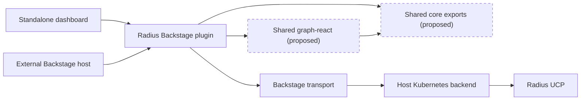
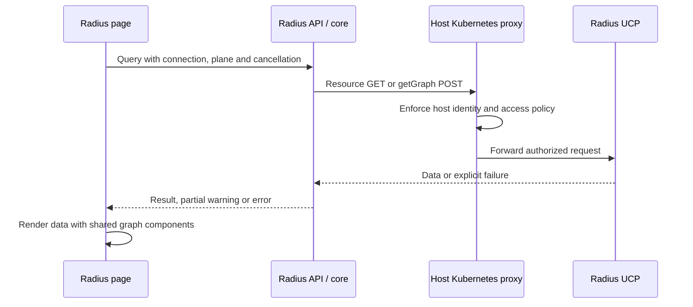

# Radius Dashboard as a distributable Backstage plugin

- **Author**: Nicole James (@nicolejms)
- **Status**: Draft, proposed for team review
- **Revised**: 2026-10-27
- **Feature spec / issue**: Not assigned
- **Authoring notes**: Agent-drafted consolidation of the existing design and test plan. Source reviews are pinned in [Appendix E](#appendix-e-source-evidence); they do not prove support for a Backstage release. This edit changes no runtime code.
- **Related**: [Test plan](./2026-09-dashboard-plugin-test-plan.md), [proposed ADR](./2026-10-radius-backstage-plugin-adr.md)

## Review guide

Review D1-D6 first. All remain open; recommendations are not approvals. Security and Compatibility need explicit review before release.

| Information                                                                                      | Single owner                                                                                |
| ------------------------------------------------------------------------------------------------ | ------------------------------------------------------------------------------------------- |
| Architecture, public contracts, support choices, security, delivery, release and rollback        | This design                                                                                 |
| Requirement IDs, test phases, host matrix, fixtures, CI protocol, coverage and baseline evidence | [Test plan](./2026-09-dashboard-plugin-test-plan.md)                                        |
| Short decision summary for readers                                                               | [ADR](./2026-10-radius-backstage-plugin-adr.md); links here rather than repeating contracts |

The difficult reviews are [live versus modeled graph contracts](#appendix-a-contracts-and-extraction), [React and packaging compatibility](#appendix-b-compatibility-evidence), [resource-type migration](#appendix-c-resource-type-model-changes), and [cross-repository candidate CI](./2026-09-dashboard-plugin-test-plan.md#appendix-h-candidate-ci-protocol). Read those appendices only for the decisions you own.

This note uses the decision-first structure proposed in [radius-project/radius#13282](https://github.com/radius-project/radius/pull/13282), at [template revision `7d22e91`](https://github.com/radius-project/radius/blob/7d22e915c5616de9a25d887df966999af45772b6/eng/design-notes/templates/design-template.md). The test plan remains an execution reference, not a second design.

## Decisions for review

| ID  | Decision                                                               | Options                                                              | Recommendation and inputs needed                                                                                     | Risk if wrong                                             | Status |
| --- | ---------------------------------------------------------------------- | -------------------------------------------------------------------- | -------------------------------------------------------------------------------------------------------------------- | --------------------------------------------------------- | ------ |
| D1  | [Where does code belong?](#d1-code-ownership)                          | Plugin in dashboard / move plugin / keep copies                      | Keep Backstage code here; shared core and graph libraries in `ai-extensions`                                         | Duplicate implementations or a second Backstage toolchain | Open   |
| D2  | [Which frontend systems do we support?](#d2-frontend-migration)        | Native plus bounded legacy / permanent conversion                    | Native Radius, hybrid-to-native app. Approve exact hosts, native subpath, legacy retirement and adapter owners       | Lost features or indefinite compatibility code            | Open   |
| D3  | [How are connections and access enforced?](#d3-connections-and-access) | Host Kubernetes proxy / new Radius gateway                           | Explicit cluster and plane through host-authorized transport. Approve the Radius/auth matrix                         | Cross-cluster data or unauthorized reads                  | Open   |
| D4  | [How do we adopt shared graph code safely?](#d4-shared-graph-adoption) | Packed-library consumer CI / source-only tests / duplicate renderers | One renderer, React 18 host, isolated React 18/19 library tests, pinned consumer checks                              | A shared change breaks the installed dashboard            | Open   |
| D5  | [What may be published?](#d5-publication-policy)                       | Versioned public libraries/plugin / keep private                     | Approve scopes, publication identity, license/notices and forwarding policy before publication                       | Uninstallable packages or unapproved code transfer        | Open   |
| D6  | [When does the namespace corpus move?](#d6-resource-type-migration)    | Separate after extraction / combine changes                          | After Phase 4's record diff, before Phase 7 if preview support is required. Maintainers must choose that requirement | Tests hide model changes or miss current resource types   | Open   |

Test-only choices about coverage targets, runner changes, timeout policy and the CI invocation contract are at the [start of the test plan](./2026-09-dashboard-plugin-test-plan.md#decisions-for-test-review). Package names and supported versions remain proposals until D2/D5 are resolved.

## Overview

Make the existing Radius frontend plugin installable in an external Backstage host. The standalone dashboard must consume the same pages and API, not a copy.

Keep the plugin in this repository. Consume shared domain and graph libraries from `radius-project/ai-extensions`, then delete the replaced dashboard implementations. Add native frontend registration and migrate the standalone app without changing its URLs or required features. The backend already uses Backstage's new system.

## Terms and definitions

| Term         | Meaning                                                                                          |
| ------------ | ------------------------------------------------------------------------------------------------ |
| Connection   | An operator-approved Kubernetes cluster plus Radius plane identity                               |
| Native entry | Plugin registration for Backstage's new frontend system                                          |
| Consumer pin | Immutable dashboard commit, lockfile, toolchain and host configuration used by shared-library CI |
| Candidate    | Built, packed libraries from one identified revision; not a registry publication                 |

## Objectives

### Goals

- Install the Radius plugin without copying source or deploying the branded dashboard container.
- Preserve existing read/inspect pages, host-owned auth, themes, optional cards and configurable mounting.
- Use one shared parser, domain contract, layout and renderer.
- Prove that packed artifacts work in standalone and external hosts before release.

### Non goals

No deployment/modeling workflows, new control-plane APIs, automatic catalog ingestion, Scaffolder actions, entity-level authorization, dynamic-plugin packaging or dashboard React major upgrade. Each needs a separate design.

### User scenarios (optional)

A platform engineer installs Radius in an existing Backstage host and configures approved connections. A developer browses applications, environments, resources, recipes and resource types, then opens a live application graph.

## User Experience (if applicable)

Mount Radius at a host-selected path, for example `/radius`. Preserve existing standalone URLs, list/detail views, JSON views, breadcrumbs and graph controls. The host owns sign-in, navigation, settings and branding.

**Sample Input:** Connection `production`, configured for an approved cluster and plane `radius/local`.

**Sample Output:** The user selects `production` and sees its application graph and resource links. No connection shows setup guidance; forbidden access shows an access error, not an empty list.

**Sample Recipe Contract:** No recipe execution contract changes; the plugin lists recipes and recipe packs.

## Design

### High Level Design

- Dashboard owns Backstage pages, API registration, transport, shell and container.
- Shared core owns browser-safe domain/graph contracts and operations; graph-react owns rendering, layout and scoped styles.
- Both Backstage hosts install the same plugin package. Shared libraries cannot import host APIs or navigate the host.

### Architecture Diagram

Arrows mean "depends on." Shared packages are proposed additions, not new services.



### Data flow and sequence



Resource reads and graph queries must use the same selected connection. Changing connection cancels work and rejects late results. A graph POST queries data; it grants no deployment permission.

### Detailed Design

#### Decision details

##### D1: Code ownership

**Context:** Both Backstage installations can share Backstage-aware pages. Only domain and graph code needs to be host-neutral.

| Option                                 | Advantage                                                   | Cost                                                              |
| -------------------------------------- | ----------------------------------------------------------- | ----------------------------------------------------------------- |
| Plugin here, shared libraries upstream | Keeps existing Backstage tooling; one shared implementation | Coordinated library releases and dashboard updates                |
| Move plugin upstream                   | One repository for all package changes                      | Adds Backstage build/host tooling and transfers product ownership |
| Keep copies                            | Smaller initial source move                                 | Fixes, layout and tests diverge                                   |

**Proposed Option:** Keep the plugin here and publish shared libraries upstream. **Consequences:** Move code with tests and notices; delete replaced code. A compatibility package may forward exports but contain no logic.

**How we'll know it's right:** The [boundary and artifact tests](./2026-09-dashboard-plugin-test-plan.md#package-and-host-requirements) use the candidate packages, with no old implementation or source alias.

**Outcome:** Open; record reviewer, date and result after review.

##### D2: Frontend migration

**Context:** The reviewed frontend uses legacy registration. Radius is code we own, so a permanent conversion wrapper is unnecessary.

| Option                              | Advantage                                        | Cost                                            |
| ----------------------------------- | ------------------------------------------------ | ----------------------------------------------- |
| Native Radius, bounded legacy entry | Direct extension contracts; controlled migration | Two public entries need tests during transition |
| Permanent wrappers or hybrid app    | Less initial host work                           | Required legacy composition has no exit         |

**Proposed Option:** Use `createFrontendPlugin`, `PageBlueprint` and `ApiBlueprint` with the existing product code. Retain the tested legacy root; `/alpha` is the proposed native default-export subpath. Qualify native Radius first, then hybrid and native standalone composition.

**Consequences:** Preserve all eight pages, route parameters, `radius-api`, `radius-catalog`, cards, themes, auth and API overrides. Install one active Radius entry. Required third-party gaps block native completion; do not remove a feature to pass.

**How we'll know it's right:** [FS-01-FS-16](./2026-09-dashboard-plugin-test-plan.md#frontend-migration-fs-01-fs-16). Keep prior app/lockfile/image together at each cutover.

**Outcome:** Open; D2 needs exact Backstage/compiler pins, subpath approval, legacy retirement milestone, and owners/upstream references/removal conditions for catalog, catalog graph, home, settings and Kubernetes integration adapters.

##### D3: Connections and access

**Context:** At the reviewed baseline, resource reads choose the first cluster and graph requests the last. Browser configuration cannot authorize either path.

| Option                                        | Advantage                                   | Cost                                             |
| --------------------------------------------- | ------------------------------------------- | ------------------------------------------------ |
| Host Kubernetes proxy and explicit connection | Reuses existing backend and identity policy | Each supported host must enforce upstream access |
| New Radius gateway                            | Can supply a missing authorization boundary | New service contract, operation and maintenance  |

**Proposed Option:** Use the existing proxy and expose a public API override for another authorized transport. Keep the health-only Radius scaffold uninstalled and outside initial distribution.

**Consequences:** Require operator-approved clusters/planes, connection-scoped state, and backend authorization for GET and graph POST. Block release if the host cannot enforce access; approve a narrow gateway separately if needed.

**How we'll know it's right:** [Connection, error and native-backend requirements](./2026-09-dashboard-plugin-test-plan.md#appendix-b-requirement-catalog) distinguish allowed, unauthenticated and forbidden requests without cross-connection leakage.

**Outcome:** Open; security reviewers must approve the supported Radius/auth matrix and minimum upstream permissions.

##### D4: Shared graph adoption

**Context:** Source tests cannot prove packed declarations, transitive dependencies, CSS or real host registration. Live and modeled graph inputs also differ.

| Option                                   | Advantage                                 | Cost                                                      |
| ---------------------------------------- | ----------------------------------------- | --------------------------------------------------------- |
| One renderer plus packed-consumer CI     | Detects integration failures before merge | Isolated cross-repository CI and maintained consumer pins |
| Source-only tests or duplicate renderers | Easier initial setup                      | Packaging and behavior can diverge unnoticed              |

**Proposed Option:** Use one layout/renderer, browser-safe core imports and explicit live/modeled variants. Keep the dashboard on React 18; qualify the shared library separately on React 18/19. Freeze observable behavior before extraction.

**Consequences:** Shared-library changes must pass the dashboard-owned journeys through packed candidates. No copied host suites, toy graph, source alias or fallback implementation may satisfy the gate.

**How we'll know it's right:** [Graph records](./2026-09-dashboard-plugin-test-plan.md#appendix-e-graph-fixtures-and-records) and the [candidate CI protocol](./2026-09-dashboard-plugin-test-plan.md#appendix-h-candidate-ci-protocol) detect changed semantics, missing styles and stale/missing results.

**Outcome:** Open; name CI/pin owners and resolve the test plan's invocation and pin-age inputs before enabling the gate.

##### D5: Publication policy

**Context:** The current plugin is private `@internal/plugin-radius`. Proposed package names and documentation do not establish registry ownership or approved licenses.

| Option                                | Advantage                             | Cost                                                    |
| ------------------------------------- | ------------------------------------- | ------------------------------------------------------- |
| Versioned public libraries and plugin | External hosts install built packages | Scope, license, provenance and release responsibilities |
| Keep private                          | No public release obligations yet     | Does not meet external-installation goals               |

**Proposed Option:** Publish qualified core, graph-react and plugin artifacts in dependency order. Proposed names are `@radius-project/core`, `@radius-project/graph-react` and `@radius-project/backstage-plugin-radius`.

**Consequences:** Confirm registry access, publication identity and maintainers. Reconcile root/plugin Apache-2.0 notices with rad-components' ISC metadata before transfer. Inventory external rad-components users; approve forwarding exports, owner and removal version only if needed.

**How we'll know it's right:** Clean packed installs and [release qualification](./2026-09-dashboard-plugin-test-plan.md#verification-phases) pass; publication uses protected revisions and immutable versions.

**Outcome:** Open; no package publication, renaming, relicensing or public support promise is approved by this draft.

##### D6: Resource-type migration

**Context:** Legacy fixtures exercise hard-coded branches. `Radius.*` changes resource shapes and graph semantics, not just namespace spelling.

| Option                                   | Advantage                                 | Cost                                        |
| ---------------------------------------- | ----------------------------------------- | ------------------------------------------- |
| Separate corpus change after extraction  | Record diffs identify one cause at a time | Legacy assumptions remain until that change |
| Combine extraction and namespace changes | One fixture update                        | Cannot attribute graph differences          |

**Proposed Option:** Run Phase 9 after Phase 4's reviewed record diff. Move it before Phase 7 if maintainers require preview-type support. Keep explicit legacy/Dapr coverage.

**Consequences:** Recheck current upstream contracts; the [namespace research](#appendix-c-resource-type-model-changes) is a dated assessment, not a deprecation promise.

**How we'll know it's right:** [NS-01-NS-10](./2026-09-dashboard-plugin-test-plan.md#namespace-migration-ns-01-ns-10) pass with reviewed expected changes.

**Outcome:** Open; maintainers must choose preview support and sequencing.

### API design (if applicable)

Expose resource identity/types, `RadiusConnection`, an injected `RadiusTransport`, query operations and the plugin's API-ref/interface/override. Core owns domain rules; the Backstage adapter owns HTTP, credentials, cluster access and decoding. Validate public inputs and replace permissive `any` with explicit types before stable publication. See [Appendix A](#appendix-a-contracts-and-extraction).

No new public backend REST API. Keep the existing `POST /apis/api.ucp.dev/v1alpha3/{application-resource-id}/getGraph?api-version=...` query. The [request table](./2026-09-dashboard-plugin-test-plan.md#appendix-a-public-and-request-inventory) owns exact regression paths and version expectations.

### CLI Design (if applicable)

No CLI changes. The first release requires no managed `rad` or Bicep process.

### Implementation Details

| Component          | Change and state rules                                                                                                                                             |
| ------------------ | ------------------------------------------------------------------------------------------------------------------------------------------------------------------ |
| Shared core        | Browser-safe typed identity/graph subpaths and domain use cases; no React, host, HTTP implementation, DOM, filesystem or credential dependency                     |
| Shared graph-react | One renderer/layout with instance-local Dagre state, scoped CSS, external React peers, typed data/options/callbacks; no fetch, host navigation or global CSS reset |
| Radius plugin      | Reuse pages/API logic across entries; centralize graph and resource requests; explicit connection/plane, cancellation, bounded fan-out and partial-result handling |
| App/backend        | Native app composition preserves shell behavior; retain existing backend services and Kubernetes proxy; no required Radius health plugin                           |

Cache keys include connection, plane, scope, API version and authorization context. Bound concurrency and cache lifetime, deduplicate requests, and follow continuation only when upstream provides it. Do not claim server pagination without it. Cancel on unmount or connection change and discard late responses. No new persistent storage is needed.

### Error Handling

The [ER-01-ER-10 catalog](./2026-09-dashboard-plugin-test-plan.md#error-states-er-01-er-10) owns the complete error list.

| Scenario                      | User sees                                  | Recovery                                                               |
| ----------------------------- | ------------------------------------------ | ---------------------------------------------------------------------- |
| Missing/invalid connection    | Setup or selection error                   | Choose an approved connection                                          |
| Unauthenticated/forbidden     | Distinct access error                      | Correct host identity/policy; no automatic retry or cluster switch     |
| Partial inventory             | Results marked incomplete                  | Retry the failed portion                                               |
| Timeout/unavailable upstream  | Explicit retryable failure                 | Bounded retries for transient reads                                    |
| Malformed data/layout failure | Error or identified, usable degraded graph | Preserve diagnostics; never show an empty success or overlap all nodes |

Keep loading, empty, partial, stale and error states distinct. Unsupported type/version responses may use documented fallback; authorization, network and malformed-data failures must not become empty results.

## Test plan

The [test plan](./2026-09-dashboard-plugin-test-plan.md) is the only owner of suites, IDs, host matrices, phases, coverage floors and executable evidence. It protects current behavior before extraction, packed legacy/native entries, shared-library adoption, and built-container rollback. Passing old legacy tests does not establish native support.

## Security

| Threat                                 | Required control                                                                                                                                  |
| -------------------------------------- | ------------------------------------------------------------------------------------------------------------------------------------------------- |
| Unauthorized resource or graph access  | Host sign-in/backend authentication and direct GET/graph POST policy tests; connection settings and hidden controls grant no access               |
| Arbitrary target or cross-user leakage | Operator-approved clusters/planes, backend-only credentials, authorization-aware caches and rechecked access                                      |
| Unsafe resource content                | Validate/escape Markdown, schemas, icons and source links; define sensitive raw-JSON fields permitted for authorized users                        |
| Credential exposure                    | No inherited guest defaults, development mode, kubectl proxy setup or broad standalone RBAC in external installation defaults; redact logs/traces |
| Untrusted candidate execution          | Read-only isolated CI without signing, registry or cloud secrets; protected publication is separate from candidate execution                      |

The first release is cluster/plane-scoped inspection, not catalog-entity authorization. If a host cannot enforce that boundary, block release.

## Compatibility

Preserve standalone URLs, route parameters, public API overrides and live graph behavior. Support the legacy entry only for the D2-approved window; a hybrid app is a migration stage, not a stable endpoint. Frontend conversion helpers apply to third-party frontend plugins, not backend plugins.

Keep React 18 in Backstage. Isolated React 19 graph tests do not qualify the host. [Appendix B](#appendix-b-compatibility-evidence) records dependency blockers and packaging rules. Exact Backstage/Radius/compiler versions remain D2/D3 inputs; source review and upstream templates do not approve a support range.

## Monitoring and Logging

Record safe correlation/connection IDs, operation, duration, upstream status, partial count, fan-out, response size, cache hits, timeouts and graph size. Use host telemetry through an explicit shared-code adapter. Never log raw resources, kubeconfig or tokens.

Diagnostics must distinguish setup, reachability, policy, API-version, frontend-registration and CSS failures. CI reports the tested consumer revision and exact candidate resolution.

## Development plan

Use the [delivery units and estimates](#appendix-d-delivery-and-release) for implementation ownership; the [test phase table](./2026-09-dashboard-plugin-test-plan.md#verification-phases) owns evidence and progress. Frontend migration can start before shared packages ship. Change frontend registration, shared-code extraction and namespace fixtures separately.

## Open Questions

No additional review choices are hidden here. Record architecture outcomes in D1-D6 and test-policy outcomes in the test plan's opening table.

## Alternatives considered

Per-decision trade-offs are above. An iframe does not provide native auth/navigation. Rebuilding every page as framework-neutral React adds work that two Backstage hosts do not need. A broad dependency/React upgrade is a separate project.

## Appendix (optional)

### Appendix A: contracts and extraction

Review with D1/D3/D4. Public names and serialized shapes need approval before code depends on them.

| Source / contract                                                | Destination and invariant                                                                                             |
| ---------------------------------------------------------------- | --------------------------------------------------------------------------------------------------------------------- |
| Resource-ID parser and resource/graph interfaces                 | Shared core: preserve full plane/group/provider/type/name identity; remove dashboard copies                           |
| Type equivalence, recipe aggregation, schema interpretation      | Core domain operations behind a typed transport; no second schema engine; listing and recipe resolution stay separate |
| `ApplicationTab` graph POST and `RadiusApiImpl` reads            | One query boundary with the same connection, plane, version/error policy and cancellation                             |
| `AppGraph` / `ResourceNode`, layout, details and legend          | Graph-react: typed graph, presentation/capability options and selection/details/source callbacks; one Dagre engine    |
| Backstage pages, API factory, route refs and optional home cards | Existing plugin; native extension IDs must be unique even where legacy display names repeat                           |

Live UCP graphs need no `diffHash`, definition file or workflow status. Modeled, planned, deployment-projection and diff inputs remain explicit variants. `applicationGraphToResources` requires valid modeled hashes; `projectDeployedGraph` retains modeled topology. Neither is a drop-in live adapter. Filtering/projection must not hide live resources or invent successful deployment status.

Preserve both application namespaces, recipe packs and legacy recipes, per-type API versions and raw status. Enable icons, source links, badges or diff actions only when their required data/capabilities are supplied. Pass themes and host actions as inputs.

Proposed configuration, not a final schema:

```yaml
radius:
  connections:
    - id: production
      clusterName: production-cluster
      plane:
        type: radius
        name: local
```

Validate through Backstage configuration. These operator-controlled identifiers contain no credentials and grant no access.

Use supported route-ref conversion where required. `convertLegacyPlugin`/`convertLegacyPageExtension` require explicit page mappings and do not convert arbitrary cards/entity extensions. Temporary `convertLegacyAppOptions`/`convertLegacyAppRoot` preserve app composition only. Native Radius itself uses no plugin converter. Migrate APIs, themes, sign-in, navigation, home and bindings, including `src/index.tsx`'s `app.createRoot()` contract.

### Appendix B: compatibility evidence

Review with D2/D4/D5. These are findings at the reviewed revisions, not current-release qualification.

| Evidence                                                                                                                                                | Implication                                                                                       |
| ------------------------------------------------------------------------------------------------------------------------------------------------------- | ------------------------------------------------------------------------------------------------- |
| Dashboard release marker 1.49.0; resolved app-defaults 1.7.11, core-components 0.18.13, core-plugin-api 1.12.9; assessed peers admit React 17/18        | Qualify resolved packages, not just the release marker                                            |
| React/DOM 18.3.1; root React type resolutions `^18`                                                                                                     | Match types to runtime; forced peers prove nothing                                                |
| Backstage guidance does not qualify React 19; MUI 4.12.4 Portal calls removed `findDOMNode`                                                             | Host-wide support and transitive MUI work are required for a future major upgrade                 |
| App already uses `react-dom/client`/`createRoot`; classic JSX config and `JSX.Element` remain                                                           | Do not invent a root-render migration; future React 19 work still needs JSX/type cleanup          |
| rad-components has no production Backstage/MUI dependency; React Flow 11.11.4 peers `>=17`; Testing Library 16.3.3 and Storybook 10.5.10 admit React 19 | Isolated library tests are viable, not proven support or a reason to require React Flow 12        |
| Dashboard Node 24, Yarn 4.17.1, TypeScript 6.0.3; shared repository Node 24, pnpm, TypeScript 7                                                         | Consumers need not adopt shared-repository tooling; test declarations with each approved compiler |
| Researched Backstage 1.54.6 templates use React 18, Node 22/24 and TypeScript 5.8                                                                       | Candidate fixture only; not dashboard's compiler or a support promise                             |

Start builds and runtime on Node 24; test wider support before adding an `engines` promise. Publish compiled JavaScript, declarations and scoped CSS. React/DOM/router remain appropriate peers; avoid a second React copy. Browser code uses safe core subpaths, not a workflow root barrel reading `process.env`. Local workspace dependencies must rewrite to installable version ranges; published artifacts contain no `workspace:`/`catalog:` protocols or source aliases. Native/root export maps, `typesVersions` and discovery metadata must resolve to shipped output.

### Appendix C: resource-type model changes

Review with D6. The earlier assessment found no formal legacy deprecation/removal date or migration guide. It found preview-gated `Radius.*` and legacy Dapr support. Recheck upstream before implementation; do not treat this dated research as a current lifecycle guarantee.

`Radius.Core` has applications, environments, recipePacks, terraformSettings and bicepSettings. Other types are YAML-registered resource types across Compute, Data, Security, Messaging, Storage and AI.

| Legacy type                                             | Assessed replacement / caveat                                                          |
| ------------------------------------------------------- | -------------------------------------------------------------------------------------- |
| `Applications.Core/applications`                        | `Radius.Core/applications`; no `properties.extensions`                                 |
| `Applications.Core/environments`                        | `Radius.Core/environments`; changed provider/recipe shape                              |
| `Applications.Core/containers`                          | `Radius.Compute/containers`; single `container` becomes `containers` map               |
| `Applications.Core/gateways`                            | `Radius.Compute/routes`; remodeled, not only renamed                                   |
| `Applications.Core/httpRoutes`                          | Removed in v0.28; services are part of container rendering                             |
| `Applications.Core/secretStores`                        | `Radius.Security/secrets`; name-level match only                                       |
| `Applications.Core/volumes`                             | `Radius.Compute/persistentVolumes`; name-level match only; legacy Azure-KeyVault shape |
| `Applications.Core/extenders`                           | No verified successor; user-defined types supersede the pattern                        |
| `Applications.Datastores/redisCaches`, `mongoDatabases` | `Radius.Data/redisCaches`, `mongoDatabases`                                            |
| `Applications.Datastores/sqlDatabases`                  | `Radius.Data/sqlServerDatabases` inferred; stale example conflicts                     |
| `Applications.Messaging/rabbitMQQueues`                 | `Radius.Messaging/rabbitMQ`                                                            |
| `Applications.Dapr/*`                                   | No successor identified; retain supported legacy fixtures                              |

Resource IDs may contain digits in namespace/type segments and globally scoped recipe packs omit `resourceGroups`. Use Radius `pkg/cli/manifest/validation.go`, not guessed character classes: `^[a-z][A-Za-z0-9]+$` for types and `^[A-Z][A-Za-z0-9]+\.[A-Z][A-Za-z0-9]+$` for namespaces. Include existing legal `.`/`_` name cases.

API versions are per type: legacy `2023-10-01-preview`, assessed new types mostly `2025-08-01-preview`, neo4j `2025-09-11-preview`; user types permit `^\d{4}-\d{2}-\d{2}(-preview)?$`. Test fallback rather than assigning one global version.

Environment `compute`/`recipes`/`extensions` are removed. Kubernetes namespace is `providers.kubernetes.namespace`; `recipePacks` replaces recipes. Azure `scope` becomes `subscriptionId`, optional `resourceGroupName`/`identity`; settings become separate resources referenced by ID. Split legacy/current `EnvironmentProperties`, not an impossible union.

New base contracts include application, environment, connections and codeReference, not legacy `iam`. Graph connections add required kind `Connection` or `Dependency`, optional icons and resource `iconHash`; requests accept `includeIcons`/`dependsOnEdges`. The [NS requirements](./2026-09-dashboard-plugin-test-plan.md#namespace-migration-ns-01-ns-10) own fixture changes.

### Appendix D: delivery and release

P identifiers name implementation review units; test phase numbers are different and live only in the test plan.

| Unit | Owner / deliverable                                                             | Prerequisite                                                                      | Estimate |
| ---- | ------------------------------------------------------------------------------- | --------------------------------------------------------------------------------- | -------- |
| P0   | Both: contracts, names/licenses, support/auth matrix, adapter and CI/pin owners | Design review                                                                     | 2-3 days |
| P1   | Dashboard: freeze real-renderer host journeys                                   | P0                                                                                | 4-6 days |
| P2   | Both: trusted candidate-install/consumer harness                                | P1; no-secret runner policy                                                       | 3-5 days |
| P3a  | Shared core: compiled browser-safe identity/graph contracts                     | P0-P2                                                                             | 2-3 days |
| P3b  | Shared core: typed query/transport/domain operations                            | P3a; affected-page baseline                                                       | 2-3 days |
| P3c  | Shared libraries: protected prerelease publisher                                | P3a; scope/license approval                                                       | 1-2 days |
| P4   | Dashboard: common client and explicit connection                                | Qualified core prerelease                                                         | 4-6 days |
| P5a  | Shared graph-react: one renderer/layout, CSS, tests/notices                     | P3a-P3b; P4 contract; transfer license                                            | 4-6 days |
| P5b  | Shared libraries: qualify graph contracts and remove replaced code              | P5a                                                                               | 3-4 days |
| P6   | Dashboard: adopt graph packages, retire old implementation                      | Qualified P5 candidates and prereleases                                           | 3-5 days |
| P7   | Dashboard: public API/config, nested routes and cards                           | P4; can overlap graph work                                                        | 3-5 days |
| P8a  | Dashboard: native plugin and backend audit                                      | P0-P1; selected frontend APIs; integrate P7 config/routes before final acceptance | 3-5 days |
| P8b  | Dashboard: hybrid standalone                                                    | P8a; frozen host baseline                                                         | 3-5 days |
| P8c  | Dashboard: native standalone, remove required converters                        | P8b; native third-party replacements                                              | 3-5 days |
| P9   | Both: publication and install/upgrade/rollback guides                           | P3c, P6-P7, P8a-P8c for stable                                                    | 2-3 days |
| P10  | Both: real supported-host pilot and stable release                              | All release gates                                                                 | 3-5 days |

Allow 45-71 engineer-days, about 9-15 working weeks for one engineer, excluding review/environment waits. The earlier 38-59-day estimate used a 2-3-day wrapper instead of P8's 9-15 days. These are estimates, not completed-work claims; re-estimate after the third-party inventory.

Before first extraction, merge dashboard journeys and candidate-install support and pin that immutable revision. A reviewed integration revision may supply needed host edits before package adoption; probes alone do not qualify the candidate. P4/P6 complete adoption and deletion. Track moved source, destination/export, consumer, test destination and removal PR.

Publish additive prereleases core first, graph-react second, plugin last. Shared graph-react uses workspace core locally; pack rewrites it to a published range. Add independent, dependency-aware Changesets, public file allowlists, provenance and protected credentials. The reviewed shared core manifest was private/source-based and ignored by Changesets, whose access was restricted; it needs a library publisher. Add dashboard plugin publication alongside the existing container build. Do not infer publication from repository docs.

Freeze one release set: exact package versions/digests, graph-react's core range, plugin version, dashboard lockfile/image, host/fixture commits, Backstage/frontend entry/backend package set and temporary adapters. Requalify any changed version rewriting, tarball or resolution. A failed publication stops downstream updates; never overwrite an immutable version. Deprecate a faulty version and publish a correction.

Rollback external hosts to the prior lockfile and standalone to its prior image with matching dependencies and pin. Prove restoration through host journeys; do not install both entries or silently resume hybrid mode. No database/state migration is planned. Changing a supported-consumer pin requires reviewed policy and passing old/new-pin evidence.

### Appendix E: source evidence

The original extraction assessment reviewed dashboard [`8a04d30`](https://github.com/radius-project/dashboard/tree/8a04d30c35cd95fa4eb65a48ee1a36157f2091cb) and shared-library draft [`9c86b40`](https://github.com/radius-project/ai-extensions/tree/9c86b4005f67010c5559bb24433a56fa6f4893d4). The frontend/backend review used dashboard [`9d295b5`](https://github.com/radius-project/dashboard/tree/9d295b5097c62d9c3fa9dab136172f34c1b912bf). Historical findings are not claims about every later branch.

| Finding                                                            | Source                                                                                                                                                                                                                                                                                                                                                                                                                                                                                                                                                                                                                                                     |
| ------------------------------------------------------------------ | ---------------------------------------------------------------------------------------------------------------------------------------------------------------------------------------------------------------------------------------------------------------------------------------------------------------------------------------------------------------------------------------------------------------------------------------------------------------------------------------------------------------------------------------------------------------------------------------------------------------------------------------------------------- |
| Legacy plugin/pages and host composition                           | [plugin](https://github.com/radius-project/dashboard/blob/8a04d30c35cd95fa4eb65a48ee1a36157f2091cb/plugins/plugin-radius/src/plugin.ts), [app](https://github.com/radius-project/dashboard/blob/8a04d30c35cd95fa4eb65a48ee1a36157f2091cb/packages/app/src/App.tsx)                                                                                                                                                                                                                                                                                                                                                                                         |
| Native backend and unused health scaffold                          | [backend](https://github.com/radius-project/dashboard/blob/8a04d30c35cd95fa4eb65a48ee1a36157f2091cb/packages/backend/src/index.ts), [scaffold](https://github.com/radius-project/dashboard/blob/8a04d30c35cd95fa4eb65a48ee1a36157f2091cb/plugins/plugin-radius-backend/src/service/router.ts)                                                                                                                                                                                                                                                                                                                                                              |
| First/last cluster split; ten-second graph abort                   | [API](https://github.com/radius-project/dashboard/blob/8a04d30c35cd95fa4eb65a48ee1a36157f2091cb/plugins/plugin-radius/src/api/api.ts), [ApplicationTab](https://github.com/radius-project/dashboard/blob/8a04d30c35cd95fa4eb65a48ee1a36157f2091cb/plugins/plugin-radius/src/components/resources/ApplicationTab.tsx)                                                                                                                                                                                                                                                                                                                                       |
| React Flow 11, Dagre, parser duplication and namespace assumptions | [graph](https://github.com/radius-project/dashboard/blob/8a04d30c35cd95fa4eb65a48ee1a36157f2091cb/packages/rad-components/src/components/appgraph/AppGraph.tsx), [parser](https://github.com/radius-project/dashboard/blob/8a04d30c35cd95fa4eb65a48ee1a36157f2091cb/plugins/plugin-radius/src/resources/resourceId.ts), [namespace filter](https://github.com/radius-project/dashboard/blob/8a04d30c35cd95fa4eb65a48ee1a36157f2091cb/plugins/plugin-radius/src/components/resourcetypes/ResourceTypesTable.tsx)                                                                                                                                            |
| Packaging, license and dependency metadata                         | [plugin](https://github.com/radius-project/dashboard/blob/8a04d30c35cd95fa4eb65a48ee1a36157f2091cb/plugins/plugin-radius/package.json), [components](https://github.com/radius-project/dashboard/blob/8a04d30c35cd95fa4eb65a48ee1a36157f2091cb/packages/rad-components/package.json), [root](https://github.com/radius-project/dashboard/blob/8a04d30c35cd95fa4eb65a48ee1a36157f2091cb/package.json), [lock](https://github.com/radius-project/dashboard/blob/8a04d30c35cd95fa4eb65a48ee1a36157f2091cb/yarn.lock), [shared core](https://github.com/radius-project/ai-extensions/blob/2c789d2e2a309d94e4164a1719c64dda580be36c/packages/core/package.json) |
| Live/model distinction                                             | [modeled conversion](https://github.com/radius-project/ai-extensions/blob/2c789d2e2a309d94e4164a1719c64dda580be36c/packages/core/src/graph/appgraph.ts), [deployment projection](https://github.com/radius-project/ai-extensions/blob/2c789d2e2a309d94e4164a1719c64dda580be36c/packages/core/src/graph/deployed.ts)                                                                                                                                                                                                                                                                                                                                        |
| React 19 blockers                                                  | [Backstage JSX guidance](https://github.com/backstage/backstage/blob/034636dabcecf4ec35e64fe1cd891e1321ebf131/docs/tutorials/jsx-transform-migration.md), [MUI Portal](https://github.com/mui/material-ui/blob/a563a60219f7f6519fb0f34f6d8e3bf0974e6495/packages/material-ui/src/Portal/Portal.js)                                                                                                                                                                                                                                                                                                                                                         |

Migration guidance: [frontend app](https://backstage.io/docs/frontend-system/building-apps/migrating/), [third-party conversion](https://backstage.io/docs/frontend-system/building-apps/plugin-conversion/), [native plugin](https://backstage.io/docs/frontend-system/building-plugins/migrating/), [backend app](https://backstage.io/docs/backend-system/building-backends/migrating/), [backend plugin](https://backstage.io/docs/backend-system/building-plugins-and-modules/migrating/), [package metadata](https://backstage.io/docs/tooling/package-metadata/), [HTTP auth](https://backstage.io/docs/backend-system/core-services/http-auth/).

## Design Review Notes

No team approval is recorded. The September draft selected the proposed ownership split; October 23 added native frontend migration; October 27 limited scope to shared libraries and consolidated this note for decision-first review. These edits publish no packages and approve no support range. Record each meeting's date, reviewers, decision outcomes and follow-up owners here.
