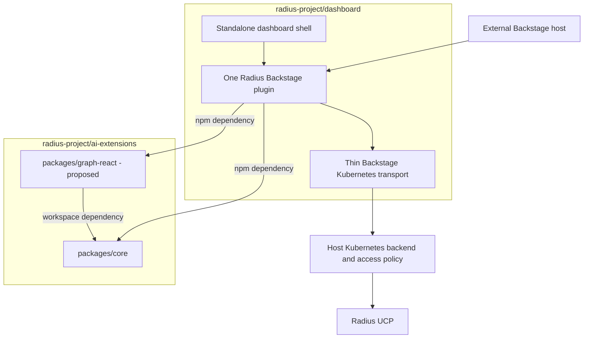

# Radius Dashboard as a distributable Backstage plugin

- **Author**: Nicole James (@nicolejms)
- **Date**: 2026-09
- **Revised**: 2026-10-27
- **Status**: Draft
- **Companion test plan**: [Radius Dashboard test plan](./2026-09-dashboard-plugin-test-plan.md)
- **Decision record**: [Keep the Radius Backstage plugin in dashboard and use shared graph libraries](./2026-10-radius-backstage-plugin-adr.md)

The dashboard repository owns the Backstage plugin and this design. `radius-project/ai-extensions` owns the shared domain and graph libraries. This plan covers those libraries and their use in Backstage, not other products in that repository.

## Overview

Keep the Radius Backstage plugin in `radius-project/dashboard`. Add native support for the new frontend system, then migrate the standalone app in stages. The dashboard is already a branded Backstage app: its backend uses the new system, but its app and Radius plugin use the legacy frontend. Plugins remain part of Backstage. Their contracts must change; the product does not need a new Backstage port.

The standalone dashboard and external Backstage hosts must use the same plugin. The plugin consumes shared graph contracts, transformations, and components from `radius-project/ai-extensions`. Before release, switch the dashboard to those libraries and delete its old implementations.

Keep the dashboard workspace. Move reusable graph code from `packages/rad-components` into the proposed `packages/graph-react` library. Keep dashboard on React 18 and test the shared graph separately on React 18 and 19. Before extracting code, record passing dashboard browser journeys with the real renderer. Run those journeys for later shared-library changes. Frontend migration can start before the shared packages are published. This design proposes the work; it does not implement or publish the plugin.

## Backstage changes and delivery decision

Backstage still uses plugins. The new backend system reduces installation and service-wiring code, so plugin dependencies can change with fewer host edits. The new frontend system replaces manual app composition with plugins, modules, and an extension tree [B7]-[B10].

Dashboard commit [`9d295b5`](https://github.com/radius-project/dashboard/commit/9d295b5097c62d9c3fa9dab136172f34c1b912bf) has the code listed below. The later extraction assessment records an older revision. Neither source review proves that a migration or dependency upgrade passes.

| Surface                                               | Current state                                                                                                                             | Plan                                                                                                                                                                                     |
| ----------------------------------------------------- | ----------------------------------------------------------------------------------------------------------------------------------------- | ---------------------------------------------------------------------------------------------------------------------------------------------------------------------------------------- |
| `packages/backend/src/index.ts`                       | Uses `createBackend` and `backend.add(import(...))` for app, proxy, auth, guest provider, catalog, and Kubernetes.                        | Retain the new backend system. Check installed versions, service dependencies, startup, and authenticated Kubernetes requests. Do not repeat an already completed migration.             |
| `plugins/plugin-radius-backend/src/service/router.ts` | Uses `createBackendPlugin`, `coreServices`, and `httpRouter`; provides only `/health` and is not installed in the host.                   | Keep maintenance tests. Do not register or publish it just to claim new-system support.                                                                                                  |
| `plugins/plugin-radius/src/plugin.ts`                 | Uses `createPlugin`, `createRoutableExtension`, API factories, and route refs.                                                            | Add a native `createFrontendPlugin` entry with page and API extensions. Reuse product pages and API logic. Retain the legacy public entry for a bounded support period.                  |
| `packages/app/src/App.tsx`                            | Uses `@backstage/app-defaults`, `FlatRoutes`, manual plugin installation, themes, and guest sign-in.                                      | Move to `@backstage/frontend-defaults` through a tested hybrid stage, then remove legacy composition. Keep host branding, URLs, and explicit auth policy.                                |
| Third-party frontend plugins                          | Catalog, catalog graph, home, user settings, and the Kubernetes API are installed. Their new-system entries have not been qualified here. | Inventory exact locked versions and native entries. Prefer native support; use temporary conversion only where needed. Do not infer support from a package name or a successful install. |

### Native support and temporary compatibility

`convertLegacyPlugin` and `convertLegacyPageExtension` from `@backstage/core-compat-api` convert frontend plugins, not backend plugins. Backstage recommends them for third-party plugins whose code the host cannot yet change [B8]. We own Radius, so we must add native frontend support.

A host must list each converted page and check its name, path, and route binding. The converter cannot infer a complete installation. It also cannot convert arbitrary cards or entity extensions. Use the plugin's documented converter or a native blueprint for those extensions. Reuse route definitions through supported route-ref conversion when the selected Backstage version requires it.

`convertLegacyAppOptions` and `convertLegacyAppRoot` can preserve app composition while the host moves `createApp` to `@backstage/frontend-defaults` [B7]. These helpers migrate the app shell; they do not replace native Radius support. Install one copy of each plugin, page, and API. A converted copy must not run beside its native replacement.

Backend plugins have a separate migration path [B9], [B10]. Check the supported backend adapter for any legacy dependency in an external host. The dashboard already uses the native backend system and needs no backend wrapper. `core-compat-api` does not supply one.

### Supported frontend entries

The first stable plugin release must run natively in the new frontend system. Keep the legacy package root for the approved support window. Export the native plugin by default from a documented subpath, proposed as `/alpha` to follow Backstage's migration guide [B12]. That export does not exist yet, and each supported Backstage release needs its own tests. Both entries use the same pages, API implementation, and domain contracts.

In P0, maintainers select exact Backstage versions, lockfiles, compilers, supported entries, and a milestone for retiring the legacy entry. Assign each temporary third-party adapter an owner, an upstream issue or migration reference, and a removal condition. Do not assume an upstream removal date. The standalone app must complete its native migration before stable release. If a required third-party feature has no native replacement, that milestone remains blocked. Do not drop the feature.

Test installation and CI on open-source Backstage. The host must enforce the Radius proxy access policy for both resource reads and graph queries.

## Terms and definitions

| Term                   | Meaning                                                                                                                                                   |
| ---------------------- | --------------------------------------------------------------------------------------------------------------------------------------------------------- |
| Dashboard              | The standalone Backstage application in `radius-project/dashboard`, including its branded shell and container deployment.                                 |
| Radius plugin          | The existing Backstage-aware Radius pages, API registration, routes, and cards in the dashboard repository.                                               |
| UCP                    | The Radius control-plane API reached by the dashboard through the Backstage Kubernetes proxy and Kubernetes aggregated API prefix.                        |
| Connection             | An explicit configured Kubernetes cluster plus Radius plane identity; not a browser-supplied URL or the first discovered cluster.                         |
| Shared graph           | Common resource/edge contracts and rendering primitives, with distinct live, modeled, planned, deployed-projection, and diff semantics.                   |
| Productization         | Turning an internal plugin into versioned packages that unrelated Backstage hosts can install without copying source or adopting the dashboard's shell.   |
| Supported consumer pin | A reviewed immutable dashboard commit plus lockfile, toolchain, and host configuration used by required compatibility CI; not a moving `main` checkout.   |
| Candidate artifact     | Compiled core/graph-react tarballs built from one identified common-code PR revision for isolated consumer qualification, not a package published to npm. |

## Objectives

> **Issue Reference:** No tracking issue is assigned to this proposal.

### Goals

- Deliver the current dashboard's read/inspect functionality as an installable Backstage plugin, without requiring the standalone dashboard container.
- Maintain one implementation of the Radius Backstage product pages for both standalone and embedded installations.
- Use shared graph libraries owned and published by `ai-extensions`; keep Backstage integration in dashboard.
- Support host-owned authentication, explicit connection selection, nested mounting, light/dark themes, and actionable failure states.
- Ship compiled packages, public contracts, installation documentation, release automation, and installed-artifact integration coverage.
- Preserve the shared libraries' existing graph contracts during extraction.
- Prevent a common-code PR from merging when its packed artifacts break the supported dashboard consumer, rather than finding the break only during a later dependency update.
- Support the new frontend system natively, keep a tested legacy entry during the agreed transition, and remove temporary app compatibility code before the stable standalone release.

### Non-goals

- Adding modeling, deployment, environment creation, credential management, or deletion to the first Backstage release. These are not features of the current dashboard.
- Embedding a dashboard iframe, copying the frontend into `ai-extensions`, or creating another standalone backend service.
- Rewriting all pages into a universal UI framework. Both dashboard distributions are Backstage hosts and can share Backstage-aware pages directly.
- Automatic catalog ingestion, Scaffolder actions, entity-level Radius authorization, or Red Hat Developer Hub dynamic-plugin packaging in the first release.
- Changing existing Radius control-plane APIs or treating a live graph as a source/Bicep graph.
- Upgrading the complete dashboard to React 19, adopting React Flow 12 without a demonstrated need, or broadly refreshing dashboard dependencies. A full React 19 host migration is a separate future project.

### User scenarios (optional)

#### User story 1

A platform operator installs Radius packages into an existing Backstage deployment, configures approved Radius connections using the host's Kubernetes integration and identity policy, and mounts the plugin under `/radius`. No guest-auth override, copied page source, or separate dashboard deployment is required.

#### User story 2

A developer browses applications, environments, resources, recipes, and resource types, opens an application's live graph, and follows resource links without leaving the selected connection. A rendering fix in the shared graph library reaches both standalone and embedded installations through the same dependency.

## User experience (if applicable)

The plugin provides routes for the existing five lists and their detail pages. Keep the resource overview and JSON views, application resources and graph, environment metadata/recipes/resources, recipe-pack aggregation, and resource-type schema documentation. Home cards remain optional extensions. The host owns navigation, sign-in, user settings, branding, and the app-wide theme.

Show a connection selector when the operator has approved more than one connection. The app can select a single configured connection automatically, but it must not choose the first or last cluster from several. Store filters under connection-scoped keys. Include the connection identity in links and cache keys so applications with the same name stay separate.

**Sample input:** An operator mounts Radius at `/radius` and configures a connection named `production` referring to a host-defined Kubernetes cluster and the `radius/local` plane.

**Sample output:** A developer opens Radius, selects `production`, opens an application, and sees its live graph and linked resources. A missing connection produces setup guidance; forbidden access produces an access error; an unavailable control plane produces a retryable failure, not an empty successful list.

The current dashboard graph supplies name/type nodes, edges, layout, and zoom controls. The shared graph library can also support source links, deployment badges, output-resource projection, and diff styling. Enable these capabilities only when the caller supplies the required data; do not enable them by default in the dashboard.

## Design

### High-level design

Keep shared domain logic and UI in `ai-extensions`, and Backstage product code in dashboard:

- **`ai-extensions` owns shared UI-independent logic:** publish selected `packages/core` subpaths for resource identity, graph contracts, normalization, and extracted Radius domain operations.
- **`ai-extensions` owns common React components:** introduce `packages/graph-react` (proposed package name `@radius-project/graph-react`) for shared rendering and layout, including reusable code from dashboard's `rad-components`. The library has no host dependency.
- **`dashboard` owns the Backstage product:** keep the existing Radius plugin as the single Backstage product UI. It consumes the published core and graph packages instead of maintaining shared implementations.
- **Backstage owns its integration:** keep app composition, authentication, Kubernetes transport, and navigation outside the shared libraries.

Core has no host dependency. Graph-react depends on core; the plugin depends on both. Neither library imports the Backstage plugin. Dashboard installs versioned npm packages. `ai-extensions` has no production dependency on dashboard packages; its isolated compatibility tests check out dashboard only to run consumer tests.

#### Review baseline and findings

The extraction review examined dashboard commit [`8a04d30`](https://github.com/radius-project/dashboard/commit/8a04d30c35cd95fa4eb65a48ee1a36157f2091cb), committed September 8, 2026. The original ai-extensions draft used [`9c86b40`](https://github.com/radius-project/ai-extensions/commit/9c86b4005f67010c5559bb24433a56fa6f4893d4). Backstage research used official documentation and release [`v1.54.6`](https://github.com/backstage/backstage/releases/tag/v1.54.6). These source and dependency checks do not establish support for that release or report a successful migration, build, or test run.

| Area                | Observed implementation                                                                                                                                                                                            | Delivery consequence                                                                                                   |
| ------------------- | ------------------------------------------------------------------------------------------------------------------------------------------------------------------------------------------------------------------ | ---------------------------------------------------------------------------------------------------------------------- |
| Dashboard frontend  | Existing `createPlugin`, API factories, routable extensions, route refs, and cards; standalone app imports the plugin's pages. [D1], [D2]                                                                          | Release and adapt this plugin rather than build another one.                                                           |
| Dashboard backend   | Running backend registers Kubernetes/auth/catalog and other Backstage plugins. The Radius backend scaffold only has a health route and is not registered. [D3], [D11]                                              | Do not publish a health-only backend as though it supplies Radius functionality.                                       |
| Radius reads        | `RadiusApiImpl` delegates to `KubernetesApi.proxy`, supports `Applications.Core` and `Radius.Core`, and performs resource-group/resource fan-out. [D4]                                                             | Extract common domain operations, retain a thin Kubernetes transport adapter, and bound concurrency.                   |
| Graph retrieval     | `ApplicationTab` makes its own `getGraph` POST with a ten-second abort timeout. API calls choose the first cluster; graph code chooses the last. [D4], [D5]                                                        | Move graph retrieval behind the same explicit connection-aware API as resource reads.                                  |
| Graph UI            | Dashboard uses React Flow 11 and `@dagrejs/dagre`. [D6]                                                                                                                                                            | Move rendering and layout into the shared graph library, not just similarly named types.                               |
| Duplicated code     | Dashboard has duplicate resource-ID parsers and repeated graph interfaces at the reviewed revision. [D7]                                                                                                           | Use shared contracts; remove copies as callers migrate.                                                                |
| Host coupling       | Hard-coded root navigation, `radius/local` assumptions, guest-auth standalone configuration, and first-cluster selection. [D2], [D4], [D8]                                                                         | Use route refs, explicit connection context, and the host's authentication configuration.                              |
| Packaging           | Dashboard plugin manifests use private `@internal/*` names; `ai-extensions`'s core/shared packages are private source exports ignored by Changesets. [D9], [A3]                                                    | Neither current packaging scheme is sufficient for public npm consumers.                                               |
| React compatibility | Dashboard is locked to React/DOM 18.3.1 with React type resolutions on 18; Backstage dependencies and MUI v4 block a simple supported React 19 host upgrade. [D13], [D14], [B6], [M1]                              | Keep dashboard 18; independently qualify shared graph 18/19.                                                           |
| Test evidence       | ApplicationTab covers requests/errors/timeouts and both namespaces but mocks AppGraph; graph test checks attribution; browser smoke checks three home cards, including in container CI. [D10], [D15], [D16], [D17] | Add real-renderer dashboard journeys before extraction; existing green checks alone cannot establish migration safety. |

The dashboard reads the live Radius control plane. Shared graph functions also support modeled graphs, diffs, and deployment projections. [`applicationGraphToResources`](https://github.com/radius-project/ai-extensions/blob/2c789d2e2a309d94e4164a1719c64dda580be36c/packages/core/src/graph/appgraph.ts) requires valid modeled diff hashes; [`projectDeployedGraph`](https://github.com/radius-project/ai-extensions/blob/2c789d2e2a309d94e4164a1719c64dda580be36c/packages/core/src/graph/deployed.ts) retains modeled topology. Neither is a drop-in adapter for live UCP data.

### Architecture diagram

The proposed packages depend on one another as shown below. Arrows mean "depends on." Builds resolve cross-repository dependencies as packages; no new network service connects them.



### Detailed design

#### Option 1: Common libraries in ai-extensions; Backstage plugin in dashboard

Publish core and graph-react from `ai-extensions`. Keep one shared graph implementation there. Keep the Backstage plugin in dashboard and make it use the published libraries.

##### Advantages

One `ai-extensions` change can update shared domain contracts and graph components together. Dashboard keeps its Backstage build, app, plugin, and container tooling. Both Backstage hosts use one UI. The shared libraries need no Backstage release toolchain.

##### Disadvantages

Maintainers must move dashboard graph code, tests, and notices into `ai-extensions`, package the React library, and coordinate dashboard updates. Existing rad-components consumers may need temporary forwarding exports and a deprecation period.

#### Option 2: Move the plugin and common UI into ai-extensions

Move plugin and component ownership to new `ai-extensions` workspace packages. Make dashboard install those packages and delete its old implementations.

##### Advantages

One repository can change core, UI, and adapters together. It could eventually own all Radius integrations.

##### Disadvantages

Maintainers must coordinate the source move, add Backstage build/TSX tooling and a host fixture, publish npm packages, and transfer dashboard ownership and release dependencies. Shared-library tooling alone does not build or publish a Backstage plugin. Copying the plugin without deleting the old implementation would leave duplication.

#### Proposed option

Choose Option 1. Keep core and graph components together in `ai-extensions`; dashboard uses their published contracts. Keep the existing Backstage plugin and its host-specific tooling in dashboard.

#### Canonical ownership and extraction map

The new export names below are proposed; they do not exist yet.

| Source today                                                                                   | Canonical destination                                                                                          | Required consumer migration                                                                           |
| ---------------------------------------------------------------------------------------------- | -------------------------------------------------------------------------------------------------------------- | ----------------------------------------------------------------------------------------------------- |
| Dashboard's two `resourceId.ts` files and resource/graph interfaces                            | `packages/core`, proposed Radius domain exports                                                                | Both dashboard packages use one parser and contracts; temporary forwarding exports contain no logic.  |
| Radius API compatibility, recipe aggregation, schema interpretation mixed into dashboard pages | `packages/core`, proposed Radius domain use cases behind a typed transport port                                | Plugin pages call the common use cases; UI does not import parsers from a visual package.             |
| Graph request in `ApplicationTab` and resource requests in `RadiusApiImpl`                     | One shared Radius client/use-case boundary plus Backstage transport adapter                                    | All reads use the same explicit connection, version policy, timeout/cancellation, and error contract. |
| Graph contracts, transformations, and dashboard layout                                         | `ai-extensions/packages/core` for domain semantics; proposed `packages/graph-react` for view models and layout | Dashboard uses one shared layout implementation with tested compatibility handling.                   |
| Dashboard `AppGraph`/`ResourceNode` rendering, details, and legend                             | Proposed `ai-extensions/packages/graph-react`, with typed data, callbacks, and view options                    | Dashboard consumes the npm package; host navigation and source opening remain injected callbacks.     |
| Dashboard Backstage pages, tables, recipe/type detail UI                                       | Existing Radius frontend plugin                                                                                | Standalone app and external host consume exactly the same exports.                                    |

Complete graph migration before stable release. First record dashboard journeys with the real renderer. Extract contracts and pure transformations, then move reusable rendering and layout into graph-react. Switch dashboard to the library and delete its old implementation. If rad-components has external consumers, keep only a temporary forwarding package with a documented removal policy.

Give each layout and graph instance its own Dagre state instead of sharing a module-level graph. Run the dashboard and shared-library fixtures before choosing one Dagre implementation. Do not keep two layout engines. Use a named fixture to preserve the legacy gateway-direction workaround only for the input shape that needs it.

Keep React and ReactDOM as peer dependencies; do not bundle a second React into Backstage. Test the shared components separately on React 18 and 19 before declaring support. Pass theme tokens, node presentation, source opening, selection, and details actions as inputs. The shared graph package must not import host APIs, read host globals, call host endpoints, or reset application-wide CSS.

#### Shared data semantics

Use full resource identity, connection, and plane for lookups and caches. Application names alone are not unique. Keep live UCP inputs separate from modeled `rad` inputs. Use explicit variants or optional capabilities for source metadata. A live graph need not have a `diffHash`, definition file, or workflow status.

Share stable edge normalization and identity handling, but keep graph projections explicit. Filtering and modeled-topology deployment projection must not hide live dashboard resources or invent successful provisioning status. Shared normalization must preserve both application namespaces, recipe packs and legacy recipes, resource-type API versions, and raw status values.

Extract the dashboard's schema interpretation into pure view-model functions; do not add another schema engine. Keep recipe listing separate from recipe resolution. Share identity handling and compatible transformations, not unrelated orchestration.

#### Backstage integration

Keep the legacy exports and add a native entry using the same pages, API implementation, and route definitions. Use `createFrontendPlugin`, `PageBlueprint`, and `ApiBlueprint` from the supported `@backstage/frontend-plugin-api` version [B12]. Register all eight routed pages, the `radius-api` factory and Kubernetes dependency, and the `radius-catalog` flag. Give page extensions unique stable IDs even when their legacy display names repeat. Register optional home cards through the selected home plugin's supported API, not as pages.

Test the native Radius entry in an external host before switching the standalone app. Move the app through hybrid mode to native composition. Move APIs, themes, sign-in, navigation, home composition, and route bindings to supported extensions/modules. Update `src/index.tsx` and app tests for the element returned by `app.createRoot()`. Delete each old route/import after its replacement works, including deep-link refresh. Enable guest sign-in only in explicitly configured development/test hosts, never as an external installation default.

Test against a selected Backstage release. Do not assume every baseline supports both entries. Update dependencies as one supported Backstage package set and check peers and emitted declarations. Keep unrelated React/MUI upgrades separate. Whether the host installs through documented features or discovery metadata, it must register Radius exactly once.

Replace hard-coded internal root links and breadcrumbs with route refs or routes relative to the plugin mount. Test direct links, refresh, browser history, and a non-root app base path. Keep home cards optional. Later catalog entity cards/tabs can use the same API. Dashboard parity does not require annotation contracts or catalog ingestion.

Use the existing Kubernetes proxy for the first release. Do not add a Radius backend just to match the frontend package. The host must install and configure the Backstage Kubernetes frontend API and backend plugin. Export `radiusApiRef`, its interface, and an override point so hosts can provide another authorized transport without copying pages.

### API design (if applicable)

The proposed public API includes resource identity/types, `RadiusConnection`, an injected `RadiusTransport` port, and operations to list/get applications, environments, resources, recipes, resource types, and application graphs. Core defines Radius behavior. The adapter handles HTTP, Backstage credentials, cluster access, and response decoding. Validate public inputs and replace permissive `any` shapes with explicit types before publishing a stable SDK.

Pass the connection to every operation and support cancellation. Graph requests must use the same cluster and plane as application-detail requests. Keep the existing upstream operation, `POST /apis/api.ucp.dev/v1alpha3/{application-resource-id}/getGraph?api-version=...`. This POST queries a graph; it does not grant deployment permission.

Keep resource-type version discovery and record how the `2023-10-01-preview` fallback behaves. An unsupported namespace/version response may allow fallback. Authentication, authorization, network, and malformed-response failures must remain errors, not empty lists. If one namespace succeeds and another fails, return partial inventory with a visible warning.

Limit concurrent resource-list requests and follow upstream continuation when available. Do not claim server pagination without it. Deduplicate requests, limit cache lifetimes, and cancel work when connections change. Cache keys include connection, plane, scope, API version, and authorization context. Check authorization on every retrieval.

#### Contract acceptance checklist

Maintainers must approve these contracts, exact export names, and serialized result shapes in P0 before code depends on them.

| Surface and owner                                        | Contract to freeze                                                                                                                                                                        | Acceptance evidence                                                                                                                                                                                            |
|----------------------------------------------------------|-------------------------------------------------------------------------------------------------------------------------------------------------------------------------------------------|----------------------------------------------------------------------------------------------------------------------------------------------------------------------------------------------------------------|
| Browser-safe core domain/graph exports, ai-extensions    | Resource IDs retain plane/group/provider/type/name; source variants distinguish live from modeled/planned/deployed-projection/diff; live input has no modeled-hash precondition.          | A live fixture without hashes renders; malformed modeled hashes still fail at the modeled adapter; both namespaces and identical names in different contexts stay distinct.                                    |
| Core client/transport boundary, ai-extensions            | Typed operation input/output, explicit connection, version policy, cancellation, partial-result/error taxonomy, bounded fan-out; no HTTP client, DOM, SDK, React, or credentials in core. | Fake-port tests assert operations and failures; browser import/build checks reject host and Node runtime leakage; existing modeled workflows remain internal.                                                  |
| Graph component, proposed graph-react in `ai-extensions` | Normalized graph plus explicit presentation/capability inputs; callbacks for selection/details/source actions; scoped CSS export and theme tokens; no data fetch or host navigation.      | Same renderer and declarations qualify with React/DOM and corresponding types on both supported majors; live mode cannot imply deployment success or enable source/diff actions without supplied capabilities. |
| Backstage plugin, dashboard                              | Public API ref/interface/override, legacy and new frontend entries, route refs, optional cards, operator connection schema and required Kubernetes integration.                           | Packed plugin mounts in standalone and external hosts; selected connection/plane reaches resource reads and graph POST; nested direct links and configuration errors work.                                     |

Proposed configuration, to document and validate against a schema during implementation:

```yaml
radius:
  connections:
    - id: production
      clusterName: production-cluster
      plane:
        type: radius
        name: local
```

These fields refer to operator-controlled Kubernetes configuration. They contain no credentials and grant no access. Test the final schema through the selected Backstage configuration mechanism. This option needs no new public Radius backend REST API.

### Implementation details

#### Core package - packages/core

Export selected domain/graph subpaths and move shared logic with its tests. Core must not depend on React, Backstage, HTTP implementations, the filesystem, DOM, or host SDKs. Publish compiled JavaScript and declarations so consumers need not transpile `ai-extensions` TypeScript. Keep unrelated modeling/workflow internals private.

Do not rewrite unrelated core code. Strengthen types and error handling where extraction changes code or makes it a shared contract, and test the before/after behavior. The exported subpaths and all their dependencies must be browser-safe. The current root barrel makes no such promise.

#### Common React components - packages/graph-react (proposed)

Put shared graph rendering, layout, nodes, edges, details, legends, and scoped styles in this `ai-extensions` package. Preserve dashboard's AppGraph/ResourceNode behavior. Move tests with the code and retain source attribution and license notices. Dashboard must use this renderer, not keep its own.

Import browser-safe core subpaths through a workspace dependency. Accept graph data, presentation options, theme tokens, and callbacks. Do not fetch Radius data, import host APIs, or manage host routes or lifecycle. Use ai-extensions' TypeScript, Vitest, and browser tooling. Add React/TSX and library packaging support where needed; do not add a second Backstage toolchain.

Publish compiled JavaScript, TypeScript declarations, and scoped CSS, with React/ReactDOM as external peer dependencies. Dashboard installs published artifacts without runtime package downloads. Emit JSX and types compatible with both React majors. Passing isolated library tests does not qualify a React 19 Backstage app.

The first Backstage release needs no managed `rad` or Bicep dependency. A future modeled/planned view would need a separately designed backend; it must not spawn tools from the frontend.

#### Dashboard repository

Keep Backstage pages and integration in `plugins/plugin-radius`. Move shared API/domain logic to core and graph components to graph-react in `ai-extensions`. Switch the plugin to published packages, then delete duplicate parsers/interfaces/renderers. Centralize graph requests and make connections and navigation configurable. Keep branding, container packaging, sign-in, and host configuration in `packages/app` and `packages/backend`.

Retire the implementation in `packages/rad-components`. If existing consumers still need its exports, forward them to graph-react without separate layout, rendering, or domain logic. Standalone and external hosts continue to use the same Backstage plugin.

Do not include the [Radius backend scaffold][D11] in the first public distribution. If a later requirement needs a Radius authorization gateway, approve its contract separately and implement it as a thin new-backend-system adapter over the shared domain code.

#### Build & packaging

Confirm npm scope ownership before publishing the proposed `@radius-project/core` and `@radius-project/graph-react` from `ai-extensions`, and `@radius-project/backstage-plugin-radius` from dashboard. Find external consumers of `@radapp.io/rad-components` before migration. Provide temporary forwarding exports and a deprecation plan if needed, but move the shared implementation to graph-react. Check the registry; repository documentation alone does not prove that a package is published.

The reviewed ai-extensions [core manifest](https://github.com/radius-project/ai-extensions/blob/2c789d2e2a309d94e4164a1719c64dda580be36c/packages/core/package.json) is private, points at source, and requires Node 24. Its [Changesets config](https://github.com/radius-project/ai-extensions/blob/2c789d2e2a309d94e4164a1719c64dda580be36c/.changeset/config.json) ignores core and uses restricted access. Add an npm library release path with compiled exports/declarations, public access, file allowlists, dependency rewriting, Changesets, provenance, and immutable versions. Version the libraries independently and add Changesets when implementation changes released behavior.

Build and publish core and graph-react through that library release path, with independent versions and dependency-aware Changesets. Graph-react uses workspace core locally; packing rewrites the dependency to a published version range.

Add a plugin publication job to dashboard alongside its container build. Build and pack the plugin against published common libraries, then test the installed tarballs. Publish core first, graph-react second, and the Backstage plugin last. Update dashboard's lockfile to tested versions. Use prereleases before stable versions; stable publication requires passing consumer compatibility checks.

Build and pack JavaScript and declarations for the legacy root and native subpath. Use Backstage's source `exports` and `typesVersions` conventions, and check that packing rewrites them to shipped output rather than `src` [B13]. Test native discovery metadata in the selected host. Test the native import separately from the legacy root. Keep frontend converters in host fixtures or temporary app composition, outside the native Radius implementation.

Use pnpm in `ai-extensions` and keep dashboard's tooling. Published packages must install without `workspace:`/`catalog:` protocols, source aliases, or a prescribed consumer package manager. Test Backstage CLI packaging and declarations in a host fixture. Ai-extensions' esbuild output alone does not establish an installable Backstage plugin.

Resolve the license metadata before publication. Dashboard's plugin/repository declare Apache-2.0, while the [rad-components manifest][D12] declares ISC. Keep applicable notices and ask maintainers to confirm the license for moved code. Do not relicense it silently.

### Error handling

Show distinct errors for no configured connection, invalid selection, unauthenticated, forbidden, not found, unsupported API version, malformed payload, partial inventory, timeout, and unavailable upstream. Keep loading, empty, partial, stale, and error states separate. Failed discovery must not appear as "no resources."

Cancel a view's work when it unmounts or changes connection. Reject late responses for old selections. Give simultaneous graphs separate layout state. If layout fails, show a usable fallback and identify the failure; do not overlap all nodes. Limit read retries to suitable transient failures. Never retry authorization failures or switch clusters automatically.

## Test plan

The [companion test plan](./2026-09-dashboard-plugin-test-plan.md) assigns dashboard phases,
requirement IDs, graph test tiers, and the expected-change manifest. The required suites are below.

Use each repository's existing runners: Vitest and browser/boundary suites in `ai-extensions`, and the current dashboard tests as the starting point here. Move tests with extracted code. Keep one shared-package behavior suite in `ai-extensions`. Dashboard owns host journeys and the external-host fixture; do not copy those tests into ai-extensions.

### Establish regression protection before extraction

At the reviewed revision, the [ApplicationTab suite][D15] tests graph success, non-OK responses, thrown errors, and ten-second timeouts for `Applications.Core` and `Radius.Core`. It replaces `AppGraph` with a test double to avoid React Flow/jsdom problems, so it cannot test real nodes, edges, layout, controls, or CSS. The [rad-components graph test][D16] checks only React Flow attribution. The [Playwright app test][D10] signs in as a guest and checks the Learn More, Join the Community, and Get help with Radius cards. [CI][D17] runs the same smoke test against a built container, still without graph coverage.

Before moving graph/domain code, add dashboard browser journeys that drive the existing plugin and real renderer with fixed fake Kubernetes/UCP responses. Cover list-to-application navigation, both namespaces, named visible nodes and edges, non-overlapping layout, zoom/fit, supported selection/details, theme/CSS loading, direct-link refresh, and graph errors/timeouts. Test the resource/environment/recipe/schema paths affected by extraction. Keep useful request tests and host suites when shared tests move.

Record a reviewed passing baseline before extraction. Label existing defects rather than treating them as correct behavior. When fixing connections, test conflicting first/last cluster and plane ordering, connection changes during requests, and partial failures. Prove that removing the renderer or stylesheet fails the relevant journey. These checks are prerequisites; the source assessment did not run them.

### Required suites

| Layer                                   | Required evidence                                                                                                                                                                                                                                                                        |
| --------------------------------------- | ---------------------------------------------------------------------------------------------------------------------------------------------------------------------------------------------------------------------------------------------------------------------------------------- |
| Domain unit                             | Full resource identity, dual namespaces, malformed IDs/payloads, live versus modeled graphs, missing hashes, recipe aggregation, schema interpretation, version fallback, explicit partial failures, connection-scoped cache behavior, cancellation and fan-out bounds.                  |
| Shared graph unit/component             | Deterministic edges/layout, gateway compatibility, simultaneous graphs without state leakage, output-resource handling, source/detail callbacks, supported graph modes, empty/error states, and update/unmount cleanup.                                                                  |
| Backstage integration                   | Real plugin/API registration with controlled Kubernetes responses; authenticated and forbidden requests; two clusters where the old first/last behavior would disagree; plane selection; GET and graph POST policy; nested routes and non-root app base paths.                           |
| Browser functional and critical journey | Lists to resource/environment detail to real graph; recipes and resource-type schemas affected by extraction; connection change during requests; visible partial failure/retry; direct-link refresh; dashboard and external-host mounting.                                               |
| Accessibility and keyboard              | Light/dark material states, graph controls/details, focus restoration, loading/error announcements, keyboard-only navigation, and accessible non-graph resource information.                                                                                                             |
| Installed artifact                      | Install packed public dependencies into a clean Backstage fixture without source aliases; compile declarations, build frontend/backend, load CSS, register the plugin, and exercise real host routes with fake upstream data.                                                            |
| Frontend migration                      | Run the same page, API, route, feature-flag, optional-card, theme, auth, and real-graph journeys in legacy, hybrid, and native hosts. Assert one registration per extension/API, test packed native exports/discovery, and fail when a required native page or API extension is removed. |
| Backend-system regression               | Start the existing native backend with controlled services; verify plugin initialization, missing-dependency/startup failures, authenticated Kubernetes GET and graph POST policy, and that the unused Radius health scaffold is not required.                                           |

Target 100% meaningful changed-code coverage and never lower existing repository/package baselines. Run the shared libraries' unit, component, and browser tests for each changed graph contract.

Enforce package boundaries: core cannot import hosts, common components cannot import host APIs, and the plugin cannot import private adapter source. Review the extraction inventory at each phase. Before acceptance, delete every parallel dashboard implementation of the migrated parser, graph request policy, layout, and renderer. Type-only re-exports can preserve access to shared contracts; copied implementations cannot serve as compatibility code.

Browser code must import browser-safe domain/graph subpaths. Do not import a root barrel that exposes Node-only workflow code or reads `process.env`. Check every new public dependency through browser builds and packed installs; do not assume all core exports are browser-safe.

### Mandatory common-code consumer CI

Every PR that changes public core/graph behavior, components, styles, declarations, exports, dependencies, build/pack inputs, or this gate must run dashboard compatibility CI alongside the shared-library suites. Even a core-only change must pack graph-react against the candidate. Neither source-only tests nor a later dashboard update can replace this check.

| Step                    | Required execution and evidence                                                                                                                                                                                                                                                                                                                                                |
|-------------------------|--------------------------------------------------------------------------------------------------------------------------------------------------------------------------------------------------------------------------------------------------------------------------------------------------------------------------------------------------------------------------------|
| Identify the run        | Record ai-extensions tested commit/merge SHA, approved workflow revision, dashboard supported commit and lockfile digest, Node/package-manager versions, host matrix, and exact candidate package versions.                                                                                                                                                                    |
| Build and pack          | Build core first, then graph-react; pack compiled JS, declarations and CSS with release-equivalent allowlists. Produce a manifest of package identities and SHA-256 tarball digests. No registry publication or production credentials are needed.                                                                                                                             |
| Install real candidates | Check out the supported dashboard commit into an isolated directory, install its pinned baseline, and replace common dependencies with exact candidate tarballs in a disposable lockfile. Force graph-react's transitive core dependency to the same candidate, rather than silently resolving released core. Do not edit the supported source or committed lockfile in place. |
| Prove resolution        | Inspect the resolved dependency tree and build module/asset provenance: both direct and transitive imports use the identified candidates, no workspace/source aliases or old rad-components implementation satisfy imports, peer React is not duplicated, and the candidate CSS is present in output and loaded in the browser. A mismatch fails before accepting results.     |
| Exercise dashboard      | Run dashboard's typecheck, affected canonical component/integration suites, production build, and its own real-renderer browser journeys against controlled fake upstream data. Never mock core/graph-react or substitute a toy graph in this gate. Exercise the built output, not only a dev server.                                                                          |
| Exercise external host  | From the dashboard-owned fixture, install the packed Radius plugin and candidate common dependencies with the same transitive-resolution checks. Run the shared dashboard journey implementation via host-specific setup against nested mounting and the approved legacy/new frontend entries. No page, graph, or test-implementation copy.                                    |
| Report and gate         | Attach identities, dependency evidence, results, and bounded browser traces/screenshots to the exact tested revision. Build/type/runtime/style/journey failures, missing evidence, skipped/cancelled/timed-out jobs, unavailable consumer checkout, and stale-SHA results all block merge and publication.                                                                     |

Run the same shared graph unit/component and packed-library suites with React/DOM 18.3.1 and a pinned React 19 version, recorded as 19.2.8 at the reviewed shared-library revision. Match the type major to each runtime. Dashboard and external Backstage jobs use tested React 18 hosts. Isolated graph results do not establish support for the whole dashboard on React 19.

Define the gate and supported-consumer pins in reviewed default-branch CI configuration. Pin actions and reusable workflows to immutable revisions. Treat PR packages, install scripts, and checked-out code as untrusted executable input. Run candidates on temporary isolated runners with read-only access. Give them no cloud/registry/signing secrets, inherited developer credentials, privileged self-hosted environment, or write-capable token. Do not execute privileged PR code through `pull_request_target`. Fetch public dashboard source at the approved immutable commit, never a contributor's checkout URL or moving branch.

Before an artifact crosses jobs or repositories, a trusted coordinator must verify its producer repository, workflow identity, run ID, tested SHA, artifact ID/digest, and expected package names. It can then start the unprivileged consumer run. "Latest successful artifact" does not identify what was tested. A separate reporter with limited permissions may record results, but must not run candidate code or accept an unverified success claim. Bind reports to the tested PR revision and invalidate them on new commits. Approval to run a fork permits isolated execution, not secret access.

Before the first extraction, merge dashboard's prerequisite journeys and candidate-install support. Record that immutable revision as the supported consumer pin in `ai-extensions`; the reviewed source baseline predates that support. The required matrix must include at least the supported standalone revision and approved external host fixture/version. Test every promised consumer line before declaring support. Dashboard maintainers own host tests and tell shared-library maintainers when the pin must change. Change pins only through reviewed PRs that run the previous and proposed pins with known-good packages. Record the toolchain, lockfile, host matrix, and results. Review pins whenever a dashboard release changes integration or dependencies. Never follow `main` silently, dismiss an old failure, or weaken the gate to pass a common-code PR.

Before a public breaking change, agree its version and migration plan and prepare an immutable compatible consumer revision. Keep testing existing supported lines until maintainers retire them. The first extraction may use a reviewed consumer-integration revision before release. CI must fix that revision and its candidate-install behavior; each PR cannot choose its own.

After publication, dashboard's dependency-update PR must install exact registry versions with a reviewed lockfile. Verify artifact identity/provenance and graph-to-core resolution. Rerun build/typecheck, affected component suites, real-renderer journeys, packed-plugin external-host tests, and existing built-container checks. A different lockfile or tarball needs its own results. The three-card smoke test cannot replace graph journeys. If any gate fails, keep dashboard on its last known-good dependency set.

Use local fixtures and fake identities in PR tests, without live cloud access or inherited credentials. Before stable publication, test supported Radius versions and host configurations in a controlled release environment. Fake responses cannot establish real Kubernetes aggregation, authorization, or UCP version compatibility.

## Security

Use the host's sign-in and backend authentication. Do not copy guest sign-in, `NODE_ENV=development`, local kubectl proxy setup, or standalone service-account permissions into installation defaults.

The Kubernetes backend and auth policy must enforce each user's cluster/Radius access for resource reads and graph POST requests. Connection settings and hidden controls grant no authorization. The first release permits cluster/plane-scoped inspection; it does not enforce catalog-entity ownership. Test direct proxy requests for policy bypasses. If the host cannot enforce this access model, block release until an authorized transport or narrow Radius gateway exists. Browser-only checks are insufficient.

Keep cluster credentials in the backend. Connections must name operator-approved clusters and planes; never proxy arbitrary endpoints supplied by a browser. Derive minimum upstream permissions from the actual GET and graph-query operations. Do not copy broad standalone RBAC or assume that every read uses GET.

Validate resource metadata, Markdown, schema descriptions, icons, and source links before rendering them safely. Define which sensitive fields raw JSON views may expose to authorized users; live resource properties may contain secrets. Use trusted assets and escape output for its destination. Logs, diagnostics, and cached responses must not leak tokens or data between users or connections.

Before distribution, review dependencies and licenses, verify package provenance, control publication credentials, and define rollback/deprecation procedures. Do not recommend a generic allow-all policy for production. Run package lifecycle scripts and browsers under the same untrusted-candidate restrictions as other consumer tests. Publish and sign only from approved protected revisions, never from the candidate execution job.

## Compatibility (optional)

### React 19 assessment and delivery decision

Dashboard cannot currently reach supported React 19 operation through a simple dependency upgrade. The source and dependency review found blockers; it did not run a failed migration. Keep dashboard on React 18 and test shared graph components separately on React 19.

| Evidence at the reviewed revisions                                                                                                                                                                                                                                 | Consequence                                                                                                                                                                                          |
|--------------------------------------------------------------------------------------------------------------------------------------------------------------------------------------------------------------------------------------------------------------------|------------------------------------------------------------------------------------------------------------------------------------------------------------------------------------------------------|
| Dashboard's [release marker][D18] says Backstage 1.49.0, while its [lockfile][D14] resolves `@backstage/app-defaults` 1.7.11, `@backstage/core-components` 0.18.13, and `@backstage/core-plugin-api` 1.12.9. Assessed peer declarations admit React 17/18, not 19. | The release marker alone is not the compatibility matrix; qualify the actual resolved dependency graph.                                                                                              |
| React and ReactDOM are locked to 18.3.1; root [resolutions][D13] constrain `@types/react` and `@types/react-dom` to `^18`.                                                                                                                                         | Changing only runtime React leaves incompatible types and dependency peers; do not use forced resolutions as evidence of support.                                                                    |
| [Official Backstage guidance][B6] explicitly says upgrading Backstage to React 19 is not yet officially supported.                                                                                                                                                 | Treat a full host upgrade as a separate migration dependent on supported Backstage dependencies.                                                                                                     |
| MUI core 4.12.4 is in the resolved dashboard graph. Its [Portal implementation][M1] actually calls `ReactDOM.findDOMNode`, removed in React 19; Modal and other paths use this legacy stack. Backstage also brings MUI v4 transitively.                            | Replacing only Radius-owned MUI imports cannot remove the runtime blocker. A host-wide dependency migration is needed, not only peer widening.                                                       |
| The [app entry][D19] already uses `react-dom/client` and `createRoot`. Root [tsconfig][D20] inherits the classic JSX transform; [EnvironmentOverviewTab][D21] uses global `JSX.Element`.                                                                           | Do not invent a createRoot migration. A future host upgrade still needs automatic JSX-transform and React-19 type cleanup, including inherited build settings.                                       |
| [rad-components][D12] has no production Backstage/MUI dependency; its own peers stop at React 18. React Flow 11.11.4 peers `>=17` admit 19; Testing Library 16.3.3 and Storybook 10.5.10 also admit 19 in the assessed graph. [D14]                                | Isolated graph qualification is viable, not already proven. Widen the new library's peer range only after runtime/type/browser tests; there is no demonstrated requirement to move to React Flow 12. |

A later React 19 upgrade must address Backstage support, transitive MUI v4 removal or supported replacements, peers/types, JSX output, and the full host integration suite together. Keep it separate from this delivery. Sharing the graph does not require it.

### Toolchain and supported hosts

The [dashboard root manifest][D13] uses Node 24, Yarn 4.17.1, and TypeScript 6.0.3. The researched Backstage `v1.54.6` [app template][B4] uses React 18, while its [root template][B5] supports Node 22/24 with TypeScript 5.8. Those template versions do not describe dashboard's compiler. `ai-extensions` uses Node 24, pnpm, and TypeScript 7. Test emitted declarations with every supported host/compiler; consumers need not adopt ai-extensions' tooling.

Test the dashboard baseline after prerequisite test work, the selected external Backstage release and frontend entries, and the shared graph library's React 19 build. Backstage `v1.54.6` remains a candidate, not a supported release. Declare only tested peer ranges. Start with Node 24 for builds and runtime; test wider Node support before adding an `engines` promise.

Test frontend systems separately from React versions. Include a legacy host during its support window, a hybrid standalone host during migration, and a native host with the existing native backend. Test the native plugin before switching the standalone app. Retire the hybrid row after its native replacement passes without required compatibility helpers. Keep the legacy row until the published support policy permits retirement.

Forward old dashboard exports where consumers still need them. Preserve standalone URLs and make embedded mounts configurable. Keep the live graph, resource-type schemas, and both Radius namespaces. Label any future modeled/planned/diff views by data source; they must not replace the live graph.

## Monitoring and logging

Record request correlation, connection ID, operation category, elapsed time, upstream status, partial-result count, and safe error codes. Measure fan-out, response size, cache hits, timeouts, and graph node/edge counts without logging raw resource bodies or credentials. Use host logging/telemetry facilities, with an explicit adapter for shared code.

The installation guide must distinguish a missing Kubernetes plugin, an unavailable cluster, insufficient UCP permissions, an unsupported API version, and frontend registration or CSS failures. CI diagnostics must identify the tested consumer revision, resolved candidate packages and CSS, and failed journey. Include no real credentials or resource payloads.

## Development plan

Proposed paths name additions, not existing packages or workflows. Each delivery unit fits a separate PR review. The listed package/repository maintainers own the work and name reviewers in P0. Cross-repository units need coordinated PRs rather than one atomic commit. Estimates include automated tests and documentation, but exclude review waits and release-environment lead time. P10 qualifies and releases the completed implementation. This design change implements or publishes no production code.

| Unit                                               | Owning repository/package and deliverable                                                                                                                                                | Prerequisites/dependencies                                                                                                          | Concrete acceptance and mandatory tests                                                                                                                                                                                                                                            | Effort   |
| -------------------------------------------------- | ---------------------------------------------------------------------------------------------------------------------------------------------------------------------------------------- | ----------------------------------------------------------------------------------------------------------------------------------- | ---------------------------------------------------------------------------------------------------------------------------------------------------------------------------------------------------------------------------------------------------------------------------------- | -------- |
| P0. Approve contracts and support policy           | Both maintainers: approved contracts, extraction inventory, public names/licenses, host/Radius/auth matrix, frontend dependency/adapter inventory, CI and pin owners.                    | Design review; no package publication.                                                                                              | Pin exact native and legacy host versions/entries; map all eight pages, API, flag, cards, shell and backend services; assign adapter owners/exit conditions and legacy retirement milestone.                                                                                       | 2-3 days |
| P1. Establish dashboard parity journeys            | Dashboard `plugins/plugin-radius`, `packages/app/e2e-tests`, existing test/CI configuration; external-host fixture location proposed and chosen in this PR.                              | P0; must precede domain/renderer extraction.                                                                                        | Real renderer with fake upstream data covers current impacted read/inspect journeys and both namespaces; stylesheet/renderer removal demonstrably fails; existing request tests remain. Record passing immutable baseline and known first/last-cluster defect without blessing it. | 4-6 days |
| P2. Add artifact-consumer harness                  | Dashboard test/install seam plus ai-extensions required compatibility workflow (proposed). Reuse dashboard suites, not copies.                                                           | P1; approved workflow/consumer identities and no-secret runner policy.                                                              | Known-good package probe establishes artifact installation/resolution reporting; deliberately wrong identities and failed/missing results fail closed. Bootstrap probes do not count as real shared-library consumer coverage; P3/P5 exercise actual candidates through the seam.  | 3-5 days |
| P3a. Publishable core contracts                    | Ai-extensions `packages/core`: browser-safe identity/graph contracts, compiled exports/declarations and pack target; canonical contract tests.                                           | P0-P2; settle live/modeled variants before adapting callers.                                                                        | No React/HTTP/SDK/DOM/Node runtime in public browser closure; both namespaces, missing live hashes and strict modeled hashes pass; declarations consume under dashboard TS6 and approved external compiler. Pinned host integration uses the actual core tarball.                  | 2-3 days |
| P3b. Extract core domain use cases                 | Ai-extensions `packages/core`: typed transport port, query/version/error policy, recipe aggregation and schema transformations with canonical tests.                                     | P3a; P1 impacted page baseline.                                                                                                     | Fake-port tests cover compatibility/partial errors, cancellation and bounds; real dashboard journeys through pinned integration use candidate operations, not legacy implementations.                                                                                              | 2-3 days |
| P3c. Enable protected library prereleases          | Ai-extensions npm-library workflow (proposed): Changesets scope, public package allowlists, dependency rewriting, provenance and protected prerelease publication.                       | P3a packing and P0 scope/license approvals; qualified package revision before each publication.                                     | Core prerelease can unblock P4; graph-react joins the same dependency-ordered publisher once added. Candidate CI has no publication credentials. Library versions and release checks are independent of host releases.                                                             | 1-2 days |
| P4. Centralize dashboard client and connection     | Dashboard `plugins/plugin-radius` and current graph consumer: use core prerelease, one connection/plane context and shared query policy; remove duplicate parser/domain implementations. | P3a-P3c and qualified core prerelease; P1 regression baseline.                                                                      | Resource GET and graph POST target the same selected cluster/plane; two-cluster ordering, cancellation/late responses, timeout, partial failures and authorization-context isolation pass; real dashboard journeys and core candidate override are gating.                         | 4-6 days |
| P5a. Consolidate graph library                     | Ai-extensions proposed `packages/graph-react`: one renderer/layout, scoped CSS, callbacks and core dependency; transfer relevant graph tests/notices.                                    | P3a-P3b; P4 consumer contract; license approval before source transfer.                                                             | React18/19 component and packed declaration/browser matrix passes; no host/fetch dependency; one Dagre engine. Live, modeled, projected, and diff fixtures preserve their semantics. Pinned dashboard integration proves candidate rendering/CSS and fails when either is removed. | 4-6 days |
| P5b. Qualify shared graph contracts                | Ai-extensions shared-library suites: verify supported graph modes and remove replaced shared implementations.                                                                            | P5a; complete before stable shared-renderer release.                                                                                | Unit, component, browser, and packed-artifact tests preserve supported graph contracts. Mandatory dashboard candidate CI passes.                                                                                                                                                   | 3-4 days |
| P6. Replace dashboard graph implementation         | Dashboard `plugins/plugin-radius` and `packages/rad-components`: consume qualified core/graph-react prereleases and retire old implementation/tests moved to ai-extensions in P5a.       | P5a-P5b candidates pass P2 harness, then protected core -> graph-react prerelease publication via P3c.                              | Real graph journeys load exact npm artifacts with transitive core/CSS evidence; no duplicate parser/layout/renderer; forwarding-only package exists solely if P0 confirms external users, with removal owner/version.                                                              | 3-5 days |
| P7. Productize legacy host surface                 | Dashboard `plugins/plugin-radius`: public API override/config schema, nested route refs and optional cards; keep standalone shell/auth out of plugin.                                    | P4; may overlap P5-P6.                                                                                                              | Packed plugin mounts under non-root app and plugin paths, links/history/refresh and same-connection details work; missing/forbidden connections are explicit; external fixture and standalone reuse product exports.                                                               | 3-5 days |
| P8a. Add native frontend support and audit backend | Dashboard `plugins/plugin-radius` native subpath and external fixture; existing backend registration audit.                                                                              | P0-P1; selected native API versions. Can start before P3-P6 publication; integrate P7 route/config changes before final acceptance. | Native page/API blueprints, route refs, flag and optional cards use existing product code; packed legacy/native entries and native backend startup pass. No Radius plugin converter and no new health-only backend dependency.                                                     | 3-5 days |
| P8b. Migrate standalone app to hybrid mode         | Dashboard `packages/app` with `@backstage/frontend-defaults`, temporary app helpers, and an adapter register for third-party plugins.                                                    | P8a; frozen host journeys. Separate from graph/domain replacement.                                                                  | App root/render tests updated; Radius installed natively exactly once; all existing pages, home/settings/catalog, auth and themes work. Each required third-party adapter has an owner and removal condition.                                                                      | 3-5 days |
| P8c. Complete native standalone app                | Dashboard app modules, supported third-party native entries, and removal of temporary app composition/adapters.                                                                          | P8b; native replacements for every required third-party surface.                                                                    | Same journeys pass with no required legacy app helpers or plugin converters. Remove obsolete routes/imports; preserve URLs, API overrides, auth, themes and cards. Legacy Radius entry stays tested until its retirement milestone.                                                | 3-5 days |
| P9. Complete plugin publication and guides         | Dashboard plugin release workflow (proposed); both repos' installation/upgrade/rollback guides and stable-library release policy.                                                        | P3c library publisher; P6-P7 and P8a-P8c for stable readiness.                                                                      | Dependency-ordered publication qualifies both packed entries and discovery metadata. Guides cover native installation first, supported legacy installation, temporary adapters, removal milestones, and coherent rollback.                                                         | 2-3 days |
| P10. Pilot and stable cut                          | Both release maintainers: protected prerelease pilot, real supported Radius/auth qualification, registry-artifact consumer update PRs, then stable versions and standalone image.        | P0-P9 gates; no unresolved launch blockers.                                                                                         | Fresh host installs published artifacts without source aliases; direct proxy policy and graph POST qualified; full promised matrix and deletion inventory accepted; actual dashboard update PR passes its own gates before release.                                                | 3-5 days |

Allow 45-71 engineer-days, about 9-15 working weeks for one engineer, excluding reviews and environment delays. The prior estimate was 38-59 days. P8 now covers 9-15 days of native plugin support, hybrid app migration, and compatibility removal instead of a 2-3-day wrapper. These ranges estimate planned work, not measured completion time. P8a-P8c can start before shared-package publication, and P7 can overlap graph work. Re-estimate after P0's third-party inventory; a missing required native entry can block P8c.

Completed test Phases 0-3 cover the current legacy frontend. Phases 3A, 3B, and 3C correspond to P8a, P8b, and P8c. Phase 4 adopts shared packages; Phase 5 tests packed hosts across the migrated frontend matrix; Phase 8 qualifies stable release. P-unit numbers identify review units, not a strict execution order. Change frontend registration and graph/domain code in separate baseline changes.

P2 prepares trusted execution and artifact installation before P3/P5 use them. Package-import probes and dashboard's candidate-install support establish that setup, but do not qualify a consumer. Each first core and graph-react extraction PR must run real host journeys through its candidate before merge. If the released consumer cannot import the proposed package yet, use a reviewed pinned integration revision containing only the needed host edits, not copied common code or tests. P4/P6 finish adoption and delete old source. After P6, pin the integrated dashboard and reject fallback to old implementations or source aliases. P3c permits protected prereleases before P4/P6; P9 later completes plugin publication and stable guides. No gate may pass by ignoring the candidate or require an unpublished package to have shipped already.

Track each moved source path, destination/export, migrated consumer, test destination, and removal PR. Before stable acceptance, delete every replaced implementation. Compatibility wrappers may forward exports only; they cannot defer this cleanup.

### Release and rollback

Publish additive core/graph-react prereleases from `ai-extensions`, then update dashboard branches to exact versions. The Backstage plugin must not depend on an unpublished workspace package. Publish stable common libraries first, then the plugin. Release the standalone dashboard after its compatibility checks pass.

Record shared package versions/digests, graph-react's core range, plugin version, dashboard lockfile/image, and supported consumer/fixture commits as one tested release set. Add Changesets for each affected published package. Rerun qualification if version rewriting or dependency resolution changes the artifacts that passed candidate CI.

Include the Backstage release, frontend entry/subpath, backend package set, and temporary third-party adapter versions. Keep the previous tested app revision and lockfile/image together at each cutover. Restore them if native registration, deep links, auth, or API lookup fails. Do not install both entries as a fallback or silently resume hybrid mode. Remove the legacy public entry only under the agreed breaking-release and migration policy.

If core publication fails, stop before graph-react. If graph-react publication fails, stop before updating plugin/dashboard. An immutable published library can remain unused while publication resumes; never overwrite its version. A failed stable gate leaves consumers on their previous compatible tuple. Deprecate a defective version where appropriate and publish a corrected version. Do not alter the existing artifact.

Keep previous known-good plugin/component/core versions and pins for rollback. External hosts restore the prior lockfile; standalone dashboard restores its prior image. Avoid database/state migrations in this read-only first release. To undo an extraction, restore a matching consumer revision and dependency set, not a permanent second implementation. Rolling back the shared-library consumer pin needs a reviewed policy change with matching versions and passing checks.

## Open questions

**Q: Who owns the public npm scopes, publication identity, CI gates, and support decisions?**

**A:** In P0, confirm registry access and name maintainers. Ai-extensions owns core and shared React components; dashboard owns the Backstage plugin and standalone shell. Proposed names do not prove registry ownership. Assign an owner in each repository for pin updates, required checks, coordinated releases, and rollback.

**Q: Which Radius versions and connection authorization mechanisms are supported?**

**A:** Select and test a bounded matrix. Source code for both namespaces shows intended support, but does not prove every deployed version works. Test whether each host's Kubernetes proxy enforces the policy. If it cannot, block release until maintainers approve an authorized transport/gateway contract. Browser checks cannot replace it.

**Q: Which external Backstage release/compiler/frontend-entry combinations will be promised?**

**A:** P0 must select immutable fixture/toolchain pins, the native subpath, the legacy support window and retirement milestone, and temporary third-party adapters. The reviewed baseline and upstream template do not settle that matrix. Native Radius support and standalone app migration are required, but their supported releases still need tests. Backstage stays on React 18 regardless of isolated React 19 component results.

**Q: Can common graph components support both React 18 and 19 without host-specific forks, and which Dagre implementation should remain?**

**A:** The dependency metadata permits isolated tests, but no migration trial has proved support. P5 must test both React majors with the same implementation, compatible JSX output and types, and the dashboard and shared-library fixtures using one layout engine. Fix concrete blockers in separate reviewed changes. Do not widen peers without evidence or ship two renderers. Adopt React Flow 12 only if a demonstrated blocker requires it.

**Q: Does rad-components require a compatibility package, and can its code be transferred under the intended license metadata?**

**A:** Find external users and confirm ISC/Apache metadata and source notices with maintainers before transfer/publication. Retire the package after dashboard migration if it has no external users. Otherwise define forwarding exports, a deprecation period, an owner, and a removal version. Keep no second implementation.

**Q: Is full catalog integration or deployment/modeling required for the initial release?**

**A:** No. The first release preserves dashboard reads and inspection. Entity annotations, tabs, and discovery need a separate identity/access contract. Modeling/deployment also needs server authorization, durable jobs, repository identity, and explicit mutation contracts. Design that work separately.

## Alternatives considered

- **Publish the existing private plugin with only a name change:** insufficient; connection selection, nested navigation, public contracts, publication, and access assumptions still belong to the standalone host.
- **Wrap Radius permanently with `convertLegacyPlugin`:** Backstage recommends this helper for third-party plugins. We own Radius and can implement native extensions without duplicating pages or domain logic.
- **Keep the standalone app in hybrid mode indefinitely:** leaves required compatibility code in place with no exit. Use hybrid mode as a measured transition, then remove its helpers. A retained legacy public plugin entry is a separate support obligation.
- **Iframe the dashboard:** avoids an initial source copy but does not provide native host authentication/navigation or solve the shared-library requirement.
- **Build new product pages around the shared graph library:** unnecessary for dashboard parity. Reuse the existing Backstage pages and replace only their shared graph dependency.
- **Add a backend plugin immediately:** unnecessary for existing functionality because Backstage's Kubernetes backend already supplies transport. Add one only when a demonstrated authorization/transport requirement cannot be met safely.
- **Move every product page into a framework-neutral React package:** premature. Both dashboard hosts already use Backstage; share only components needed by non-Backstage consumers, beginning with the graph.
- **Share types but keep two renderers:** reduces superficial duplication while leaving layout, node behavior, fixes, and tests duplicated. Rejected under the explicit requirement.
- **Keep common components in dashboard:** reduces the initial source move but separates core and graph-component changes across repositories. Keep the shared libraries together in ai-extensions; the Backstage plugin need not move.
- **Upgrade all of dashboard to React 19 first:** expands this delivery into an unsupported Backstage/transitive-MUI migration. Qualify the host-neutral graph separately instead.
- **Rely only on ai-extensions unit tests or later dashboard dependency PRs:** misses packed declarations, CSS, transitive resolution and real host integration at the point a common-code break merges. Require both common-code candidate CI and subsequent actual dependency-update gates, using dashboard's one canonical host suite.

## Design review notes

On September 10, 2026, Nicole asked to host common components in `ai-extensions`. Core and the proposed graph-react library therefore belong there; the Backstage plugin stays in dashboard. Callers must move to the shared libraries and delete their old implementations. This replaces the proposal to publish the common graph from dashboard.

The delivery review kept the draft's architecture and scope. It added the React 19 source/dependency finding, separated dashboard tooling from upstream templates, and required real-renderer baselines and pinned cross-repository consumer CI. Work is split into PR-sized units with contract, test, dependency, publication, and rollback gates. That document review did not upgrade dependencies, run a migration, publish packages, or create an issue or pull request.

The October 23, 2026 revision addresses Backstage's frontend and backend systems. Source inspection found a native backend and a legacy frontend. The plan now requires native Radius extensions, staged app migration, compatibility removal, and open-source Backstage installation. The review checked official guidance for app migration, plugin conversion, native plugin development, and backend migration. It did not run a migration or establish new support.

The October 27, 2026 revision limits cross-repository scope to the shared domain and graph libraries. Dashboard retains its Backstage integration, host tests, and release process. The shared libraries retain their own contracts, tests, and package releases.

The design still needs review. These document edits implement or publish no packages and change no released behavior, so they need no Changeset. The pull request must carry `pr:standard`.

## Source references

Dashboard and ai-extensions links pin the source revisions reviewed. Backstage documentation and dependency metadata describe contracts and constraints; they do not report executed compatibility tests. New package, workflow, and fixture paths remain proposals.

[D1]: https://github.com/radius-project/dashboard/blob/8a04d30c35cd95fa4eb65a48ee1a36157f2091cb/plugins/plugin-radius/src/plugin.ts
[D2]: https://github.com/radius-project/dashboard/blob/8a04d30c35cd95fa4eb65a48ee1a36157f2091cb/packages/app/src/App.tsx
[D3]: https://github.com/radius-project/dashboard/blob/8a04d30c35cd95fa4eb65a48ee1a36157f2091cb/packages/backend/src/index.ts
[D4]: https://github.com/radius-project/dashboard/blob/8a04d30c35cd95fa4eb65a48ee1a36157f2091cb/plugins/plugin-radius/src/api/api.ts
[D5]: https://github.com/radius-project/dashboard/blob/8a04d30c35cd95fa4eb65a48ee1a36157f2091cb/plugins/plugin-radius/src/components/resources/ApplicationTab.tsx
[D6]: https://github.com/radius-project/dashboard/blob/8a04d30c35cd95fa4eb65a48ee1a36157f2091cb/packages/rad-components/src/components/appgraph/AppGraph.tsx
[D7]: https://github.com/radius-project/dashboard/blob/8a04d30c35cd95fa4eb65a48ee1a36157f2091cb/plugins/plugin-radius/src/resources/resourceId.ts
[D8]: https://github.com/radius-project/dashboard/blob/8a04d30c35cd95fa4eb65a48ee1a36157f2091cb/plugins/plugin-radius/src/components/resourcetypes/ResourceTypesTable.tsx
[D9]: https://github.com/radius-project/dashboard/blob/8a04d30c35cd95fa4eb65a48ee1a36157f2091cb/plugins/plugin-radius/package.json
[D10]: https://github.com/radius-project/dashboard/blob/8a04d30c35cd95fa4eb65a48ee1a36157f2091cb/packages/app/e2e-tests/app.test.ts
[D11]: https://github.com/radius-project/dashboard/blob/8a04d30c35cd95fa4eb65a48ee1a36157f2091cb/plugins/plugin-radius-backend/src/service/router.ts
[D12]: https://github.com/radius-project/dashboard/blob/8a04d30c35cd95fa4eb65a48ee1a36157f2091cb/packages/rad-components/package.json
[D13]: https://github.com/radius-project/dashboard/blob/8a04d30c35cd95fa4eb65a48ee1a36157f2091cb/package.json
[D14]: https://github.com/radius-project/dashboard/blob/8a04d30c35cd95fa4eb65a48ee1a36157f2091cb/yarn.lock
[D15]: https://github.com/radius-project/dashboard/blob/8a04d30c35cd95fa4eb65a48ee1a36157f2091cb/plugins/plugin-radius/src/components/resources/ApplicationTab.test.tsx
[D16]: https://github.com/radius-project/dashboard/blob/8a04d30c35cd95fa4eb65a48ee1a36157f2091cb/packages/rad-components/src/components/appgraph/__test__/AppGraph.test.tsx
[D17]: https://github.com/radius-project/dashboard/blob/8a04d30c35cd95fa4eb65a48ee1a36157f2091cb/.github/workflows/build.yaml
[D18]: https://github.com/radius-project/dashboard/blob/8a04d30c35cd95fa4eb65a48ee1a36157f2091cb/backstage.json
[D19]: https://github.com/radius-project/dashboard/blob/8a04d30c35cd95fa4eb65a48ee1a36157f2091cb/packages/app/src/index.tsx
[D20]: https://github.com/radius-project/dashboard/blob/8a04d30c35cd95fa4eb65a48ee1a36157f2091cb/tsconfig.json
[D21]: https://github.com/radius-project/dashboard/blob/8a04d30c35cd95fa4eb65a48ee1a36157f2091cb/plugins/plugin-radius/src/components/environments/EnvironmentOverviewTab.tsx
[A3]: https://github.com/radius-project/ai-extensions/blob/2c789d2e2a309d94e4164a1719c64dda580be36c/packages/core/package.json
[B4]: https://github.com/backstage/backstage/blob/0e67bc1fc88fba3a8cb716d3584cef05ecbcf9a8/packages/create-app/templates/default-app/packages/app/package.json.hbs
[B5]: https://github.com/backstage/backstage/blob/0e67bc1fc88fba3a8cb716d3584cef05ecbcf9a8/packages/create-app/templates/default-app/package.json.hbs
[B6]: https://github.com/backstage/backstage/blob/034636dabcecf4ec35e64fe1cd891e1321ebf131/docs/tutorials/jsx-transform-migration.md
[M1]: https://github.com/mui/material-ui/blob/a563a60219f7f6519fb0f34f6d8e3bf0974e6495/packages/material-ui/src/Portal/Portal.js
[B7]: https://backstage.io/docs/frontend-system/building-apps/migrating/
[B8]: https://backstage.io/docs/frontend-system/building-apps/plugin-conversion/
[B9]: https://backstage.io/docs/backend-system/building-backends/migrating/
[B10]: https://backstage.io/docs/backend-system/building-plugins-and-modules/migrating/
[B12]: https://backstage.io/docs/frontend-system/building-plugins/migrating/
[B13]: https://backstage.io/docs/tooling/package-metadata/

- [Backstage frontend plugin architecture](https://backstage.io/docs/frontend-system/architecture/plugins/)
- [Backstage backend plugin architecture](https://backstage.io/docs/backend-system/building-plugins-and-modules/index/)
- [Backstage HTTP authentication](https://backstage.io/docs/backend-system/core-services/http-auth/)
- [Backstage package metadata](https://backstage.io/docs/tooling/package-metadata/)
- [Backstage build and packaging system](https://backstage.io/docs/tooling/cli/build-system/)
